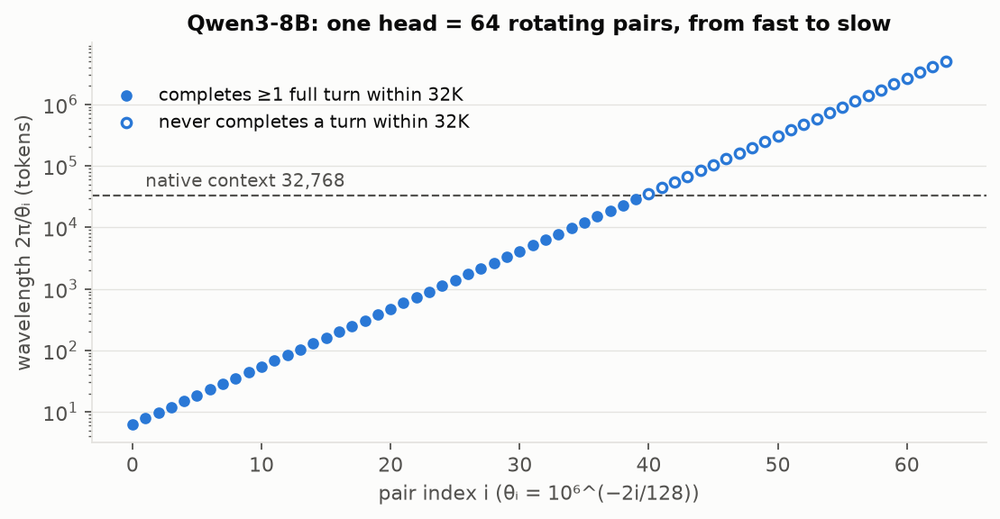
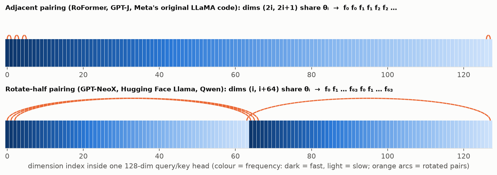
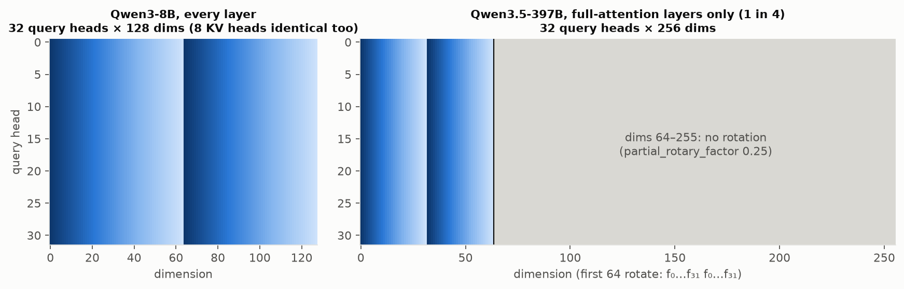
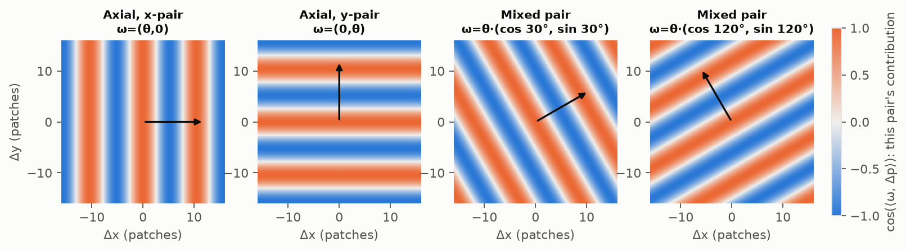
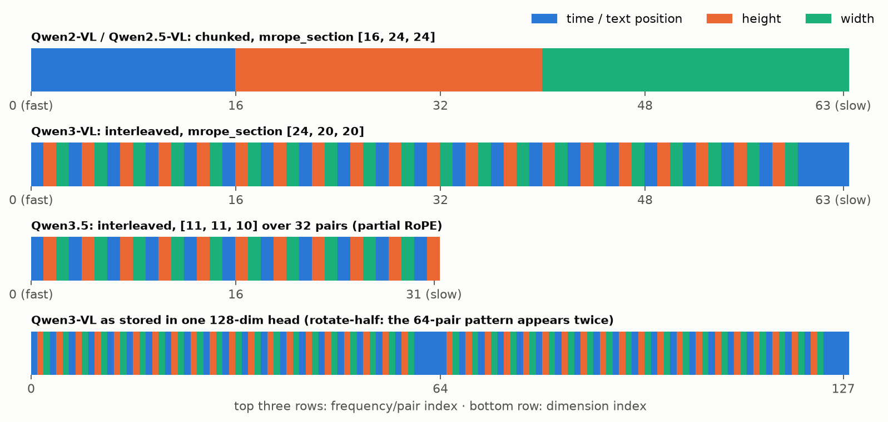
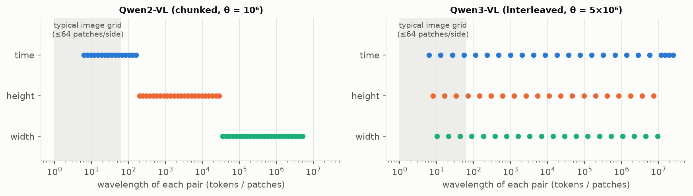
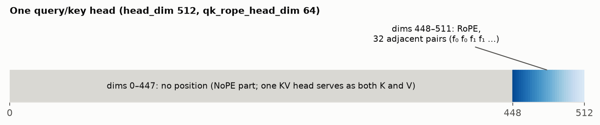
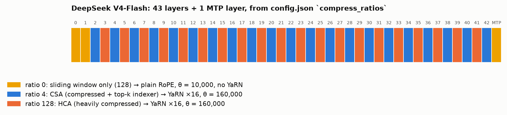
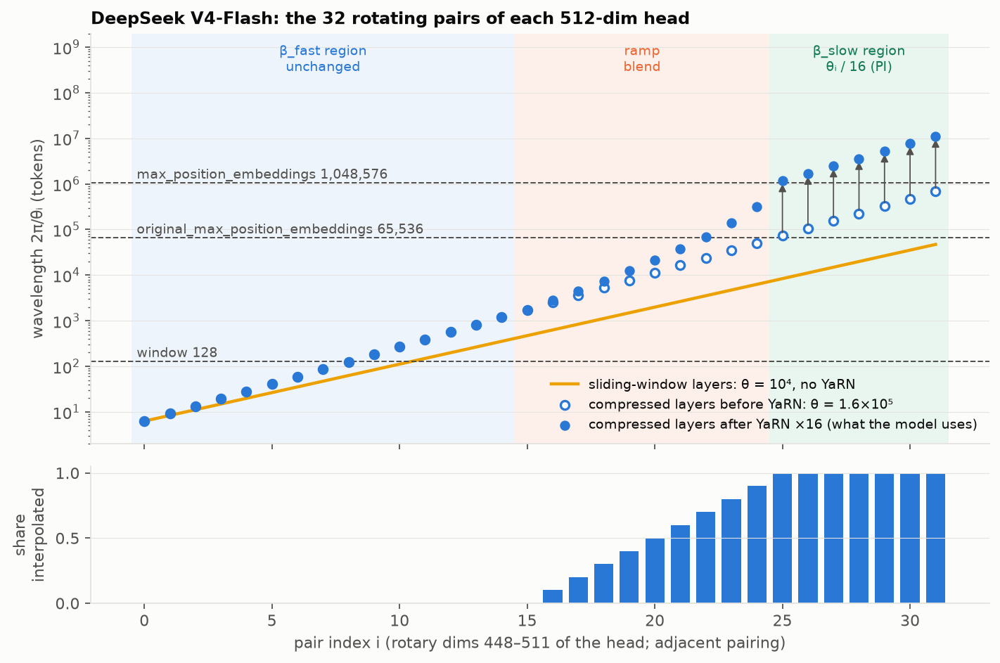

# Open LLMs outgrew the rotation-speed trick

Most open-weight LLMs from 2022 to October 2026 extend their context with one recipe: **raise the RoPE base θ ("ABF") and keep pretraining on long sequences**. In shipped configs the most common outcome is a large `rope_theta` (5×10⁵ to 10¹¹) with **no `rope_scaling` entry at all**. A common belief is that the most popular extension method today is YaRN or NTK, i.e. changing how fast RoPE rotates. That belief is partly right. "Changing the rotation speed of RoPE" does describe nearly every extension method in use, since PI, NTK, YaRN, Llama 3 scaling, LongRoPE and ABF all retune the same per-dimension frequencies. Among *named* scaling types, **YaRN is clearly the most popular today**: among the current flagships of 18 major labs, 5 ship it in config (DeepSeek, OpenAI, Mistral, Meituan, AI2) and Qwen recommends it as an opt-in, while `llama3` has one user and dynamic-NTK, linear and LongRoPE have **none**. Yet 10 of the 18 ship no scaling at all, and 16 of 18 rely on sparse, linear, sliding-window or NoPE attention layers. Two corrections apply, though. First, "NTK" in its narrow sense (training-free NTK-aware or dynamic NTK) is now rare, surviving mainly at Tencent and InternLM. Second, most YaRN use is trained in during a short long-context phase, not applied at inference time. The bigger 2025–2026 story is architectural. Flagships increasingly confine RoPE to a few global layers or a quarter of the head dimensions, remove it entirely from some layers (NoPE), or bound attention cost with sliding-window, linear-attention and learned sparse-attention hybrids. That pushes "native" context to 256K–1M and makes rotation-speed tricks a secondary knob.

## Background: how RoPE and its extensions work

Read this part first. The history below assumes you know how RoPE rotates each pair of head dimensions at its own frequency, and that every extension method works by changing those frequencies.

### Why RoPE looks the way it does

**[Christopher Fleetwood, "You could have designed state of the art positional encoding"](https://huggingface.co/blog/designing-positional-encoding)** (Hugging Face, Nov 2024) is the best explanation of *why* RoPE looks the way it does. It builds up from integer to binary to sinusoidal encodings with animations, then derives RoPE. The RoPE part itself is equations only, and it does not cover context extension. The two subsections below fill that gap with pictures of a real model.

### Which frequency each dimension gets: Qwen3 as an example

A head of size d is split into d/2 pairs. Pair i rotates by angle m·θᵢ at position m, with

  θᵢ = b^(−2i/d),  i = 0 … d/2 − 1,  wavelength λᵢ = 2π/θᵢ tokens.

Qwen3-8B has d = 128 and base b = 10⁶ ([config](https://huggingface.co/Qwen/Qwen3-8B/blob/main/config.json)). That gives 64 pairs with wavelengths from 6.3 tokens (pair 0) up to about 5 million tokens (pair 63), each about 1.24× slower than the previous one.



Pairs 0–39 complete at least one full turn within the 32,768-token native context. Pairs 40–63 never do: during training they only ever saw part of their circle. These slow pairs are what every extension method in this report is about. PI, NTK, ABF and YaRN differ mainly in how they treat them versus the fast pairs.

**How pairs are laid out inside a head.** "Pair i" is a mathematical idea; the code has to choose which two of the 128 dimensions form it. There are two conventions:



- **Adjacent (interleaved) pairing:** dims (2i, 2i+1) form pair i, so frequencies run f₀ f₀ f₁ f₁ f₂ f₂ …. Used by the RoFormer paper, GPT-J and Meta's original LLaMA code, which treats each pair as one complex number.
- **Rotate-half pairing:** dims (i, i + d/2) form pair i, so frequencies run f₀ f₁ … f₆₃ f₀ f₁ … f₆₃. Used by GPT-NeoX and by Hugging Face's Llama, Qwen and most other implementations. The code splits the head into two halves and computes `q·cos + rotate_half(q)·sin`, where `rotate_half(x) = cat(−x₂, x₁)` ([Qwen3 modeling code](https://github.com/huggingface/transformers/blob/main/src/transformers/models/qwen3/modeling_qwen3.py)).

The two are equivalent up to a fixed reordering of the q and k projection rows, so neither is better. A checkpoint trained with one does not work with the other unless its weights are permuted; Hugging Face's LLaMA conversion script does exactly this permutation.

**Every head gets the same table.** In standard RoPE the frequencies do not depend on the head or the layer. Every query head and every key/value head in every layer uses the same layout. Heads differ only through their learned projections, which decide how much each head relies on fast or slow pairs. Partial RoPE changes this picture: in Qwen3.5 only the full-attention layers (1 in 4; the others are Gated DeltaNet layers without RoPE) rotate anything. Within them, only the first 64 of 256 dimensions rotate, as 32 pairs with b = 10⁷ ([config](https://huggingface.co/Qwen/Qwen3.5-397B-A17B/blob/main/config.json)). The other 192 dimensions carry no position at all.



### Multidimensional RoPE: images and video

**Start from 1D RoPE.** Pair k of the query and key is rotated by an angle proportional to the token's position:

  q_pair_k ← R(m·θₖ) · q_pair_k,  k_pair_k ← R(n·θₖ) · k_pair_k

Rotations compose, so pair k's contribution to the dot product depends only on (m − n)·θₖ. The attention score sums over all pairs, so it depends on the relative position, not the absolute one. The key way to see it: **the angle of pair k is (frequency) × (position).**

**Making it multidimensional.** For images and video a position is a vector, such as p = (x, y) or (t, h, w). The general recipe replaces the product with a dot product:

  angle of pair k = ⟨ωₖ, p⟩,

where ωₖ is a frequency *vector*. Then q·k = Σₖ fₖ(⟨ωₖ, p_q − p_k⟩): the score still depends only on the relative offset, now a 2D or 3D offset. Everything comes down to choosing ωₖ, and there are three main ways.

1. **Axial RoPE** (the simple version). Split the pairs into one group per axis. In 2D, the first half of the pairs rotate by x·θₖ, so ωₖ = (θₖ, 0); the second half rotate by y·θₖ, so ωₖ = (0, θₖ). The score becomes (a function of Δx) + (a function of Δy). This is cheap and exactly relative. Its limitation is that the axes are additively separable, so no single pair "sees" a diagonal offset.
2. **Mixed or learned-direction RoPE** (RoPE-Mixed, Heo et al. 2024, "Rotary Position Embedding for Vision Transformer"). Each pair's ωₖ may point in any direction, often learned: angle = θₖ·(aₖ·x + bₖ·y). Different pairs then respond to diagonal and other directions. Vision transformers that use it extrapolate to larger resolutions better.

   

   Each panel shows one pair's contribution, cos(⟨ω, Δp⟩), as a function of the 2D offset. Axial pairs make only vertical or horizontal stripes. Mixed pairs make stripes at any angle, perpendicular to ω.
3. **M-RoPE** (Qwen2-VL and later Qwen VL models). This is the version used in production multimodal LLMs, with three axes: time, height and width.
   - The head's frequency pairs are divided into sections for t, h and w. Qwen2-VL's config has `mrope_section: [16, 24, 24]`, i.e. 16 pairs for time and 24 each for height and width ([config](https://huggingface.co/Qwen/Qwen2-VL-7B-Instruct/blob/main/config.json)).
   - Image patches get IDs (t, h, w) from their grid position.
   - Text tokens get the same ID on all three axes (t = h = w = position). Then ⟨ωₖ, p⟩ reduces to ordinary 1D RoPE over all 64 pairs, so text behaves exactly as in a normal LLM.
   - Positions after an image continue from the image's largest ID plus one, so the sequence stays monotonic.

**A subtle problem: which frequencies each axis gets.** Frequencies run from fast (pair 0) to slow (last pair). If the sections are contiguous chunks, as in Qwen2-VL and Qwen2.5-VL, time gets only the fastest pairs and width gets only the slowest. **Interleaved M-RoPE** fixes this by assigning pairs round-robin, t h w t h w …, so every axis spans the full fast-to-slow range. Qwen3-VL (`mrope_section: [24, 20, 20]`, `mrope_interleaved: true`) and Qwen3.5 (`[11, 11, 10]` over its 32 rotating pairs) use it ([Qwen3-VL config](https://huggingface.co/Qwen/Qwen3-VL-8B-Instruct/blob/main/config.json)). The assignments below are computed from the Hugging Face code (`recomposition_frequencies` in the [Qwen2-VL](https://github.com/huggingface/transformers/blob/main/src/transformers/models/qwen2_vl/modeling_qwen2_vl.py) and [Qwen3-VL](https://github.com/huggingface/transformers/blob/main/src/transformers/models/qwen3_vl/modeling_qwen3_vl.py) modeling files). Because of rotate-half pairing, the 64-pair pattern appears twice in the stored head (bottom row).



In Qwen3-VL the time axis gets 24 pairs and the other two get 20, so the last four (slowest) pairs all go to time.

What chunking does in practice shows up when each pair's wavelength is plotted per axis:



In Qwen2-VL the width pairs have wavelengths from about 35,000 to 5 million. Across a 64-patch-wide image, even the fastest width pair turns by only about 0.011 radians (0.65°). RoPE therefore encodes horizontal offsets inside an image only very weakly, and time gets no slow pairs for long videos. In Qwen3-VL every axis spans wavelengths from about 6 up to millions. This calculation is ours, from the configs and code; it is not a claim from Qwen's papers.

**How this connects to context extension.** Everything from the 1D case still applies, but per axis. Each axis has its own trained range (number of frames, image height, image width) and its own slow pairs that never completed a turn in training. Raising the base, YaRN and similar methods can be applied per axis. With chunked M-RoPE that is awkward, because each axis owns only a narrow band of frequencies; interleaving makes it uniform.

### Extending the context: PI, NTK and YaRN

**[Honglu Fan, Bowen Peng and Jeffrey Quesnelle, "YaRN" (EleutherAI blog)](https://blog.eleuther.ai/yarn/)** (Nov 2023). Written by the YaRN authors, and the best single source on extension. It walks through Position Interpolation, NTK-aware, NTK-by-parts, dynamic scaling and YaRN. Its key figures are a circle diagram of PI and a chart comparing each dimension's wavelength under RoPE, PI and NTK-by-parts, which is the wavelength plot above with each method applied. It does not use the term ABF, but NTK-aware scaling is the same base change applied without training; ABF applies it with continued training.

### Worked example: how YaRN is applied in DeepSeek V4-Flash

DeepSeek V4-Flash (April 2026, 43 layers, 1M context) is a good model for seeing YaRN in real code. Everything quoted below comes from the reference implementation DeepSeek ships in its Hugging Face repo, [`inference/model.py`](https://huggingface.co/deepseek-ai/DeepSeek-V4-Flash/blob/60d8d70770c6776ff598c94bb586a859a38244f1/inference/model.py), and from [`config.json`](https://huggingface.co/deepseek-ai/DeepSeek-V4-Flash/blob/60d8d70770c6776ff598c94bb586a859a38244f1/config.json), both at commit `60d8d70`. The figures are computed from that config with a line-for-line port of DeepSeek's `precompute_freqs_cis`.

**Step 1: what the config says.**

```json
"head_dim": 512,
"qk_rope_head_dim": 64,
"sliding_window": 128,
"max_position_embeddings": 1048576,
"rope_theta": 10000,
"compress_rope_theta": 160000,
"rope_scaling": {
  "type": "yarn",
  "factor": 16,
  "original_max_position_embeddings": 65536,
  "beta_fast": 32,
  "beta_slow": 1
}
```

> **Callout: the factor is just the length ratio.** 65,536 × 16 = 1,048,576. YaRN's `factor` is the ratio between the length the frequencies were originally fitted to and the advertised context. Note also that there are **two** RoPE bases, which Step 3 explains.

**Step 2: where RoPE lives inside a head.**



> **Callout: only the last 64 of 512 dimensions rotate.** The attention code rotates only the tail of each query and key ([L499](https://huggingface.co/deepseek-ai/DeepSeek-V4-Flash/blob/60d8d70770c6776ff598c94bb586a859a38244f1/inference/model.py#L499), [L504](https://huggingface.co/deepseek-ai/DeepSeek-V4-Flash/blob/60d8d70770c6776ff598c94bb586a859a38244f1/inference/model.py#L504)):
> ```python
> apply_rotary_emb(q[..., -rd:], freqs_cis)    # rd = rope_head_dim = 64
> apply_rotary_emb(kv[..., -rd:], freqs_cis)
> ```
> The other 448 dimensions carry no position. YaRN therefore touches only 32 pairs per head.

> **Callout: DeepSeek uses adjacent pairing.** `apply_rotary_emb` views each consecutive pair of dims as one complex number ([L235](https://huggingface.co/deepseek-ai/DeepSeek-V4-Flash/blob/60d8d70770c6776ff598c94bb586a859a38244f1/inference/model.py#L235)):
> ```python
> x = torch.view_as_complex(x.float().unflatten(-1, (-1, 2)))
> ```
> That is the f₀ f₀ f₁ f₁ … layout from the pairing figure above, not Qwen's rotate-half layout.

**Step 3: which layers get YaRN.** V4 is a hybrid. Every layer attends to a 128-token sliding window. Most layers *also* attend to a compressed copy of the whole context, either every 4 tokens pooled into one entry with a learned top-k selector (CSA) or every 128 tokens pooled into one (HCA). The `compress_ratios` list in the config says which is which:



The attention constructor then picks the RoPE setup per layer ([L475–L481](https://huggingface.co/deepseek-ai/DeepSeek-V4-Flash/blob/60d8d70770c6776ff598c94bb586a859a38244f1/inference/model.py#L475)):

```python
if self.compress_ratio:
    original_seq_len, rope_theta = args.original_seq_len, args.compress_rope_theta
else:
    # disable YaRN and use base rope_theta in pure sliding-window attention
    original_seq_len, rope_theta = 0, args.rope_theta
freqs_cis = precompute_freqs_cis(self.rope_head_dim, args.max_seq_len, original_seq_len,
                                 rope_theta, args.rope_factor, args.beta_fast, args.beta_slow)
```

> **Callout: YaRN is applied per layer, not to the whole model.** Layers 0, 1 and the MTP layer only see 128 tokens, so their positions never go beyond what they were trained on. They keep plain RoPE with θ = 10,000 and no YaRN. The 41 compressed layers (21 CSA, 20 HCA), which see the full million tokens, get both a 16× larger base (160,000, an ABF-style raise) **and** YaRN on top. In those layers the 128-token window uses the same YaRN frequencies, since there is one `freqs_cis` table per layer. This is the "scale RoPE only on the global layers" pattern from the architecture section, as it looks in code.

**Step 4: what YaRN does to the frequencies.** This is the whole YaRN implementation ([L200–L229](https://huggingface.co/deepseek-ai/DeepSeek-V4-Flash/blob/60d8d70770c6776ff598c94bb586a859a38244f1/inference/model.py#L200), abridged):

```python
def find_correction_dim(num_rotations, dim, base, max_seq_len):
    return dim * math.log(max_seq_len / (num_rotations * 2 * math.pi)) / (2 * math.log(base))

freqs = 1.0 / (base ** (torch.arange(0, dim, 2, dtype=torch.float32) / dim))
if original_seq_len > 0:
    low, high = find_correction_range(beta_fast, beta_slow, dim, base, original_seq_len)
    smooth = 1 - linear_ramp_factor(low, high, dim // 2)
    freqs = freqs / factor * (1 - smooth) + freqs * smooth
```

`find_correction_dim(r, …)` returns the pair index whose wavelength fits exactly r full turns into the original 65,536 tokens. With dim 64 and base 160,000:

- β_fast = 32 turns gives index 15.45, rounded down to **15**.
- β_slow = 1 turn gives index 24.71, rounded up to **25**.

`smooth` is 1 below the first index and 0 above the second, with a straight-line ramp in between. Each frequency is then a blend of "keep" and "divide by 16":



- **Pairs 0–15 are unchanged.** They complete at least 32 turns within 64K, so they had already seen every angle many times. They encode local order, and stretching them would blur nearby positions.
- **Pairs 25–31 are divided by 16.** That is pure Position Interpolation. They completed less than one turn in 64K, so at 1M they would otherwise reach angles never seen in training. Dividing by 16 maps 1M positions onto the angle range they saw at 64K.
- **Pairs 16–24 are blended**, interpolated 10%, 20% … 90% (bottom panel).

> **Callout: what YaRN preserves.** Before YaRN, 25 of the 32 pairs complete at least one full turn within the 65,536-token original context. After YaRN, the same 25 pairs complete at least one turn within the 1,048,576-token context. The longest wavelength goes from 691K to 11.1M tokens, and the fully interpolated pairs never reach an angle at 1M that they did not reach at 64K.

**Step 5: what is missing, the attention temperature.** The YaRN paper also sharpens attention by scaling the logits with √(1/t) = 0.1·ln s + 1, which is 1.277 for s = 16. V4's attention uses the plain scale ([L464](https://huggingface.co/deepseek-ai/DeepSeek-V4-Flash/blob/60d8d70770c6776ff598c94bb586a859a38244f1/inference/model.py#L464)):

```python
self.softmax_scale = self.head_dim ** -0.5
```

DeepSeek-V3's reference code *did* include the temperature ([V3 `model.py` L219–L221](https://huggingface.co/deepseek-ai/DeepSeek-V3/blob/e815299b0bcbac849fa540c768ef21845365c9eb/inference/model.py#L219)):

```python
if args.max_seq_len > args.original_seq_len:
    mscale = 0.1 * args.mscale * math.log(args.rope_factor) + 1.0
    self.softmax_scale = self.softmax_scale * mscale * mscale
```

> **Callout: V4 uses only the frequency half of YaRN.** Strictly, this is NTK-by-parts. Two other changes from V3 point the same way. First, V3 switched YaRN on only when the configured length exceeded the original ([V3 L176](https://huggingface.co/deepseek-ai/DeepSeek-V3/blob/e815299b0bcbac849fa540c768ef21845365c9eb/inference/model.py#L176), `if seqlen > args.original_seq_len`), while V4 applies it whenever `original_seq_len > 0`. That makes V4's YaRN static: the same frequencies at every length. Second, V4 RMS-normalizes each query head right before rotation ([L498](https://huggingface.co/deepseek-ai/DeepSeek-V4-Flash/blob/60d8d70770c6776ff598c94bb586a859a38244f1/inference/model.py#L498), `q *= torch.rsqrt(q.square().mean(-1, keepdim=True) + self.eps)`) and adds learned attention sinks. The code does not say why the temperature was dropped. A plausible reason, which is our inference, is that the model was trained with these frequencies all the way to 1M, so it learned its own attention sharpness. The V4 report describes pretraining that steps from 4K to 16K to 64K to 1M ([report](https://arxiv.org/abs/2606.19348)), which fits `original_max_position_embeddings` = 65,536.

**Step 6: two more RoPE details in V4.**

> **Callout: compressed entries sit at their block's first position.** When the compressor pools 4 or 128 tokens into one KV entry, that entry is rotated with the frequencies of the block's first token ([L364](https://huggingface.co/deepseek-ai/DeepSeek-V4-Flash/blob/60d8d70770c6776ff598c94bb586a859a38244f1/inference/model.py#L364)):
> ```python
> freqs_cis = self.freqs_cis[:cutoff:ratio]
> ```
> Relative distances to compressed memory are therefore measured to block starts.

> **Callout: the output is rotated back.** V4 has a single KV head that serves as both key and value, so each value's last 64 dims carry the key's rotation R(n). After attention, the code applies the inverse rotation for the query position m ([L534](https://huggingface.co/deepseek-ai/DeepSeek-V4-Flash/blob/60d8d70770c6776ff598c94bb586a859a38244f1/inference/model.py#L534)):
> ```python
> apply_rotary_emb(o[..., -rd:], freqs_cis, True)   # inverse=True uses the complex conjugate
> ```
> The rotary part of the output becomes Σ aₙ·R(n − m)·vₙ, which depends only on relative positions, like the attention scores. This is one of the rare places where queries and keys/values are treated differently.

**Summary of what changed.**

| | Sliding-window layers (0, 1, MTP) | Compressed layers (2–42) |
|---|---|---|
| RoPE base θ | 10,000 | 160,000 |
| YaRN | off | factor 16 from 65,536; β_fast 32, β_slow 1 |
| Effect on the 32 pairs | none | 16 untouched, 9 blended, 7 divided by 16 |
| Longest wavelength | 47K tokens | 691K → 11.1M tokens |
| Attention temperature | none | none (DeepSeek-V3 had 0.1·ln s + 1) |

### Further reading

**["Frequency Bands in RoPE: Base Frequency and Context Length Shape the Interpolation–Extrapolation Trade-off"](https://proceedings.iclr.cc/paper_files/paper/2026/hash/993dbaec0418a6449090f1debbcb8844-Abstract-Conference.html)** (ICLR 2026). A recent analysis of how θ and training length shift which frequencies matter. It is research-level rather than a tutorial.

## Thirty labs and five eras define the open-weight landscape

The "prominent open models" in this report are the families that dominated releases, downloads or technical discussion in each period. **2022** includes EleutherAI GPT-NeoX-20B, Meta OPT and Galactica, BigScience BLOOM, Tsinghua/Zhipu GLM-130B, and Google Flan-T5/UL2. **2023** adds Meta LLaMA 1, Llama 2 and Code Llama, MosaicML MPT, TII Falcon, BigCode StarCoder, Mistral 7B and Mixtral, Alibaba Qwen (v1), 01.AI Yi, THUDM ChatGLM2/3, Baichuan 2, InternLM, Salesforce XGen, Adept Persimmon, Microsoft Phi-1/2, and the community long-context fine-tunes (LongChat, Together-32K, Nous YaRN-Llama-2, LongLoRA). **2024** brings Llama 3/3.1/3.2/3.3, Gemma 1/2, Phi-3/3.5/4, Mistral NeMo, Mixtral 8x22B, Command R, Jamba, Granite 3, OLMo 1/2, Falcon 2/3, Qwen1.5/2/2.5, DeepSeek-V2/V3, GLM-4, InternLM2/2.5, Yi-1.5 and Hunyuan-Large. **2025** brings Llama 4, Gemma 3/3n, gpt-oss, Command A, SmolLM3, OLMo 3, Mistral Small 3.x and Ministral 3, Nemotron-H/Nano 2/Nemotron 3, Granite 4, Falcon-H1, Qwen3/Qwen3-2507/Qwen3-Next, DeepSeek V3.1/V3.2, Kimi K2 and Kimi Linear, MiniMax-01/M1/M2, GLM-4.5/4.6, Hunyuan-A13B, MiMo, LongCat-Flash and Ling 2.0. **2026 to date** brings Gemma 4, Mistral Small 4, Nemotron 3 Super, Olmo Hybrid, DeepSeek V4/V4.1, Qwen3.5/3.8, Kimi K2.5/K2.6/K3, GLM-5/5.x, MiniMax-M3, LongCat-2.0, Ling 2.5/3.0, Hy3/Hy4, MiMo-V2.5 and Step-3.5. The research notes found **no new open Meta, Phi or Gemma-5 release after mid-2026**, but that absence is unconfirmed rather than proven.

## Every RoPE method retunes the same rotation frequencies

RoPE rotates each pair of query/key dimensions by angle m·θᵢ, where m is the token position and **θᵢ = b^(−2i/d)** (base b = 10,000 by default, d = rotary dimension). The dot product q_m·k_n therefore depends only on m − n, and dimension i has wavelength λᵢ = 2π·b^(2i/d) ([RoFormer](https://arxiv.org/abs/2104.09864); [HF modeling_rope_utils.py](https://github.com/huggingface/transformers/blob/main/src/transformers/modeling_rope_utils.py)). High-frequency dimensions wrap around many times within the training window and encode local order. Low-frequency dimensions complete less than one rotation, so a model has never seen their angles beyond the training length, and that is where extrapolation fails. Each extension method answers one question: which frequencies to slow down, by how much, and whether to train afterwards.

| Method (first appearance) | What changes | Formula (s = L_target / L_train) | Typical use |
|---|---|---|---|
| **PI / linear** (Meta and kaiokendev, Jun 2023) | All frequencies slowed uniformly | θ'ᵢ = θᵢ / s (equivalently position m → m/s) | LongChat, Together-32K, Gemma 3 global layers ([PI](https://arxiv.org/abs/2306.15595)) |
| **NTK-aware** (bloc97, mid-2023) | Base raised; high frequencies barely move, lowest frequency slowed ≈ s | b' = b · s^(d/(d−2)) | Zero-shot; formalized in [YaRN](https://arxiv.org/abs/2309.00071) |
| **Dynamic NTK** (emozilla, 2023) | NTK base recomputed from the current length | b' = b · ((s·L/L_train) − (s−1))^(d/(d−2)), only when L > L_train | Qwen-1, InternLM, Hunyuan ([HF source](https://raw.githubusercontent.com/huggingface/transformers/main/src/transformers/modeling_rope_utils.py)) |
| **ABF** (Code Llama Aug 2023; Llama 2 Long Sep 2023) | Same base raise as NTK-aware, but *trained* | b: 10⁴ → 5×10⁵ … 10⁷+, then continued pretraining | Near-universal ([Llama 2 Long](https://arxiv.org/html/2309.16039)) |
| **NTK-by-parts** (bloc97, 2023) | Interpolate only low-frequency dims | rᵢ = L_train/λᵢ; γ ramps 0→1 between α and β; θ'ᵢ = (1−γ(rᵢ))·θᵢ/s + γ(rᵢ)·θᵢ | Basis of YaRN ([YaRN](https://arxiv.org/abs/2309.00071)) |
| **YaRN** (Aug 2023) | NTK-by-parts plus attention temperature | as above with α = `beta_slow` = 1, β = `beta_fast` = 32; logits scaled by √(1/t) = 0.1·ln s + 1 | DeepSeek, Kimi, gpt-oss, Mistral 2025–26, OLMo 3, Qwen opt-in |
| **llama3** (Jul 2024) | By-parts by wavelength thresholds, no temperature | λ > L/low_freq_factor → θ/s; λ < L/high_freq_factor → unchanged; smooth blend between | Llama 3.1–4, Nemotron-Llama, Apertus, Step-3.5 ([HF source](https://raw.githubusercontent.com/huggingface/transformers/main/src/transformers/modeling_rope_utils.py)) |
| **LongRoPE** (Feb 2024) | Per-dimension factors found by evolutionary search | θ'ᵢ = θᵢ / fᵢ (separate short/long factor lists); attention factor √(1 + ln s / ln L_train) | Phi-3, Phi-3.5, Phi-4-mini only ([LongRoPE](https://arxiv.org/abs/2402.13753)) |
| **Partial RoPE / p-RoPE** (Oct 2024 paper; Gemma 4 2026) | Rotate only a fraction p of dims; rest get zero frequency (position-free) | θᵢ as normal for i < p·d/2, else θᵢ = 0 | Gemma 4 (p = 0.25), Qwen3.5+ (0.25), GLM-4.5 (0.5), MLA (64 rotary dims) ([p-RoPE](https://arxiv.org/abs/2410.06205)) |
| **NoPE layers** (2023 paper; Llama 4 2025) | No positional encoding in some layers; causal mask gives implicit order | — | Llama 4, SmolLM3, Command A, Kimi Linear/K3 ([NoPE](https://arxiv.org/abs/2305.19466)) |
| **ALiBi** (2021) | No rotation; linear distance bias | logit −= m_h·(i − j) | BLOOM, MPT, Baichuan-13B; absent from 2025–26 configs ([ALiBi](https://arxiv.org/abs/2108.12409)) |
| **DCA** (2024) | Remap relative positions into chunks so no distance exceeds L_train | intra-chunk, inter-chunk (capped) and successive-chunk position patterns | Qwen2.5-1M, Qwen3-2507 to 1M ([Qwen2.5-1M](https://arxiv.org/html/2501.15383)) |
| **Length-dependent temperature** | Sharpen attention as context grows | Llama 4: q ← q·(1 + 0.1·log1p(⌊(pos+1)/8192⌋)); also YaRN's 0.1·ln s + 1 | Llama 4, Mistral Small 4 / Ministral 3 (`llama_4_scaling_beta`) ([HF Llama4](https://raw.githubusercontent.com/huggingface/transformers/main/src/transformers/models/llama4/modeling_llama4.py)) |

Three points from this table matter for the verdict. **YaRN is not a separate family from NTK.** It refines NTK-by-parts, which refined NTK-aware, and adds a temperature term. **ABF and NTK-aware use the same formula**: Meta calls it ABF when it trains with the new base, Reddit called it NTK-aware when applied zero-shot, and THUDM exposed it as `rope_ratio`. The YaRN authors explicitly classify Code Llama's θ = 10⁶ as "NTK-aware" scaling ([YaRN](https://arxiv.org/abs/2309.00071)). The current `transformers` library supports exactly `linear`, `dynamic`, `yarn`, `longrope`, `llama3`, `proportional` and `default`. It has also renamed `rope_scaling` to `rope_parameters`, which can now be nested per layer type ([HF source](https://raw.githubusercontent.com/huggingface/transformers/main/src/transformers/modeling_rope_utils.py)).

The theory behind ABF explains why it dominates. "Base of RoPE Bounds Context Length" derives a lower bound on the base for a target context. It warns that a base that is too small yields "superficial" long-context ability: low perplexity but poor retrieval ([arXiv:2405.14591](https://arxiv.org/abs/2405.14591)). In Llama 2 Long's ablations, ABF was the only variant that kept first-sentence retrieval accurate across the full 32,768 window ([arXiv:2309.16039](https://arxiv.org/html/2309.16039)).

## The evolution, era by era

Notation: θ = `rope_theta`; "pretrain" = main pretraining sequence length; "final" = released or advertised context; "—" = not disclosed or not found. Values marked † come from memory or secondary sources in the research notes and were not confirmed against a primary source.

### 2022: everyone stopped at 2,048 tokens

The 2022 generation treated positional encoding as a training-quality choice, not a length strategy. BLOOM chose ALiBi because it gave "smoother training and better downstream performance", not mainly to extrapolate ([BLOOM](https://arxiv.org/abs/2211.05100)). GLM-130B picked RoPE over ALiBi for stability ([GLM-130B](https://arxiv.org/abs/2210.02414)). Nobody shipped an extension method.

| Model | Release | Pretrain | Final | Positional encoding | θ | Extension |
|---|---|---|---|---|---|---|
| GPT-NeoX-20B | Feb 2022 | 2,048 | 2,048 | Partial RoPE (25% of dims) | 10,000 | None ([paper](https://arxiv.org/abs/2204.06745); [config](https://huggingface.co/EleutherAI/gpt-neox-20b/blob/main/config.json)) |
| OPT (125M–175B) | May 2022 | 2,048 | 2,048 | Learned absolute | n/a | None; hard limit ([paper](https://arxiv.org/abs/2205.01068)) |
| BLOOM (176B) | Jul 2022† | 2,048 | 2,048 | ALiBi | n/a | None official ([paper](https://arxiv.org/abs/2211.05100)) |
| GLM-130B | Aug 2022† | 2,048 | 2,048 | RoPE | 10,000† | None ([paper](https://arxiv.org/abs/2210.02414)) |
| Flan-T5 / UL2 | Oct 2022 | 512† | 512 config (UL2 advertised 2,048†) | T5 bucketed relative bias (32 buckets, max distance 128) | n/a | None; every distance beyond 128 shares one bucket ([config](https://huggingface.co/google/flan-t5-xxl/blob/main/config.json)) |
| Galactica | Nov 2022 | 2,048 | 2,048 | Learned absolute | n/a | None ([paper](https://arxiv.org/abs/2211.09085)) |

GPT-J-6B (June 2021) belongs to this lineage too. It applied RoPE to 64 of 256 head dimensions at 2,048 tokens and later became a common community target for RoPE scaling ([card](https://huggingface.co/EleutherAI/gpt-j-6b)).

### 2023: a four-month burst invented the toolkit, and ABF won

Between May and September 2023 the community and labs produced almost every RoPE extension idea still in use. The sequence ran: MPT-StoryWriter's ALiBi to 65K (May), kaiokendev's SuperHOT linear scaling and Meta's PI (late June), bloc97's NTK-aware and emozilla's dynamic NTK (late June–July), Code Llama's ABF (24 Aug), YaRN (31 Aug), LongLoRA (21 Sep), Llama 2 Long (27 Sep) and StreamingLLM's attention sinks (29 Sep). PI showed the stakes. Direct fine-tuning without interpolation moved LLaMA's effective window only "from 2048 to 2560" after more than 10,000 batches, while PI reached 32,768 "within 1000 steps" ([PI](https://arxiv.org/abs/2306.15595)). Official vendors, however, converged on ABF. Code Llama reset θ to 10⁶, explicitly "instead of downscaling frequencies linearly" ([Code Llama](https://arxiv.org/abs/2308.12950)). Llama 2 Long's authors acknowledged the base-frequency idea was "concurrently suggested in the Reddit r/LocalLLaMa community" ([arXiv:2309.16039](https://arxiv.org/abs/2309.16039)).

| Model | Release | Pretrain | Final | Positional encoding | θ | Extension method |
|---|---|---|---|---|---|---|
| LLaMA 1 | Feb 2023 | 2,048 | 2,048 | RoPE | 10,000 | None; base for all community extensions ([paper](https://arxiv.org/abs/2302.13971)) |
| Pythia | Apr 2023 | 2,048 | 2,048 | Partial RoPE 25% | 10,000 | None ([config](https://huggingface.co/EleutherAI/pythia-12b/blob/main/config.json)) |
| MPT-7B / StoryWriter-65k+ | May 2023 | 2,048 | 2,048 / 65K trained, 84K generated | ALiBi | n/a | ALiBi extrapolation + 65K fine-tune ([blog](https://www.databricks.com/blog/mpt-7b)) |
| StarCoder 15.5B | May 2023 | 8,192 | 8,192 | Learned absolute | n/a | None; cannot extrapolate ([paper](https://arxiv.org/abs/2305.06161)) |
| Falcon 7B/40B/180B | May–Sep 2023 | 2,048† | 2,048 | RoPE | 10,000† | None official ([paper](https://arxiv.org/abs/2311.16867)) |
| MPT-30B | Jun 2023 | 2K then 50B tokens at 8K | 8K | ALiBi | n/a | Staged length training ([blog](https://www.databricks.com/blog/mpt-30b)) |
| ChatGLM2-6B / -32K | Jun–Jul 2023† | 32K claimed; 8K chat | 8K / 32K | RoPE | 10,000 × `rope_ratio` 16† | Base scaling (ABF-like) + long dialogue training ([README](https://github.com/THUDM/ChatGLM2-6B/blob/main/README_EN.md); [config](https://huggingface.co/THUDM/chatglm2-6b-32k/blob/main/config.json)) |
| LongChat-16k (LMSYS) | Jun 2023 | 2,048 (LLaMA) | 16K | RoPE | 10,000 | PI ×8 + fine-tune ([blog](https://lmsys.org/blog/2023-06-29-longchat/)) |
| Llama 2 | Jul 2023 | 4,096 | 4,096 | RoPE; GQA on 70B | 10,000 | None official ([paper](https://arxiv.org/abs/2307.09288)) |
| Together LLaMA-2-7B-32K | Jul 2023 | 4,096 | 32K | RoPE | 10,000 | PI ×8, 1.5B tokens ([blog](https://www.together.ai/blog/llama-2-7b-32k)) |
| Qwen-7B / 14B (v1) | Aug–Sep 2023 | 2,048 | 8K | RoPE | 10,000 | **Dynamic NTK + LogN + layer-wise window attention**, training-free ([report](https://arxiv.org/abs/2309.16609)) |
| Code Llama | Aug 2023 | 4K (Llama 2) → 16,384 fine-tune | 16K; "up to 100k" | RoPE | **1,000,000** | ABF ([paper](https://arxiv.org/abs/2308.12950)) |
| InternLM-7B / 20B | Jul–Sep 2023† | 2,048 / 4,096 | 8K / 16K† advertised | RoPE, `type: dynamic` | 10,000 | Dynamic NTK ([config](https://huggingface.co/internlm/internlm-7b/blob/main/config.json)) |
| XGen-7B-8K | Jun–Sep 2023 | 2K → 4K → 8K staged (800B/400B/300B tokens) | 8K | RoPE | 10,000 | Staged pretraining ([paper](https://arxiv.org/abs/2309.03450)) |
| Baichuan 2 7B / 13B | Sep 2023 | 4,096 | 4,096 | 7B RoPE / 13B ALiBi | 10,000† | None ([paper](https://arxiv.org/abs/2309.10305)) |
| Persimmon-8B | Sep 2023† | **16K from scratch** | 16K | RoPE | 25,000 | Raised base from scratch ([card](https://huggingface.co/adept/persimmon-8b-base)) |
| Llama 2 Long | Sep 2023 (paper) | +400B tokens at 32,768 (7B/13B) / 16,384 (34B/70B) | 32,768 | RoPE | **500,000** | ABF + continued pretraining ([paper](https://arxiv.org/abs/2309.16039)) |
| Mistral 7B v0.1 | Sep–Oct 2023 | Not stated (8K†) | 32K config | RoPE + SWA (W = 4,096) | 10,000 | Sliding window; ~131K theoretical receptive field ([paper](https://arxiv.org/abs/2310.06825)) |
| Nous YaRN-Llama-2-128k | Aug–Nov 2023 | 4,096 | 128K | RoPE | 10,000 | YaRN ×32 + fine-tune ([config](https://huggingface.co/NousResearch/Yarn-Llama-2-7b-128k/blob/main/config.json)) |
| Yi-34B / Yi-34B-200K | Nov 2023† | 4K | 4K / 200K | RoPE | **5×10⁶ / 10⁷** | ABF + 10B tokens of long-upsampled continued pretraining ([paper](https://arxiv.org/abs/2403.04652); [config](https://huggingface.co/01-ai/Yi-34B-200K/blob/main/config.json)) |
| Qwen-72B | Nov 2023† | 32,768 | 32K | RoPE | **1,000,000** | ABF; dynamic NTK turned off ([config](https://huggingface.co/Qwen/Qwen-72B/blob/main/config.json)) |
| Mixtral 8x7B / Mistral 7B v0.2 | Dec 2023 | 32K | 32K, "fully dense" | RoPE, SWA dropped | **1,000,000** | ABF ([paper](https://arxiv.org/abs/2401.04088); [config](https://huggingface.co/mistralai/Mixtral-8x7B-v0.1/blob/main/config.json)) |
| Phi-1.5 / Phi-2 | Sep / Dec 2023 | 2,048 | 2,048 | Partial RoPE (50% / 40%) | 10,000 | None ([config](https://huggingface.co/microsoft/phi-2/blob/main/config.json)) |

Two lessons came out of 2023. ALiBi peaked as a marketing point in mid-2023 and then disappeared from new releases. Its own paper admits gains peak around twice the training length and come mostly from avoiding the "early token curse" ([ALiBi](https://arxiv.org/abs/2108.12409)). Baichuan 2 also cites FlashAttention compatibility as the reason labs prefer RoPE ([Baichuan 2](https://arxiv.org/abs/2309.10305)). Second, linear PI, NTK-aware and YaRN lived almost entirely in community fine-tunes in 2023. **Qwen-1 was the one official vendor shipping training-free NTK tricks**, and even Qwen switched to ABF for Qwen-72B.

### 2024: big θ, long continued pretraining, and static scaling recorded in config

In 2024 the recipe industrialized. **Llama 3.1 raised θ to 500,000 and extended from 8K to 128K in six stages on about 800B tokens.** Each stage advanced only when short-context performance had "recovered completely" and needle-in-a-haystack was solved at that length ([Llama 3](https://arxiv.org/html/2407.21783v3)). Its config also ships a static `llama3` frequency-band scaling (factor 8, low/high frequency factors 1/4), which the paper never describes ([config](https://huggingface.co/unsloth/Meta-Llama-3.1-8B/blob/main/config.json)). DeepSeek made YaRN official by baking it into MLA's decoupled 64-dim RoPE key. Microsoft alone adopted LongRoPE.

| Model | Release | Pretrain | Final | Positional encoding | θ | Extension method |
|---|---|---|---|---|---|---|
| InternLM2 / 2.5 | Jan / Jun 2024 | 4K → 32K† | 200K† / 1M (2.5-Chat-1M) | RoPE | 10⁶ / **5×10⁷** | ABF + dynamic NTK ×2–2.5 ([config](https://huggingface.co/internlm/internlm2_5-7b-chat-1m/blob/main/config.json)) |
| Qwen1.5 | Jan 2024 | — | 32K | RoPE | 10⁶ | ABF ([config](https://huggingface.co/Qwen/Qwen1.5-7B/blob/main/config.json)) |
| Gemma 1 | Feb 2024 | 8,192 | 8,192 | RoPE | 10,000 | None ([config](https://huggingface.co/unsloth/gemma-7b/blob/main/config.json)) |
| Jamba v0.1 / 1.5 | Mar / Aug 2024 | — | 256K | No PE on attention layers† | — | Mamba hybrid, 1 attention per 8 layers ([config](https://huggingface.co/ai21labs/Jamba-v0.1/blob/main/config.json)) |
| Llama 3 | Apr 2024 | 8,192 | 8,192 | RoPE | 500,000 | None yet ([config](https://huggingface.co/NousResearch/Meta-Llama-3-8B/blob/main/config.json)) |
| Phi-3-mini-128k / Phi-3.5 | Apr / Aug 2024 | 4,096 | 131,072 | RoPE | 10,000 | **LongRoPE** per-dimension factors ([config](https://huggingface.co/microsoft/Phi-3-mini-128k-instruct/blob/main/config.json)) |
| Mixtral 8x22B | Apr 2024 | — | 65,536 | RoPE | 10⁶ | Large θ ([config](https://huggingface.co/mistralai/Mixtral-8x22B-v0.1/blob/main/config.json)) |
| DeepSeek-V2 | Apr 2024 | 4,096 | 128K (163,840 config) | Decoupled RoPE (64 dims) in MLA | 10,000 | **YaRN ×40** + ~1,000 steps at 32K† ([config](https://huggingface.co/deepseek-ai/DeepSeek-V2/blob/main/config.json)) |
| Qwen2 | Jun 2024 | 4K → 32K† | 32K native; 128K opt-in | RoPE | 10⁶ | ABF; YaRN + DCA at inference† ([config](https://huggingface.co/Qwen/Qwen2-7B-Instruct/blob/main/config.json)) |
| GLM-4-9B-Chat / -1M | Jun 2024 | — | 128K / 1M | RoPE | `rope_ratio` 500 / 10,000 (≈5×10⁶ / 10⁸ if base × ratio†) | Base scaling + continued training† ([config](https://huggingface.co/zai-org/glm-4-9b-chat-1m/blob/main/config.json)) |
| Gemma 2 | Jun 2024 | 8,192 | 8,192 | RoPE; 1:1 local SWA 4,096 / global | 10,000 | None ([config](https://huggingface.co/unsloth/gemma-2-9b/blob/main/config.json)) |
| Llama 3.1 (8B–405B) | Jul 2024 | 8,192 | 131,072 | RoPE | 500,000 | ABF + 6-stage CPT (~800B tokens) + `llama3` ×8 ([paper](https://arxiv.org/html/2407.21783v3)) |
| Mistral NeMo 12B | Jul 2024 | — | 128K, "trained with a 128k context window" | RoPE | 10⁶ | Large θ + long training ([card](https://huggingface.co/mistralai/Mistral-Nemo-Base-2407)) |
| Command R / R+ 08-2024 | Aug 2024 | — | 131,072 | RoPE | 4×10⁶ / 8×10⁶ | Large θ ([config](https://huggingface.co/unsloth/c4ai-command-r-plus-08-2024/blob/main/config.json)) |
| Qwen2.5 | Sep 2024 | 4K → 32K† | 32K native; 128K via YaRN ×4 | RoPE | 10⁶ | ABF; YaRN + DCA at inference† ([config](https://huggingface.co/Qwen/Qwen2.5-7B/blob/main/config.json)) |
| Llama 3.2 1B/3B | Sep 2024 | 8,192† | 131,072 | RoPE | 500,000 | `llama3` ×32 ([config](https://huggingface.co/unsloth/Llama-3.2-1B/blob/main/config.json)) |
| Ministral 8B | Oct 2024 | — | 32K config | RoPE; 3 SWA : 1 full | 10⁸ | Large θ + interleaving ([config](https://huggingface.co/mistralai/Ministral-8B-Instruct-2410/blob/main/config.json)) |
| Hunyuan-Large | Oct 2024 | — | 128K config; 256K† | RoPE | 10,000 | **Dynamic NTK-alpha 1,000** ([config](https://huggingface.co/tencent/Tencent-Hunyuan-Large/blob/main/Hunyuan-A52B-Instruct/config.json)) |
| Granite 3.1 | Dec 2024 | 4,096 | 131,072 | RoPE | 10⁷ | ABF + long CPT† ([config](https://huggingface.co/ibm-granite/granite-3.1-8b-instruct/blob/main/config.json)) |
| Phi-4 | Dec 2024 | 4,096† | 16,384 | RoPE | 250,000 | ABF midtraining† ([config](https://huggingface.co/microsoft/phi-4/blob/main/config.json)) |
| Falcon 3 / Llama 3.3 | Dec 2024 | — / 8,192 | 32K / 131,072 | RoPE | ~10⁶ / 500,000 | Large θ / `llama3` ×8 ([Falcon 3 card](https://huggingface.co/tiiuae/Falcon3-10B-Base); [Llama 3.3 config](https://huggingface.co/unsloth/Llama-3.3-70B-Instruct/blob/main/config.json)) |
| DeepSeek-V3 | Dec 2024 | 4,096 | 128K (163,840 config) | Decoupled RoPE in MLA | 10,000 | **YaRN s = 40, trained**: 4K→32K→128K, 1,000 steps each ([report](https://arxiv.org/html/2412.19437)) |

### 2025: hybrids arrive, and YaRN becomes the named method of choice

In 2025 the families split. One camp kept full-attention RoPE with an even larger θ, often 10⁶–10⁹, and no scaling field: Qwen3-2507, GLM-4.5/4.6, MiniMax-M2, Mistral Small 3.x and Seed-OSS. A second camp, the MLA lineage plus OpenAI, AI2 and the late-2025 Mistral models, adopted **trained-in YaRN**. A third camp changed the architecture itself, by interleaving local and global layers, inserting NoPE layers, or replacing most attention with linear or state-space layers.

| Model | Release | Pretrain | Final | Positional encoding | θ | Extension method / architecture |
|---|---|---|---|---|---|---|
| MiniMax-Text-01 / M1 | Jan / Jun 2025 | 8,192 | 1M trained; 4M NIAH extrapolation | RoPE on half the dims, softmax layers only | 10⁴ → 5×10⁶ → 10⁷ | ABF in 3 stages (128K/512K/1M) + **lightning linear attention 7:1** ([report](https://arxiv.org/abs/2501.08313)) |
| Qwen2.5-1M | Jan 2025 | progressive 4K→256K | 1,010,000 | RoPE | 10⁶ → 10⁷ | ABF (10K→1M→5M→10M) + **DCA** ×4 + MInference ([report](https://arxiv.org/html/2501.15383)) |
| Phi-4-mini | Feb 2025 | 4,096 | 131,072 | Partial RoPE 0.75 | 10,000 | LongRoPE ([config](https://huggingface.co/microsoft/Phi-4-mini-instruct/blob/main/config.json)) |
| Command A | Mar 2025 | — | 256K | RoPE on SWA layers only; **NoPE on full layers** | 50,000 | 3 SWA (4,096) : 1 global, no scaling ([config](https://huggingface.co/unsloth/c4ai-command-a-03-2025/blob/main/config.json); [HF code](https://raw.githubusercontent.com/huggingface/transformers/main/src/transformers/models/cohere2/modular_cohere2.py)) |
| Gemma 3 | Mar 2025 | 32K | 128K | RoPE: local 10⁴, global 10⁶ | 10⁶ global | **PI ×8 on global layers only** at end of pretraining; 5 SWA (1,024) : 1 global ([report](https://arxiv.org/html/2503.19786v1)) |
| Mistral Small 3.1 / 3.2 | Mar / Jun 2025 | — | 131,072 | RoPE | **10⁹** | Large θ only ([config](https://huggingface.co/mistralai/Mistral-Small-3.2-24B-Instruct-2506/blob/main/config.json)) |
| Llama 4 Scout / Maverick | Apr 2025 | **256K** | 10M / 1M claimed | **iRoPE**: RoPE + chunked attention (8,192) in 3 of 4 layers, NoPE global every 4th | 500,000 | `llama3` ×16 (Scout) + inference-time attention temperature ([blog](https://ai.meta.com/blog/llama-4-multimodal-intelligence/); [config](https://huggingface.co/unsloth/Llama-4-Scout-17B-16E-Instruct/blob/main/config.json)) |
| Qwen3 | Apr 2025 | 4,096 (S1/S2) → 32,768 (S3) | 32K native; 131K via YaRN ×4 | RoPE | 10⁶ | ABF in S3 + opt-in **YaRN** / DCA ([report](https://arxiv.org/abs/2505.09388); [card](https://huggingface.co/Qwen/Qwen3-8B)) |
| Falcon-H1 | May 2025 | — | 262,144 | RoPE on attention heads | **10¹¹** | Very high θ; parallel attention + Mamba-2 ([config](https://huggingface.co/tiiuae/Falcon-H1-34B-Instruct/blob/main/config.json)) |
| Hunyuan-A13B | Jun 2025 | — | 256K native (32K config default) | RoPE | 10,000 | **Dynamic NTK-alpha 1,000** ([config](https://huggingface.co/tencent/Hunyuan-A13B-Instruct/blob/main/config.json)) |
| Kimi K2 | Jul 2025 | 4,096 (15.5T tokens) | 128K → 256K (0905) | Decoupled RoPE in MLA | 50,000 | 60B tokens at 32K, then **YaRN ×32 → ×64** ([report](https://arxiv.org/abs/2507.20534)) |
| SmolLM3 | Jul 2025 | 4,096 → 32K → 64K | 64K trained; 128K | RoPE with **NoPE every 4th layer** | 1.5×10⁶ → 5×10⁶ | ABF over 2 × 50B-token stages + **inference-only YaRN ×2** ([blog](https://huggingface.co/blog/smollm3)) |
| Qwen3-2507 | Jul 2025 | — | 262,144 native; 1M via `config_1m.json` | RoPE | 5×10⁶–10⁷ | ABF; **DCA + MInference** for 1M ([card](https://huggingface.co/Qwen/Qwen3-235B-A22B-Instruct-2507)) |
| GLM-4.5 / 4.6 | Jul / Sep 2025 | 4,096 | 128K / 200K | Partial RoPE 0.5 | 10⁶ | ABF 10⁴→10⁶ at 32K, then 128K mid-training; no scaling ([report](https://arxiv.org/abs/2508.06471)) |
| gpt-oss-20b / 120b | Aug 2025 | 4,096 | 131,072 | RoPE; alternating 128-token band / dense layers; learned sinks | 150,000 | **YaRN ×32, trained** on dense layers ([model card](https://arxiv.org/html/2508.10925v1); [config](https://huggingface.co/openai/gpt-oss-120b/blob/main/config.json)) |
| Nemotron Nano 2 | Aug 2025 | 8,192 | 131,072 | **None** ("we do not use any position embeddings") | — | Mamba-2 hybrid; CPT at 524,288 for 18.9B tokens ([report](https://arxiv.org/html/2508.14444v1)) |
| Grok-2 (weights) | Aug 2025 | 8,192 | 131,072 | RoPE | ~2.1×10⁸ | Scaling ×16 from 8,192 ([config](https://huggingface.co/xai-org/grok-2/blob/main/config.json)) |
| Qwen3-Next-80B-A3B | Sep 2025 | — | 262,144 | Partial RoPE 0.25, full-attention layers only | 10⁷ | **Gated DeltaNet 3:1** hybrid ([config](https://huggingface.co/Qwen/Qwen3-Next-80B-A3B-Instruct/blob/main/config.json)) |
| DeepSeek-V3.2-Exp | Sep 2025 | from V3.1 | 128K | Decoupled RoPE | 10,000 | YaRN ×40 + **DSA** sparse attention trained at 128K (943.7B tokens) ([report](https://arxiv.org/abs/2512.02556)) |
| Granite 4.0-H | Oct 2025 | samples up to 512K | 128K validated | **NoPE** | n/a | Mamba-2 hybrid, 4/40 attention ([config](https://huggingface.co/ibm-granite/granite-4.0-h-small/blob/main/config.json)) |
| Kimi Linear | Oct 2025 | 4,096 | 1M | **NoPE in all MLA layers** | (vestigial 10⁴) | KDA 3:1 hybrid; "no frequency base tuning or YaRN" ([report](https://arxiv.org/html/2510.26692)) |
| MiniMax-M2 / M2.5 | Oct 2025 / Feb 2026 | — | 196,608 | Partial RoPE | 5×10⁶ | **Back to full attention**, no scaling ([config](https://huggingface.co/MiniMaxAI/MiniMax-M2/blob/main/config.json)) |
| OLMo 3 | Nov 2025 | 8,192 | 65,536 | RoPE; 3 SWA (4,096) : 1 full | 500,000 | **YaRN ×8, trained**, global layers only† ([config](https://huggingface.co/allenai/Olmo-3-1025-7B/blob/main/config.json)) |
| MiMo-V2-Flash | Dec 2025 | 32K | 262,144 | Partial RoPE; global 5×10⁶, SWA 10⁴ | 5×10⁶ | SWA (128) : global 5:1 + sinks ([card](https://huggingface.co/XiaomiMiMo/MiMo-V2-Flash)) |
| Ministral 3 / Devstral 2 | Dec 2025 | 16,384 / 4,096 (YaRN original) | 262,144 | RoPE | 10⁶–10⁹ | **YaRN ×16 / ×64** + Llama-4-style scaling ([config](https://huggingface.co/mistralai/Devstral-2-123B-Instruct-2512/blob/main/config.json)) |
| Nemotron 3 Nano | Dec 2025 | — | 1M (256K default) | Unclear (config lists θ 10⁴) | 10⁴? | Mamba-2 + MoE + 6 attention layers; RULER-100@1M 86.3 ([card](https://huggingface.co/nvidia/NVIDIA-Nemotron-3-Nano-30B-A3B-BF16)) |

### 2026: 1M becomes native, mostly through trained sparse or linear attention

By 2026 flagships train close to their advertised lengths, and the context ceiling moved to 1M through architecture rather than rescaling. **DeepSeek V4 progresses 4K→16K→64K→1M during pretraining.** It combines compressed sparse attention (CSA: 4× KV compression plus top-k indexing), heavily compressed attention (HCA: 128×) and a 128-token sliding window. At 1M, V4-Pro uses **27% of the FLOPs and 10% of the KV cache** of V3.2 ([V4 report](https://arxiv.org/abs/2606.19348); [HF blog](https://huggingface.co/blog/deepseekv4)). Qwen moved to a Gated DeltaNet hybrid in which only one layer in four uses attention, and only 25% of that layer's head dimensions rotate.

| Model | Release | Pretrain | Final | Positional encoding | θ | Extension method / architecture |
|---|---|---|---|---|---|---|
| Kimi K2.5 / K2.6 | Jan / Apr 2026 | 4,096 | 262,144 | Decoupled RoPE | 50,000 | YaRN ×64, `beta_fast` changed 1 → 32 ([config](https://huggingface.co/moonshotai/Kimi-K2.6/blob/main/config.json)) |
| GLM-5 / 5.1 | Feb / Apr 2026 | 4K → 32K (1T tokens) → 128K (500B) → 200K (50B) | 202,752 | Decoupled RoPE (MLA) | 10⁶ | ABF + mid-training; **MLA + DSA** via 20B-token adaptation ([report](https://arxiv.org/abs/2602.15763)) |
| Step-3.5-Flash | Feb 2026 | — | 262,144 | RoPE; per-layer θ (5×10⁶ full, 10⁴ SWA) | 5×10⁶ | `llama3` ×2 + 3 SWA (512) : 1 full ([config](https://huggingface.co/stepfun-ai/Step-3.5-Flash/blob/main/config.json)) |
| Ling-2.5-1T | Feb 2026 | — | 256K → 1M (YaRN) | RoPE | 6×10⁶ | 1 MLA : 7 lightning linear, via incremental training ([card](https://huggingface.co/inclusionAI/Ling-2.5-1T)) |
| Qwen3.5 (0.8B–397B) | Feb 2026 | — | 262,144 native; 1M extensible | Interleaved M-RoPE, partial 0.25 | 10⁷ | **GDN 3:1** hybrid; opt-in YaRN beyond 256K ([config](https://huggingface.co/Qwen/Qwen3.5-397B-A17B/blob/main/config.json)) |
| Mistral Small 4 | Mar 2026 | 8,192 (YaRN original) | 256K advertised; 1M config | Decoupled RoPE (MLA) | 10,000 | **YaRN ×128** + Llama-4 attention scaling ([config](https://huggingface.co/mistralai/Mistral-Small-4-119B-2603/blob/main/config.json)) |
| Nemotron 3 Super | Mar 2026 | — | 1M | Unclear | 10⁴ (config) | LatentMoE + Mamba-2 hybrid; RULER@1M 91.75 ([card](https://huggingface.co/nvidia/NVIDIA-Nemotron-3-Super-120B-A12B-BF16)) |
| Gemma 4 (E2B–31B) | ~Apr 2026† | — | 128K / 256K | Local RoPE 10⁴; global **p-RoPE** (25% rotary) | 10⁶ global | 5 SWA (1,024) : 1 global, last layer global; no scaling factor ([card](https://huggingface.co/google/gemma-4-31b-it); [config](https://huggingface.co/google/gemma-4-31b-it/blob/main/config.json)) |
| Olmo Hybrid 7B | 2026 | — | 65,536 | `rope_theta: null` → apparently NoPE† | — | Gated DeltaNet 3:1 ([config](https://huggingface.co/allenai/Olmo-Hybrid-7B/blob/main/config.json)) |
| DeepSeek V4-Flash / V4-Pro | Apr 2026 | 4K → 16K → 64K → 1M within pretraining | 1,048,576 | Partial RoPE (64 dims) | 10⁴; compressed branch 160,000 | **YaRN ×16 from 65,536** + CSA/HCA + SWA 128 ([config](https://huggingface.co/deepseek-ai/DeepSeek-V4-Pro-0813/blob/main/config.json)) |
| MiMo-V2.5-Pro | Apr 2026 | 32K | 1,048,576 | Global 10⁷, SWA 10⁴ | 10⁷ | SWA (128) : global 6:1 ([card](https://huggingface.co/XiaomiMiMo/MiMo-V2.5-Pro)) |
| MiniMax-M3 | Jun 2026 | — | 1,048,576 native | Partial RoPE 0.5 | 5×10⁶ | **MiniMax Sparse Attention** (block 128, top-16) ([card](https://huggingface.co/MiniMaxAI/MiniMax-M3)) |
| Kimi K3 (2.8T) | Jun 2026 | — | 1,048,576 | Gated MLA with `mla_use_nope: true` | none listed | 69 KDA + 24 MLA ([config](https://huggingface.co/moonshotai/Kimi-K3/blob/main/config.json)) |
| GLM-5.2 / 5.3 | Jun / Aug 2026 | — | 1,048,576 | Decoupled RoPE | **8×10⁶** (from 10⁶) | ABF + DSA with IndexShare, no scaling ([config](https://huggingface.co/zai-org/GLM-5.3/blob/main/config.json); [card](https://huggingface.co/zai-org/GLM-5.2)) |
| Hy3 / Hy4-preview | Apr–Aug 2026 | — | 262,144 / 1,048,576 | RoPE | ~1.1×10⁷ / 10⁷ | Large θ; Hy4 adds gated DSA + MLA ([config](https://huggingface.co/tencent/Hy4-preview/blob/main/config.json)) |
| LongCat-2.0 / Lite-Sparse | Jul 2026 | progressive to 1,024K | 262K config / ~1M | Decoupled RoPE | 10⁶ | `deepseek_yarn` ×120 from 8,192 + LongCat Sparse Attention ([card](https://huggingface.co/meituan-longcat/LongCat-Flash-Lite-Sparse)) |
| Qwen3.8 (27B, 2.4T) / Flash-Next | Aug 2026 | — | 262,144 native; 1M via YaRN ×4 | Partial RoPE 0.25 | 10⁷ | GDN 3:1; Flash-Next adds Qwen Sparse Attention ([card](https://huggingface.co/Qwen/Qwen3.8-27B); [Flash-Next card](https://huggingface.co/Qwen/Qwen3.8-Flash-Next)) |
| Ling-3.0-flash | Aug 2026 | 8K → 32K → 256K | 262,144 | Gated MLA | 6×10⁶ | 5 KDA : 1 MLA from scratch ([config](https://huggingface.co/inclusionAI/Ling-3.0-flash/blob/main/config.json)) |
| GLM-5.3-Flash | Aug 2026 | — | 1,048,576 | `qk_rope_head_dim` 0 → probably NoPE† | — | KDA + DSA 3:1 ([config](https://huggingface.co/zai-org/GLM-5.3-Flash/blob/main/config.json)) |
| DeepSeek V4.1-Flash | Sep 2026 | 64K sparse; 1M reached at 34T of 45T tokens | 1,048,576 | Partial RoPE 64 | 10⁴ | YaRN ×16 + CSA2 cross-layer KV/index reuse ([card](https://huggingface.co/deepseek-ai/DeepSeek-V4.1-Flash)) |

Across the five tables, θ inflated by seven orders of magnitude. It started at 10⁴ in 2022, reached 10⁶ in late 2023 and 10⁷–10⁹ through 2024–25, peaked at **10¹¹ in Falcon-H1**, and sat at 3.6×10⁹ in a Nemotron Llama derivative ([config](https://huggingface.co/unsloth/Llama-3.1-Nemotron-Nano-4B-v1.1/blob/main/config.json)). The number of layers and dimensions that rotate at all shrank over the same period.

## Training-time extension dominates; inference-time scaling is a 2–4× add-on

Real flagships almost never rely on zero-shot rescaling alone. **Every model in the sample pairs a RoPE change with continued long-sequence training.** Budgets range from DeepSeek-V3's two 1,000-step YaRN phases, about 63B tokens each by step × batch × length arithmetic ([report](https://arxiv.org/html/2412.19437)), through ProLong's 40B tokens ([ProLong](https://arxiv.org/html/2410.02660)) and Llama 2 Long's 400B, to Llama 3's roughly 800B. DeepSeek V3.1 reportedly enlarged its 32K phase about tenfold, to 630B tokens†. DeepSeek V3.2 spent 943.7B tokens training sparse attention at 128K ([V3.2 report](https://arxiv.org/abs/2512.02556)). The `rope_scaling` block in a config usually *records* the interpolation used during training rather than marking a pure inference hack. That holds for DeepSeek, Kimi, gpt-oss and OLMo 3 ([gpt-oss card](https://arxiv.org/html/2508.10925v1)).

Inference-only extension survives in three places. The first is **opt-in YaRN beyond the native length**. Qwen tells users to add YaRN ×4 to go from 32,768 to 131,072 (Qwen3) or from 262,144 to 1M (Qwen3.8). It also warns that "all the notable open-source frameworks implement static YaRN," which can hurt short-text performance, and advises enabling it only when needed ([Qwen3-8B card](https://huggingface.co/Qwen/Qwen3-8B)). SmolLM3 trains to 64K and uses YaRN ×2 to reach 128K ([card](https://huggingface.co/HuggingFaceTB/SmolLM3-3B)). The second is **training-free chunked attention**: Qwen's DCA plus MInference sparse prefill reaches 1M from a 256K-trained model ([Qwen3-2507 card](https://huggingface.co/Qwen/Qwen3-235B-A22B-Instruct-2507)). The third is **architectural extrapolation**. Llama 4 Scout was "pre-trained and post-trained with a 256K context length" but claims 10M by relying on NoPE layers, chunked attention and inference-time temperature scaling ([Meta blog](https://ai.meta.com/blog/llama-4-multimodal-intelligence/)).

The data lessons from training-time extension are consistent across reports. ProLong found the best mix was **30% code repositories, 30% books and 37% high-quality short data**. Training on long data alone hurt long-context results after SFT, and adding even 1% synthetic long instruction data hurt ([ProLong](https://arxiv.org/html/2410.02660)). Llama 2 Long concluded that data quality "plays a more critical role than the length of texts" ([arXiv:2309.16039](https://arxiv.org/html/2309.16039)). Llama 3's long-context SFT made up just 0.11% of examples ([Llama 3](https://arxiv.org/html/2407.21783)). NVIDIA showed that **training *past* the target length pays off**. In ablations scored on RULER at 128K, continued pretraining at 512K plus synthetic data scored 81.04, against 73.68 for 128K plus synthetic ([Nemotron Nano 2](https://arxiv.org/html/2508.14444v1)).

Claimed context still outruns effective context. RULER found that only half of 17 models claiming at least 32K "can maintain satisfactory performance at the length of 32K," despite near-perfect vanilla needle-in-a-haystack scores ([RULER](https://arxiv.org/abs/2404.06654)). Gemma 3's own report says its models "generalize to 128K, but rapidly degrade as we continue to scale" ([report](https://arxiv.org/html/2503.19786v1)). SmolLM3's RULER score falls from 76.35 at 32K to 61.03 at 128K once YaRN takes over ([card](https://huggingface.co/HuggingFaceTB/SmolLM3-3B)). DeepSeek-V4-Pro holds above 0.82 on 8-needle MRCR through 256K but drops to 0.59 at 1M ([HF blog](https://huggingface.co/blog/deepseekv4)). The practical rule is to treat effective context as close to the longest length actually trained.

## Architecture now carries long context; RoPE scaling has been localized

From 2025 the decisive move was limiting how many layers and dimensions carry long-range positional information. Four patterns emerged, and most new flagship families use at least one.

**Local/global interleaving** confines most layers to a short sliding window, where RoPE never needs extending, and applies scaling only to a few global layers. Gemma moved from 1:1 local/global (Gemma 2) to 5:1 with a 1,024 window (Gemma 3, kept in Gemma 4) ([Gemma 3 report](https://arxiv.org/html/2503.19786v1)). gpt-oss alternates 128-token banded layers with dense layers and adds learned attention sinks. Because the banded layers only ever see 128 tokens, only the dense layers need YaRN ([model card](https://arxiv.org/html/2508.10925v1)). OLMo 3, Command A, Trinity, MiMo-V2 and Step-3.5 use 3:1 to 6:1 ratios. A 2026 ablation in JetBrains' Mellum2 report found that **YaRN on global layers only beat both a uniform θ increase and no change** ([Mellum2](https://arxiv.org/pdf/2605.31268)).

**NoPE and partial RoPE** remove rotation where it causes extrapolation trouble. Llama 4 drops positional embeddings from every fourth layer. SmolLM3 does the same at a 3:1 ratio. Command A applies RoPE only to its sliding-window layers. Cohere's "Rope to Nope and Back Again" study supplied the evidence: 3 RoPE sliding-window layers plus 1 NoPE global layer held RULER retrieval at **74.8 at 256K versus 57.1 for the RoPE baseline**, and trained about 2× faster at 128K ([arXiv:2501.18795](https://arxiv.org/html/2501.18795v1)). Partial RoPE shrinks the rotating slice to 25–75% of head dimensions: Gemma 4's p-RoPE, Qwen3.5+, GLM-4.5, Phi-4-mini, and MLA's 64-dimension decoupled key ([HF source](https://raw.githubusercontent.com/huggingface/transformers/main/src/transformers/modeling_rope_utils.py)).

**Linear-attention and state-space hybrids** replace most softmax layers with position-aware recurrences, so the few global layers can be NoPE. Kimi Linear's 3:1 KDA:MLA design uses NoPE in every MLA layer. It pretrained at only 4,096 tokens yet serves 1M, with up to 75% less KV cache and up to 6× faster decoding ([Kimi Linear card](https://huggingface.co/moonshotai/Kimi-Linear-48B-A3B-Instruct)). Qwen3-Next → 3.5 → 3.8, Kimi K3, Ling 2.5/3.0, Olmo Hybrid, Nemotron-H/2/3, Granite 4-H, Jamba and Falcon-H1 follow versions of this design. Nemotron 3 Super reports **RULER 91.75 at 1M** ([card](https://huggingface.co/nvidia/NVIDIA-Nemotron-3-Super-120B-A12B-BF16)).

**Learned sparse attention**, built on DeepSeek's lightning indexer plus top-k selection (DSA), has become an industry template. It runs from DeepSeek V3.2 to V4's CSA/HCA and into GLM-5.x, LongCat, Hy4, MiniMax-M3 and Qwen3.8-Flash-Next. GLM-5.2's IndexShare cuts per-token FLOPs 2.9× at 1M ([card](https://huggingface.co/zai-org/GLM-5.2)), and MiniMax-M3 claims 9× faster prefill and 15× faster decoding than M2 at 1M ([card](https://huggingface.co/MiniMaxAI/MiniMax-M3)). The trend is not uniform. **MiniMax reversed course**, going from its lightning hybrid (M1) to pure full attention (M2) before adopting sparse attention (M3), and its reasons were not investigated. Mistral, Phi, dense Granite and Apertus stayed with full-attention RoPE.

## Verdict: YaRN leads the named methods, but raised θ leads overall

The tally below counts **the current flagship open-weight model from each major lab** (as of Oct 2026), not download rankings. Download rankings are dominated by fine-tunes, quantized copies and legacy small models, and they under-count huge, important models such as Kimi K3 that few people can run. Small models (Phi, SmolLM3, Granite, Falcon-H1) are left out. Each row comes from the model's own config.json or technical report, as cited in the era tables above.

| Lab | Current flagship | Context | RoPE base θ | Scaling in config | How long context is handled architecturally |
|---|---|---|---|---|---|
| DeepSeek | V4-Pro / V4.1 | 1M (trained to 1M) | 10⁴ window-only layers / 1.6×10⁵ compressed layers | **YaRN ×16** on compressed layers only | Sparse attention (CSA/HCA) + 128-token SWA |
| Moonshot | Kimi K3 | 1M | none listed | none | **NoPE** MLA layers† + KDA linear hybrid 3:1 |
| Alibaba | Qwen3.8 / 3.5-397B | 256K native; 1M with YaRN | 10⁷, 25% of dims rotated | none (card: opt-in **YaRN ×4** to 1M) | Gated DeltaNet linear hybrid 3:1 |
| Zhipu | GLM-5.3 | 1M | 8×10⁶ | none | DSA sparse attention |
| MiniMax | M3 | 1M native | 5×10⁶, partial | none | MiniMax sparse attention |
| Meituan | LongCat-2.0 | 256K (Lite-Sparse ~1M) | 10⁶ | **YaRN ×120** | LongCat sparse attention |
| Tencent | Hy4 | 1M | 10⁷ | none | Gated DSA + MLA |
| Xiaomi | MiMo-V2.5-Pro | 1M | 10⁷ global / 10⁴ local | none | SWA (128) : global 6:1 |
| StepFun | Step-3.5-Flash | 256K | 5×10⁶ global / 10⁴ local | `llama3` ×2 | SWA (512) : full 3:1 |
| Ant Group | Ling-3.0 | 256K | 6×10⁶ | none | KDA linear hybrid 5:1 |
| Meta | Llama 4 Maverick (Scout) | 1M claimed (Scout 10M claimed; trained at 256K) | 5×10⁵ | none (Scout: `llama3` ×16) | **NoPE** every 4th layer + chunked attention |
| Google | Gemma 4 | 128K / 256K by size | 10⁶ global (25% of dims rotated) / 10⁴ local | none | SWA (1,024) : global 5:1 |
| OpenAI | gpt-oss-120b | 128K | 1.5×10⁵ | **YaRN ×32**, trained | 128-token banded : dense, alternating + sinks |
| Mistral | Small 4 / Medium 3.5 | 256K (Small 4 config allows 1M) / 256K | 10⁴ / 10⁶ | **YaRN ×128 / ×64** | Full attention (MLA) |
| NVIDIA | Nemotron 3 Super | 1M | unclear | none | Mamba-2 hybrid, few attention layers |
| AI2 | OLMo 3 | 64K | 5×10⁵ | **YaRN ×8**, trained, global layers only† | SWA (4,096) : full 3:1 |
| Cohere | Command A | 256K | 5×10⁴ (local layers only) | none | SWA : **NoPE** global 3:1 |
| xAI | Grok-2 | 128K | ≈2.1×10⁸ | custom ×16 (`rope_type: original`) | Full attention |

Counting the 18 rows:

| Question | Count |
|---|---|
| YaRN written into config | **5** (DeepSeek, OpenAI, Mistral, Meituan, AI2) |
| YaRN only as an opt-in knob on the model card | 1 (Qwen) |
| `llama3` scaling | 1 (StepFun; also Llama 4 Scout) |
| Dynamic / NTK-aware scaling | **0** |
| No scaling at all | **10** |
| RoPE base raised to ≥10⁶ | **10** |
| Some layers with no positional encoding (NoPE) | 3–4 (Meta, Cohere, Moonshot†, possibly NVIDIA) |
| Pure full attention everywhere | **2** (Mistral, xAI) |
| Sparse attention | 5 (DeepSeek, Zhipu, MiniMax, Meituan, Tencent) |
| Linear-attention or SSM hybrid | 4 (Moonshot, Alibaba, Ant, NVIDIA) |
| Sliding-window local/global mix | 6 (Google, OpenAI, Xiaomi, StepFun, AI2, Cohere) |

Two patterns stand out. First, **YaRN and a big θ act mostly as alternatives**: the labs that ship YaRN in config (the DeepSeek/MLA lineage, Mistral, OpenAI, AI2) keep θ at 10⁴–10⁶, while the labs that ship no scaling raise θ to 10⁶–10⁸ instead. Second, **16 of 18 flagships rely on an architectural change** (sparse, linear, sliding-window or NoPE layers) rather than on RoPE rescaling alone. Only Mistral and xAI run full RoPE attention in every layer.

For comparison, a popularity count over the Hugging Face top-200 text-generation models by downloads (157 readable configs, 2026-10-09) found 84% with no scaling, 15 `yarn`, 7 `llama3`, and no `linear`, `dynamic` or `longrope`. That count mostly reflects fine-tunes and copies, so the flagship table above is the better guide to what labs actually do.

Taking the common belief ("the most popular method is YaRN or NTK, i.e. changing the rotation speed in rotary embeddings") claim by claim:

**"YaRN is the most popular method."** This is **correct among named rope-scaling types**, and YaRN is the default zero-shot "stretch beyond native" knob in 2025–26 model cards. Among lab flagships it is the only scaling method with more than one user (5 of 18 in config, 6 counting Qwen's opt-in). It needs a qualifier: most shipped YaRN is *trained in* during a short long-context phase (DeepSeek, Kimi, gpt-oss, Mistral, OLMo 3) rather than applied training-free.

**"…or NTK."** This is **mostly incorrect if it means NTK-aware or dynamic NTK as a zero-shot trick**. That family has zero entries among the 18 current lab flagships and survives only at Tencent Hunyuan (alpha 1,000) and InternLM ([Hunyuan-A13B config](https://huggingface.co/tencent/Hunyuan-A13B-Instruct/blob/main/config.json)). It becomes **correct in a sense the claim may not intend**: the NTK base-raise formula, used *with training* and called ABF, is the single most widespread practice. Every model in the sample sets a non-default θ, and the largest group (Qwen, GLM, MiniMax, Mistral Small 3.x, Seed-OSS, ERNIE, LongCat-Flash, Grok-2, Falcon) ships **only** a raised θ with no scaling entry. Even YaRN users combine it with a raised base: gpt-oss 150K, Kimi 50K, OLMo 3 500K, Mistral Medium 3.5 10⁶.

**"Changing the rotation speed in rotary embeddings."** As a description of the mechanism this is **right for every RoPE-based method**: PI, NTK, YaRN, `llama3`, LongRoPE and ABF all rescale θᵢ. As a description of *the* current approach it is **incomplete for the 2025–26 frontier**. Gemma 4, Qwen3.5/3.8, Kimi Linear/K3, Llama 4, SmolLM3, GLM-5.x and DeepSeek V4 get much of their long-context ability from removing rotation (NoPE layers, partial or p-RoPE) and from hybrid, linear or sparse attention. Some of them, such as Kimi Linear, need no frequency rescaling at all.

The corrected statement is this: **for RoPE models, the dominant recipe is "raise θ and continue pretraining on long data, optionally with YaRN interpolation during a short long-context phase." YaRN is the dominant named scaling method and the standard opt-in extrapolation knob. Training-free NTK is now rare, and the newest flagships increasingly avoid needing any of it.**

## What remains uncertain

Several facts in this report rest on weaker evidence and are flagged as such. Release dates for many 2022–23 models, and Hugging Face repo-creation dates for 2025–26 models, are approximate; Gemma 4's repo was created on 2026-03-11, but its public release date was not confirmed. Mistral 7B v0.1's pretraining length and Falcon's 2,048 are commonly cited but were not confirmed from primary text. ChatGLM/GLM-4 effective bases assume the base × `rope_ratio` convention. Qwen2/2.5 extension details, DeepSeek-V2's 32K step count and V3.1's 630B/209B-token figures come from memory. Whether DeepSeek V4's YaRN ×16 matches a trained 1M stage or serves as extrapolation is inferred from its 64K→1M schedule; the report's text on this point was not read. NoPE status is unresolved for Nemotron 3, which lists θ 10⁴, and is inferred for Kimi K3, Olmo Hybrid and GLM-5.3-Flash. OLMo 3's global-only YaRN comes from secondary papers. Mistral Large 2/3 configs were unreadable. No independent cross-model RULER/HELMET leaderboard for 2026 1M models was found; all 1M figures are vendor-reported. The notes also did not verify the exact numbers in several method papers (LongRoPE, p-RoPE, DCA, StreamingLLM), nor the original NTK-aware Reddit post.

## Conclusion

Positional extension has moved through three phases, each cheaper than the last. The first was community zero-shot rescaling: PI, NTK-aware and dynamic NTK, invented in mid-2023. The second was vendor-scale training with a raised base, which is ABF, mathematically NTK with training. The third is architecture that makes most positions cheap or position-free. YaRN won the naming contest because it fits in the middle phase. It is a principled, by-parts interpolation that MLA models can bake in after a short training phase, and that dense models can switch on for a 2–4× stretch. But the frontier's attention has shifted from *how to rescale rotation* to *how few layers and dimensions should rotate*.

For anyone choosing a recipe today, this has three consequences. For a dense RoPE model, the evidence-backed path is ABF plus staged continued pretraining on a mixed short/long corpus, overshooting the target length, with YaRN only on global layers if layers are interleaved. Zero-shot NTK is a legacy tool. Advertised context should be discounted toward the longest length actually trained. For new 1M-context designs, the open question is no longer YaRN versus NTK. It is whether linear hybrids with NoPE global layers (Qwen, Moonshot, Ant) or trained sparse attention (DeepSeek, Zhipu, Meituan, MiniMax) delivers better *effective* long-context quality per FLOP. Some labs, such as GLM-5.3-Flash and Qwen3.8-Flash-Next, are already betting on combining the two.
