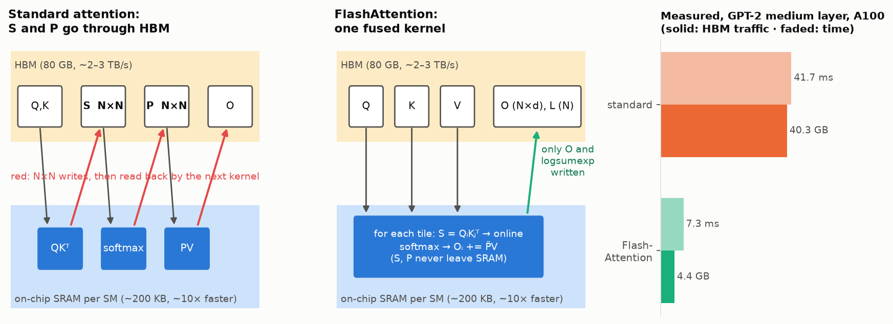
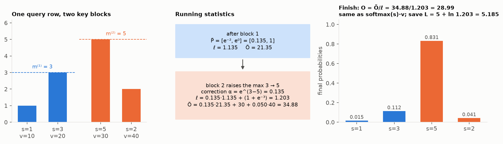
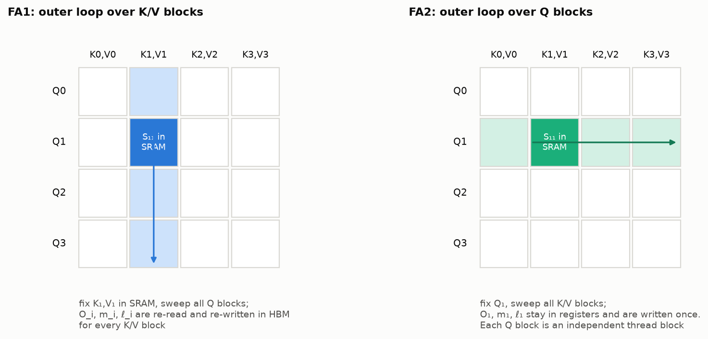
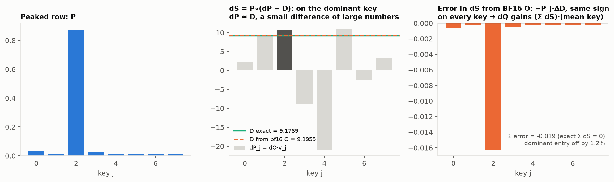
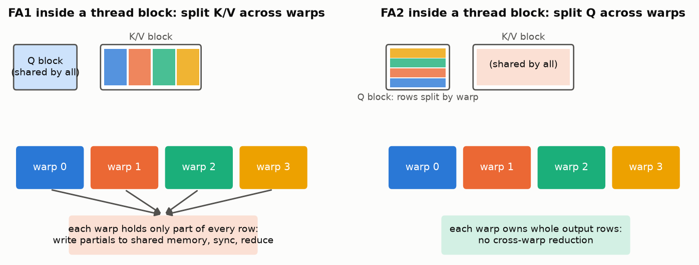
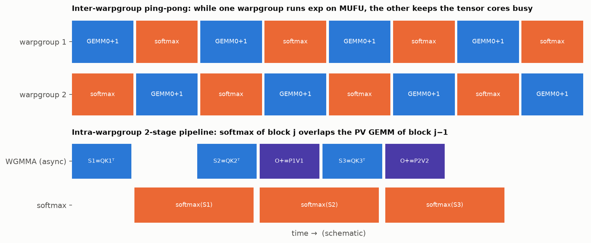
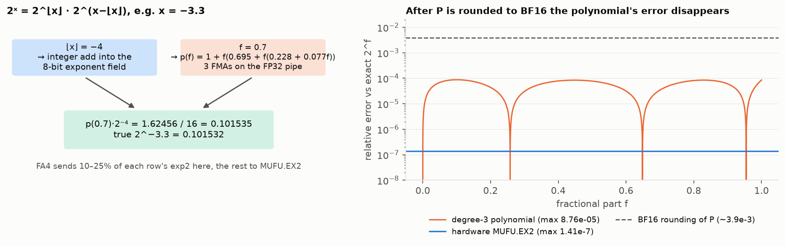
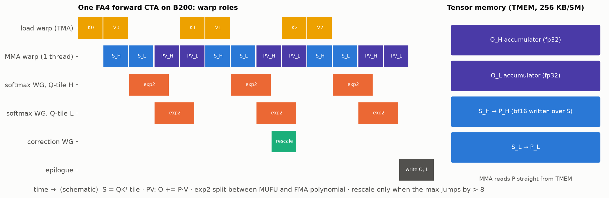
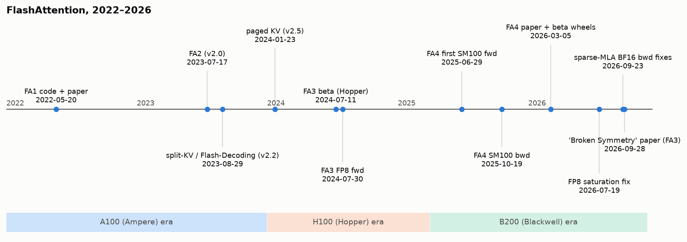

# FlashAttention rebuilds exact attention for every GPU

FlashAttention computes ordinary, exact softmax attention. It is fast because it **never writes the N×N score matrix to GPU main memory (HBM)**. It streams blocks of Q, K and V through the small on-chip memory, keeps a running max and a running sum for each query row (the "online softmax"), and recomputes the scores during the backward pass instead of storing them. That idea has stayed the same from 2022 to 2026. Each version since has rebuilt the kernel around whatever unit of the newest GPU had become the bottleneck. FlashAttention-1 (May 2022, A100) removed the HBM traffic. FlashAttention-2 (July 2023) cut non-matmul work and repartitioned the work across the GPU, for about 2× more speed. FlashAttention-3 (July 2024, H100) overlapped the softmax exponentials with asynchronous tensor-core matmuls and added FP8. FlashAttention-4 (code from mid-2025, paper March 2026, B200) works around a GPU whose tensor cores doubled in speed while its exponential unit did not, partly by computing `exp2` with a polynomial on ordinary FMA units. Along the way the library gained causal alignment, split-KV decoding, sliding windows, paged KV caches, softcapping, deterministic gradients, MLA shapes and programmable masks. The numerical story ends in an open question. In 2025–2026, two papers and a run of upstream pull requests showed that **BF16 rounding in the backward pass breaks an exact identity, rowsum(dS) = 0**, and that this can blow up gradients late in training. As of 13 October 2026, the main Dao-AILab repository has fixed this only for one FlashAttention-4 path, sparse-MLA training on Blackwell (three PRs merged on 23 September 2026). The dense backward path, FlashAttention-3, and the fixes proposed in the papers are not upstream.

## Attention is slow because of memory traffic, not arithmetic

### The N×N matrix makes three round trips through HBM

Standard attention for one head, with sequence length N and head dimension d, is

  S = QKᵀ / √d ∈ ℝ^{N×N},  P = softmax(S) (row-wise),  O = PV ∈ ℝ^{N×d}.

A straightforward implementation launches separate kernels. It computes S and **writes it to HBM**, reads S back, computes P and **writes P to HBM**, then reads P and V and writes O. The FlashAttention-1 paper calls this Algorithm 0 and points out that most of these operations are memory-bound ([FA1, §2.2](https://arxiv.org/abs/2205.14135)). Masking and dropout add more passes over the same N×N matrix. Storing S and P also costs O(N²) memory, and the backward pass needs P again.



*Standard attention writes S and P (N×N) to HBM and reads them back; FlashAttention keeps them on chip. Right: the FA1 paper's measurement.*

### The GPU has a small fast scratchpad next to a large slow warehouse

A GPU has two very different kinds of memory. **HBM** is large and comparatively slow. **SRAM** (shared memory and registers inside each streaming multiprocessor, SM) is tiny and fast. The numbers used in the papers are:

| GPU | HBM | HBM bandwidth | On-chip SRAM | SRAM bandwidth |
|---|---|---|---|---|
| A100 | 40–80 GB | 1.5–2.0 TB/s | 192 KB per SM × 108 SMs | ~19 TB/s |
| H100 SXM5 | 80 GiB | 3.35 TB/s | 228 KiB shared memory per SM (+256 KiB registers) | ~31 TB/s |

Sources: A100 figures from the [FA2 paper §2.1](https://arxiv.org/abs/2307.08691); H100 figures from Table 1 of the [FA3 paper](https://arxiv.org/pdf/2407.08608v2), which also lists a 50 MiB L2 cache at 12 TB/s.

SRAM is roughly 10× faster than HBM, but there is far less of it: about 20 MB across all of an A100's SMs, against 40–80 GB of HBM. **IO-aware** algorithm design, the phrase the FA1 paper introduced, means counting reads and writes between these levels as the main cost ([FA1](https://arxiv.org/abs/2205.14135)).

### Attention's arithmetic intensity sits far below the ridge point

> **Callout: a back-of-envelope check (our calculation, not from the papers).** An A100 does 312 TFLOP/s of BF16 matmul and moves about 2 TB/s from HBM. A kernel needs about 312/2 ≈ **156 FLOPs per byte** of HBM traffic to keep the tensor cores busy. Writing S costs 2 bytes per entry (fp16) and produces 2d FLOPs per entry, so the QKᵀ kernel alone runs at about d = 64 FLOPs/byte when d = 64, already below the ridge. The softmax pass reads 2 bytes and writes 2 bytes per entry for a handful of FLOPs, about 1 FLOP/byte. The whole chain is limited by memory bandwidth, not by the tensor cores.

The FA1 paper measured this directly. In a GPT-2 medium attention layer (sequence length 1024, d = 64, 16 heads, batch 64, A100, forward plus backward), standard attention did **66.6 GFLOPs, moved 40.3 GB through HBM and took 41.7 ms**. FlashAttention did *more* arithmetic, **75.2 GFLOPs** because of recomputation, but moved only **4.4 GB and took 7.3 ms** ([FA1, Fig. 2](https://arxiv.org/abs/2205.14135)). About 9× less traffic gave about 5.7× less time. Doing more arithmetic to move fewer bytes is the trade every later version makes.

## FlashAttention-1 (2022): tile, keep running statistics, recompute

FlashAttention-1 was released as code on 20 May 2022 ([first commit](https://github.com/Dao-AILab/flash-attention/commit/1fcbe6f)), with the paper [arXiv 2205.14135](https://arxiv.org/abs/2205.14135) (Tri Dao, Dan Fu, Stefano Ermon, Atri Rudra, Christopher Ré; NeurIPS 2022) later that month. The repository started under HazyResearch and later moved to Dao-AILab. The paper names two techniques, **tiling** and **recomputation**.

### Online softmax: rescale what you have already summed

Softmax needs the maximum and the sum of a whole row, but a tile holds only part of a row. The fix is to keep two statistics per row and correct them as new blocks arrive. For a vector x, define m(x) = maxᵢ xᵢ, f(x) = [e^{x₁−m(x)}, …], ℓ(x) = Σᵢ f(x)ᵢ, so softmax(x) = f(x)/ℓ(x). For a concatenation x = [x⁽¹⁾ x⁽²⁾] ([FA1 §3.1](https://arxiv.org/abs/2205.14135)):

  m(x) = max(m(x⁽¹⁾), m(x⁽²⁾))
  ℓ(x) = e^{m(x⁽¹⁾) − m(x)} ℓ(x⁽¹⁾) + e^{m(x⁽²⁾) − m(x)} ℓ(x⁽²⁾)

Subtracting the max keeps every exponential ≤ 1, so nothing overflows. When a later block brings a bigger max, everything already accumulated is multiplied by the correction factor e^{m_old − m_new} ≤ 1. The output is handled the same way. In the FlashAttention-2 form, which keeps an un-normalized accumulator Õ and divides once at the end ([FA2 §3.1.1](https://arxiv.org/abs/2307.08691)), processing key/value block j for query block i is:

  m⁽ʲ⁾ = max(m⁽ʲ⁻¹⁾, rowmax(Sᵢⱼ))
  P̃ᵢⱼ = exp(Sᵢⱼ − m⁽ʲ⁾)
  ℓ⁽ʲ⁾ = e^{m⁽ʲ⁻¹⁾ − m⁽ʲ⁾} ℓ⁽ʲ⁻¹⁾ + rowsum(P̃ᵢⱼ)
  Õ⁽ʲ⁾ = diag(e^{m⁽ʲ⁻¹⁾ − m⁽ʲ⁾}) Õ⁽ʲ⁻¹⁾ + P̃ᵢⱼ Vⱼ

After the last block, Oᵢ = diag(ℓ)⁻¹ Õ and the **logsumexp** Lᵢ = m + log ℓ is saved for the backward pass.

> **Callout: a typo to watch for.** The arXiv v1 PDF of FA2 prints the rescale in Algorithm 1 as diag(e^{m⁽ʲ⁻¹⁾−m⁽ʲ⁾})**⁻¹** Õ⁽ʲ⁻¹⁾. The correct update *multiplies* by e^{m_old − m_new}, as the two-block example on the same page shows. Algorithm 2 also prints D ∈ ℝᵈ where it should be ℝᴺ. The equations above are the corrected forms.



*The worked example above, block by block.*

### Worked example: softmax over two blocks

Take one query row with four scores, s = [1, 3 | 5, 2], split into two blocks of two. To keep the arithmetic readable, each value vector has one dimension: v = [10, 20 | 30, 40].

**Block 1** (scores 1, 3):
m⁽¹⁾ = 3
P̃ = [e^{1−3}, e^{3−3}] = [0.1353, 1.0000]
ℓ⁽¹⁾ = 1.1353
Õ⁽¹⁾ = 0.1353·10 + 1.0000·20 = 21.353

**Block 2** (scores 5, 2): the block max 5 beats the old max 3.
m⁽²⁾ = 5, correction α = e^{3−5} = 0.1353
P̃ = [e^{5−5}, e^{2−5}] = [1.0000, 0.0498]
ℓ⁽²⁾ = 0.1353·1.1353 + (1.0000 + 0.0498) = 0.1536 + 1.0498 = 1.2034
Õ⁽²⁾ = 0.1353·21.353 + 1.0000·30 + 0.0498·40 = 2.890 + 30 + 1.991 = 34.881

**Finish:** O = 34.881 / 1.2034 = **28.985**, and L = 5 + ln 1.2034 = **5.185**.

**Check against an ordinary softmax.** exp(s − 5) = [0.0183, 0.1353, 1, 0.0498], which sums to 1.2034. The probabilities are [0.0152, 0.1125, 0.8310, 0.0414], and 0.0152·10 + 0.1125·20 + 0.8310·30 + 0.0414·40 = 28.985. The two results are identical. In the backward pass, any probability can be rebuilt from L alone: P₃ = exp(5 − 5.185) = 0.831.

### A reference implementation in 25 lines

The loop below is the FA2 forward algorithm written in plain PyTorch. A real kernel runs the inner loop in SRAM and registers, but the math is the same. It matches `torch.softmax(S) @ v` and `torch.logsumexp(S)` to fp32 precision (we ran this check with N = 256, d = 64, blocks of 64).

```python
import torch

def flash_forward(q, k, v, block=64):
    # q, k, v: (N, d) for one head, no mask. Returns O and logsumexp L.
    N, d = q.shape
    scale = d ** -0.5
    O, L = torch.empty_like(q), torch.empty(N)
    for i in range(0, N, block):                        # outer loop: Q blocks (FA2 order)
        qi = q[i:i+block] * scale
        m = torch.full((qi.shape[0],), float("-inf"))   # running max
        l = torch.zeros(qi.shape[0])                    # running sum
        acc = torch.zeros(qi.shape[0], d)               # un-normalized output
        for j in range(0, N, block):                    # inner loop: K/V blocks
            s = qi @ k[j:j+block].T                     # (Br, Bc) scores, never stored
            m_new = torch.maximum(m, s.max(dim=1).values)
            p = torch.exp(s - m_new[:, None])
            alpha = torch.exp(m - m_new)                # correction for old statistics
            l = alpha * l + p.sum(dim=1)
            acc = alpha[:, None] * acc + p @ v[j:j+block]
            m = m_new
        O[i:i+block] = acc / l[:, None]                 # normalize once, at the end
        L[i:i+block] = m + torch.log(l)                 # the only statistic saved
    return O, L
```

### FA1's loop order and recomputation

FlashAttention-1's Algorithm 1 chooses block sizes B_c = ⌈M/(4d)⌉ and B_r = min(⌈M/(4d)⌉, d), where M is the SRAM size. Its **outer loop runs over K/V blocks** and its inner loop over Q blocks. As a result, O, ℓ and m live in HBM and are read and rewritten on every inner iteration ([FA1, Alg. 1](https://arxiv.org/abs/2205.14135)). FA2 later reversed this order. FA1 saved O, ℓ, m and the random-number-generator state for dropout. The backward pass rebuilds S and P block by block from Q, K and the saved statistics, and regenerates the dropout mask from the RNG state, so no O(N²) tensor is ever stored. The paper calls this "a form of selective gradient checkpointing" and notes that "even with more FLOPs, our recomputation speeds up the backward pass due to reduced HBM accesses" ([FA1 §3.1](https://arxiv.org/abs/2205.14135)). Extra memory falls from O(N²) to O(N). That is where the 10–20× memory savings come from.



*Which loop is outermost decides what stays on chip.*

### IO complexity: Θ(N²d²/M) instead of Θ(N²)

For d ≤ M ≤ Nd, standard attention needs Θ(Nd + N²) HBM accesses, while FlashAttention needs **Θ(N²d²/M)** (Theorem 2 for the forward pass, Theorem 5 for the backward). The ratio between the two is roughly M/d². With d = 64–128 and M around 100 KB, the paper notes that "d² is many times smaller than M". It also proves a lower bound (Proposition 3): no exact attention algorithm can do asymptotically better for all M in [d, Nd] ([FA1 §3.2](https://arxiv.org/abs/2205.14135)). The measured 40.3 GB → 4.4 GB in the GPT-2 example (about 9×) is that ratio in practice.

FA1's headline results were up to 7.6× faster attention on GPT-2, BERT-large trained 15% faster than the MLPerf 1.1 record, GPT-2 small trained 3.5× faster than the Hugging Face implementation, and the first better-than-chance Transformer on Path-X (16K tokens) ([FA1 §4](https://arxiv.org/abs/2205.14135)). FA1 also had a block-sparse variant with Θ(Nd + N²d²M⁻¹s) accesses, where s is the fraction of non-zero blocks. Programmable block sparsity returned in 2025 as FA4's mask_mod.

## The backward pass hinges on one scalar per row, D

The precision story at the end of this lesson depends on this section.

Given dO, the gradient of the loss with respect to O, the backward pass computes:

  dV = Pᵀ dO
  dP = dO Vᵀ
  D = rowsum(dO ∘ O)      (one number per query row)
  dS = P ∘ (dP − D)      (D broadcast along each row)
  dQ = dS K · (1/√d)
  dK = dSᵀ Q · (1/√d)

([FA1 App. B.2/B.4](https://arxiv.org/abs/2205.14135); [FA2 Alg. 2](https://arxiv.org/abs/2307.08691)). Five matmuls appear here (S is recomputed, plus dV, dP, dQ, dK), against two in the forward pass. That is why the papers count backward FLOPs as 2.5× forward ([FA2 §4.1](https://arxiv.org/abs/2307.08691)).

**Where D comes from.** The softmax Jacobian gives, for row i,

  dSᵢⱼ = Pᵢⱼ (dPᵢⱼ − Σₖ Pᵢₖ dPᵢₖ).

The sum Σₖ Pᵢₖ dPᵢₖ runs over all N keys. That is a reduction over a whole row, exactly what a tiled kernel wants to avoid. But dPᵢₖ = dOᵢ · vₖ, so

  Σₖ Pᵢₖ dPᵢₖ = dOᵢ · (Σₖ Pᵢₖ vₖ) = dOᵢ · Oᵢ = Dᵢ.

A length-N reduction becomes a **length-d dot product between two tensors that already exist**, dO and the saved output O ([FA1 Eq. 4](https://arxiv.org/abs/2205.14135)). FA2 computes D in a separate pre-pass and writes it to HBM; FA3 and FA4 do the same with a preprocessing kernel ([FA3 App. B.1](https://arxiv.org/pdf/2407.08608v2)). The FA code calls it `dpsum`. The saved logsumexp gives back P exactly: Pᵢⱼ = exp(Sᵢⱼ − Lᵢ).

**The conservation law.** Summing dS along a row gives

  Σⱼ dSᵢⱼ = Σⱼ Pᵢⱼ dPᵢⱼ − Dᵢ Σⱼ Pᵢⱼ = Dᵢ − Dᵢ · 1 = **0**.

The underlying reason is that softmax ignores a constant added to a whole row: softmax(s + c·1) = softmax(s). The gradient with respect to the scores therefore has no component along the all-ones direction. This has a concrete consequence for dQ. Write each key as kⱼ = μ + k̃ⱼ, where μ is the mean key. Then

  dQᵢ ∝ Σⱼ dSᵢⱼ kⱼ = Σⱼ dSᵢⱼ k̃ⱼ + (Σⱼ dSᵢⱼ) μ.

In exact arithmetic the second term vanishes, so **the true dQ does not depend on the mean key at all**. If rounding makes the row sum ρ = Σⱼ dSᵢⱼ nonzero, the error ρ·μ leaks into dQ, and it is large exactly when keys share a large common component.

**Why D is fragile.** Mathematically, D = Σ P∘dP. In the kernel, D is computed from O, and **O is stored in BF16**. Every other quantity in dS is formed from fp32 accumulators. When attention is peaked on one key, that key's dP is close to D, and dS on that key is a small difference of two large numbers.

> **Callout: a two-key example (our numbers).** Let P = [0.98, 0.02] and dP = [2.00, −1.00]. Then D = 0.98·2 − 0.02·1 = 1.94 and dS = [0.98·0.06, 0.02·(−2.94)] = [0.0588, −0.0588], which sums to 0. Now suppose D comes out 0.004 too large (≈ 0.2%, about the size of one BF16 rounding, since BF16 keeps 8 significant bits). Then dS = [0.0549, −0.0589]. **The dominant entry moves by 6.7%**, the row sum becomes −0.004 instead of 0, and dQ picks up −0.004 × (mean key). A 0.2% error in an input became a 6.7% error in a gradient, and the error has the same sign on every key in the row.



*A simulated peaked row (8 keys, d = 64, our numbers): O is rounded to BF16 before computing D, everything else is exact.*

## FlashAttention-2 (2023): same math, 2× faster

FlashAttention-2 shipped on 17 July 2023 ([release commit](https://github.com/Dao-AILab/flash-attention/commit/4f285b3); [arXiv 2307.08691](https://arxiv.org/abs/2307.08691), ICLR 2024) as a "complete rewrite" on CUTLASS 3/CuTe. The paper starts from a utilization gap. **FA1 reached only 25–40% of A100 peak** (30–50% forward, 25–35% backward), while optimized GEMMs reach 80–90%. It blames "suboptimal work partitioning between different thread blocks and warps" ([FA2 §1](https://arxiv.org/abs/2307.08691)). The paper makes three changes.

**1. Fewer non-matmul FLOPs.** An A100 does 312 TFLOP/s of FP16/BF16 matmul but only 19.5 TFLOP/s of other FP32 math, so "each non-matmul FLOP is 16× more expensive than a matmul FLOP". FA2 keeps Õ un-normalized and divides by ℓ once at the end, and saves only the logsumexp L instead of both m and ℓ ([FA2 §3.1](https://arxiv.org/abs/2307.08691)).

**2. Parallelism over the sequence.** FA1 launched one thread block per (batch, head), which fills 108 SMs only when batch × heads is large. FA2 swaps the loops so that the **outer loop runs over Q blocks**, and each Q block gets its own thread block. This is "embarrassingly parallel", and the accumulator of each Q block stays on chip, so O and L are written exactly once. In the backward pass each thread block owns a K/V block, and "we use atomic adds to communicate between different thread blocks to update dQ". The paper credits Phil Tillet's Triton implementation with first suggesting the loop swap and sequence parallelism ([FA2 §3.2](https://arxiv.org/abs/2307.08691)). Those atomic adds are the source of the nondeterminism discussed later. The FA1 *code* had already gained sequence-length splitting in October–November 2022 ([a44f48d](https://github.com/Dao-AILab/flash-attention/commit/a44f48d), [5577819](https://github.com/Dao-AILab/flash-attention/commit/5577819)), so this change was partly a cleanup.

**3. Split Q across warps, not K.** Inside a thread block, FA1 split K and V across four warps ("split-K"), so every warp had to write partial results to shared memory, synchronize and sum them. FA2 splits Q across warps and shares K and V, so "there is no need for communication between warps" ([FA2 §3.3](https://arxiv.org/abs/2307.08691)).



*Work split between the 4 warps of one thread block.*

The paper also skips causal blocks that lie entirely above the diagonal (a 1.7–1.8× speedup over non-causal), and handles MQA/GQA by indexing into shared K/V heads instead of copying them ([FA2 §3.1](https://arxiv.org/abs/2307.08691)). The results were **1.7–3.0× over FA1**, up to **230 TFLOP/s forward (73% of A100 peak)** and 63% in the backward pass, and **225 TFLOP/s per A100 end-to-end (72% MFU)**. For GPT3-2.7B at 8K context, throughput per GPU went 80 → 175 → 225 TFLOP/s (no FlashAttention → FA1 → FA2). On H100, the same code reached 335 TFLOP/s without any Hopper-specific instructions, and the paper predicted "another 1.5x-2x" from using them. That became FA3 ([FA2 §4](https://arxiv.org/abs/2307.08691)). The paper has no ablation separating the three changes, so how much of the 2× each contributes is unknown.

FA2 supports Ampere, Ada and Hopper, fp16 and bf16, and every head dimension up to 256. Turing was dropped, and only a separate community repo supports it today ([README](https://github.com/Dao-AILab/flash-attention/blob/main/README.md)). Through the v2.x series it collected most of the features that later versions inherited (see the tables below).

## Flash-Decoding (2023): split the keys when there is only one query

When a model generates text, each step has a query length of 1. FA2 parallelizes over batch, heads and query blocks, so "with a batch size of 1, FlashAttention will use less than 1% of the GPU" ([Flash-Decoding blog](https://crfm.stanford.edu/2023/10/12/flashdecoding.html)). **Flash-Decoding** (Tri Dao, Daniel Haziza, Francisco Massa, Grigory Sizov) adds the *key* length as a parallel dimension. It splits K/V into chunks, runs attention on each chunk in parallel, and has each split write its partial output Oₛ and logsumexp Lₛ. A small combine kernel then merges them:

  L = log Σₛ exp(Lₛ),  O = Σₛ exp(Lₛ − L) · Oₛ.

This is the online-softmax rescaling again, applied across splits instead of across sequential blocks. Saving one L per row is what makes the merge so simple. The code landed as "Implement splitKV attention" on 29 August 2023 ([b1fbbd8](https://github.com/Dao-AILab/flash-attention/commit/b1fbbd8)) and shipped with `flash_attn_with_kvcache` in v2.2.0 in early September, more than a month before the October blog post. The blog reported up to 50× faster attention and up to 8× faster end-to-end generation for very long sequences on CodeLlama-34B ([blog](https://crfm.stanford.edu/2023/10/12/flashdecoding.html)). The same LSE merge underlies FA3's `num_splits`, FlashInfer's cascade attention and ring/context-parallel attention across GPUs.

## FlashAttention-3 (2024): Hopper makes the exponential the next bottleneck

FA2 reached only **35% utilization on H100**, because it ignored Hopper's asynchronous hardware: TMA, a dedicated unit that copies data from global to shared memory, and WGMMA, warpgroup-wide asynchronous tensor-core instructions that read operands straight from shared memory ([FA3](https://arxiv.org/pdf/2407.08608v2)). The older `mma.sync` reaches only about two thirds of Hopper's tensor-core peak ([Tri Dao blog](https://tridao.me/blog/2024/flash3/)). FlashAttention-3 (Jay Shah, Ganesh Bikshandi, Ying Zhang, Vijay Thakkar, Pradeep Ramani, Tri Dao; [arXiv 2407.08608](https://arxiv.org/abs/2407.08608), NeurIPS 2024) landed in the repo as a beta on 11 July 2024 ([7f67966](https://github.com/Dao-AILab/flash-attention/commit/7f67966)).

> **Callout: two sets of numbers.** The arXiv v2 paper (benchmarked May 2024) reports FP16 up to **740 TFLOP/s (75%)** and FP8 "close to 1.2 PFLOP/s". The NeurIPS camera-ready (benchmarked October 2024, newer libraries) reports BF16 up to **840 TFLOP/s (85%)** and FP8 **1.3 PFLOP/s**. Both are quoted widely; always say which version a number comes from. Both headline numbers are for head dim 256, non-causal, 16K sequence ([arXiv v2](https://arxiv.org/pdf/2407.08608v2); [NeurIPS](https://proceedings.neurips.cc/paper_files/paper/2024/file/7ede97c3e082c6df10a8d6103a2eebd2-Paper-Conference.pdf)).

### Why exp becomes the bottleneck

"The H100 SXM5 GPU has 989 TFLOPS of FP16 matmul but only 3.9 TFLOPS of special functions such as exponential". The 3.9 figure is 16 operations per SM per clock × 132 SMs × 1830 MHz, on the multi-function unit (MUFU) that executes `MUFU.EX2` ([FA3 §3, fn. 5](https://arxiv.org/pdf/2407.08608v2)). Per score entry, the two matmuls cost 2d + 2d = 4d FLOPs, which is 512 for d = 128, while the softmax costs one exponential. Matmul throughput is about 256× the exponential throughput, so **the exponentials need 256/512 = 50% as many cycles as the matmuls**. With FP8 the matmuls get twice as fast and the ratio becomes 100% ([FA3](https://arxiv.org/pdf/2407.08608v2)). The goal is to run the exponentials *while* the tensor cores work, not after them.

### Three techniques

**Producer/consumer warp specialization.** One "producer" warpgroup only issues TMA loads of K and V into a circular shared-memory buffer. "Consumer" warpgroups issue WGMMAs and do the softmax. `setmaxnreg` moves registers from the producer, which needs almost none, to the consumers ([FA3 §3.1](https://arxiv.org/pdf/2407.08608v2)).

**Ping-pong scheduling between warpgroups.** Barriers force warpgroup 1's GEMMs to run while warpgroup 2 does its softmax, and then the roles swap. This lifted the FP16 forward pass from about 570 to 620–640 TFLOP/s ([FA3 §3.1](https://arxiv.org/pdf/2407.08608v2)).

**Pipelining within a warpgroup.** Inside one iteration the work is serial: softmax needs S, and the PV GEMM needs P. FA3 breaks the chain across iterations. It issues S_next = QKⱼᵀ and the previous iteration's PV GEMM asynchronously, then computes softmax on S_next while the PV GEMM runs. The cost is extra registers for S_next ([FA3 §3.2](https://arxiv.org/pdf/2407.08608v2)).



*Schematic of FA3's two overlap schemes on H100.*

The ablation (non-causal FP16, head dim 128, sequence 8448) is unchanged between paper versions ([FA3 Table 2](https://arxiv.org/pdf/2407.08608v2)):

| Configuration | TFLOP/s |
|---|---|
| Full FA3 | 661 |
| Without GEMM–softmax pipelining | 582 |
| Without warp specialization | 570 |

### FP8 needed layout surgery and a Hadamard rotation

FP8 WGMMA accepts shared-memory operands only in "k-major" layout, but V is normally contiguous along the head dimension. FA3 transposes each V tile **inside the kernel** after loading it, using `ldmatrix`/`stmatrix` in the producer warpgroup, an idea credited to the cuDNN team. A byte permutation then makes the FP32 accumulator layout match what the next FP8 matmul expects ([FA3 §3.3](https://arxiv.org/pdf/2407.08608v2)). For accuracy, the paper uses **block quantization** (one scale per tile) and **incoherent processing**: it multiplies Q and K by a random orthogonal matrix M (random ±1 signs times a Hadamard matrix) before quantizing. Since (QM)(KM)ᵀ = QKᵀ, the result is unchanged, but outlier features get spread across dimensions. On a synthetic test with 0.1% large outliers, FP8 RMSE fell from **2.4e-2 (per-tensor baseline) to 9.1e-3**. Removing the Hadamard step brings it back to 2.4e-2, while removing block quantization barely matters (9.3e-3). FP16 FA2 and FA3 both reach 1.9e-4, against 3.2e-4 for standard attention, because the softmax stays in FP32 ([FA3 Table 3](https://arxiv.org/pdf/2407.08608v2)).

> **Callout: what the library actually does.** The released FA3 kernel takes `q_descale`/`k_descale`/`v_descale` tensors but contains no Hadamard transform. Incoherent processing is left to the caller, for example fused into the RoPE kernel as the paper suggests. Passing plain per-tensor-scaled FP8 gives roughly the baseline FP8 error. This is our inference from the interface and Table 3 ([flash_attn_interface.py](https://github.com/Dao-AILab/flash-attention/blob/main/hopper/flash_attn_interface.py)).

### How FA3 grew

BF16 arrived on 14 July 2024, varlen on 22 July, the FP8 forward pass on 30 July, a rewritten backward on 1 August, sliding windows in August–September, KV cache + split-KV + GQA packing on 15 October, and paged KV on 10 November 2024. A large refactor on 7 January 2025 also compiled the same source for Ampere (sm80/sm86) and added softcapping. Head-dimension pairs with hdimQK ≠ hdimV (192/128, DeepSeek style) came on 3 February 2025 and the MLA flag (rope 64, latent 512) on 22 February 2025. Python stable-ABI builds and torch.compile support followed during 2025. The current main branch was marked **v3.0.0 stable** on 5 February 2026 ([PR #2223](https://github.com/Dao-AILab/flash-attention/pull/2223)), prebuilt `flash_attn_3` wheels appeared on the PyTorch index on 27 April 2026 ([index](https://download.pytorch.org/whl/flash-attn-3/)), and the version was bumped to 3.0.1 on 12 October 2026 ([bb25ba3](https://github.com/Dao-AILab/flash-attention/commit/bb25ba3)). All dates are commit dates from the [`hopper/` history](https://github.com/Dao-AILab/flash-attention/commits/main/hopper). **FP8 backward and dropout were never added.** The C++ backward dispatch has only fp16/bf16 instantiations, and issue [#1069](https://github.com/Dao-AILab/flash-attention/issues/1069) asking for FP8 backward is still open. The v3.0.0 PR itself says "most new development is happening in FA4".

## FlashAttention-4 (2025–2026): Blackwell doubles the tensor cores but not the exp unit

### Asymmetric scaling is the whole story

On B200, the BF16 tensor cores do **8192 FLOPs per clock per SM, twice Hopper's 4096**. The MUFU still does **16 exponentials per clock per SM**, and shared-memory bandwidth is still 128 B per clock per SM, both unchanged from Hopper. B300/GB300 doubled the exponential rate to 32 ([FA4 §2](https://arxiv.org/abs/2603.05451)). For one 128 × 128 tile with d = 128, the paper's roofline is:

| Resource | Forward cycles | Backward cycles (1-CTA) |
|---|---|---|
| Tensor cores (MMA) | 1024 | 2560 |
| Shared memory | 768 | 3328 |
| Exponential (MUFU) | 1024 | 1024 |

([FA4 §2–3, Table 1](https://arxiv.org/abs/2603.05451))

> **Callout: check the forward row yourself.** Two GEMMs on a 128×128 tile with d = 128 cost 2 × 2 × 128³ ≈ 8.39 M FLOPs, and 8.39 M / 8192 = 1024 cycles. The tile has 128 × 128 = 16,384 exponentials, and 16,384 / 16 = 1024 cycles. On Hopper the exponentials took half the matmul time; on Blackwell they take **all** of it. In the backward pass, **shared-memory traffic** is the limit.

So FA4 does two things: move exponentials off the MUFU, and do fewer of the extra multiplies that online softmax adds.

### Trick 1: compute some exp2 on the FMA units with a cubic polynomial

GPUs compute eˣ as 2^(x·log₂e), and FlashAttention folds log₂e into the softmax scale, so the kernel needs 2ˣ. FA4 computes part of these on the ordinary FP32 FMA pipes, using the classical Cody–Waite range reduction ([FA4 §3.1.3](https://arxiv.org/abs/2603.05451)):

  2ˣ = 2^⌊x⌋ · 2^(x − ⌊x⌋)

The steps are: (1) clamp x ≥ −127; (2) get ⌊x⌋ by adding 2²³ + 2²² with round-down and subtracting it back; (3) f = x − ⌊x⌋ ∈ [0, 1); (4) evaluate a degree-3 minimax polynomial p(f) ≈ 2^f with Horner's rule; (5) shift ⌊x⌋ into the 8-bit exponent field and add it to the bit pattern of p(f) with an integer add. The coefficients in the code come from the Sollya tool (`fpminimax(exp(x * log(2.0)), 1, …, [0;1], relative)`) ([utils.py](https://github.com/Dao-AILab/flash-attention/blob/main/flash_attn/cute/utils.py)):

```python
# flash_attn/cute/utils.py, POLY_EX2[3]
1.0, 0.695146143436431884765625, 0.227564394474029541015625, 0.077119089663028717041015625
```

For example, 2^−3.3: ⌊x⌋ = −4 and f = 0.7, so p(0.7) = 1.62456 and 1.62456 × 2⁻⁴ = 0.1015350, against the true 0.1015315. The kernel evaluates two values at once with packed `fma.rn.ftz.f32x2` instructions ([Modal analysis](https://modal.com/blog/reverse-engineer-flash-attention-4)).

Accuracy against FP64 on 4M inputs ([FA4 Table 2](https://arxiv.org/abs/2603.05451)): hardware `MUFU.EX2` has max relative error 1.41e-7. The degree-3 polynomial has 8.77e-5 max and 5.43e-5 mean (we reproduced 8.76e-5 / 5.43e-5 from the coefficients above). Degree 5 reaches 1.44e-7. After rounding P to BF16, whose own rounding error is about 3.9e-3, every degree ≥ 3 is indistinguishable from the hardware, and degree 3 matches it within 1 BF16 ulp on 99% of inputs.

Only **10–25% of each row** is emulated; the rest still goes to `MUFU.EX2`. Emulating everything would raise register pressure and cause spills ([FA4](https://arxiv.org/abs/2603.05451)). In the code, rows are split into 32-element fragments, and a tuned frequency picks which element pairs are emulated (for example, freq = 16 for 1-CTA causal hdim 128 is 12.5% of a 128-element row, by our count) ([softmax.py](https://github.com/Dao-AILab/flash-attention/blob/main/flash_attn/cute/softmax.py)). On B300 (SM103), with its doubled MUFU, emulation is switched off ("SM103 has fast native exp2"; [8e0b5d75](https://github.com/Dao-AILab/flash-attention/commit/8e0b5d75), 21 February 2026).



*Software exp2 on FMA units (left) and its accuracy, computed from the coefficients in the FA4 code (right).*

### Trick 2: rescale only when the max jumps by more than τ = 8

Every time the running max grows, online softmax multiplies the whole output accumulator by e^{m_old − m_new}. On Blackwell, O lives in tensor memory (TMEM), so that multiply is a TMEM → registers → TMEM round trip. FA4 keeps the stale max unless the new one is much bigger ([FA4 §3.1.4](https://arxiv.org/abs/2603.05451)):

  if m_new − m_old > τ:  O ← e^{m_old − m_new} O + e^{S − m_new} V  (normal update)
  else:  O ← O + e^{S − m_old} V  (keep the old max)

The paper sets τ to "log2(256) = 8.0, corresponding to a rescaling factor of 256.0". The result is still exact, because ℓ is accumulated with the same stale max and the final O/ℓ cancels it. To avoid warp divergence, a whole warp rescales if any of its threads needs to. In the code the threshold is in log₂ units of the scaled score, and it is turned off for FP8 ([flash_fwd_sm100.py](https://github.com/Dao-AILab/flash-attention/blob/main/flash_attn/cute/flash_fwd_sm100.py)):

```python
rescale_threshold = 8.0 if q_dtype.width == 16 else 0.0
```

With a stale max, un-normalized probabilities can reach 2⁸ = 256. That is harmless in BF16, but it matters for FP8, as the stability section below shows. Rescaling is done by a separate "correction" warpgroup, off the softmax critical path. Modal relays Tri Dao as saying the trick cut corrections by about 10× ([Modal](https://modal.com/blog/reverse-engineer-flash-attention-4)); the paper has no ablation for either trick on its own.

### The pipeline: TMEM, single-thread MMA, 2-CTA tiles

Blackwell replaces WGMMA with `tcgen05` MMAs that a **single thread** issues, with accumulators in **256 KB of TMEM per SM**. The largest BF16 tile is 128×256×16, and a pair of CTAs can cooperate on 256×256×16 ([Tri Dao blog](https://tridao.me/blog/2026/flash4/)). WGMMA no longer exists on SM100, so FA3 does not run on B200 at all ([PyTorch blog](https://pytorch.org/blog/flexattention-flashattention-4-fast-and-flexible/)). Each FA4 forward CTA processes two 128-row Q tiles in ping-pong. Two softmax warpgroups use **one thread per full row**, so the row max needs no shuffles. One correction warpgroup rescales O, and one warp each drives the tensor cores and TMA. P is written to TMEM, overlapping S, in stages: the first 3/4 triggers the PV MMA before the last 1/4 is stored ([FA4 §3.1.2](https://arxiv.org/abs/2603.05451)).



*Schematic of one FA4 forward CTA; not to scale.*

**Backward.** The backward pass is shared-memory bound (3328 vs 2560 cycles). FA4 keeps the dK and dV accumulators resident in TMEM, uses Pᵀ and dSᵀ from TMEM as matmul operands, and overlaps the softmax of tile j with the dQ and dK matmuls of tile j−1. The **2-CTA backward** uses an M = 256 MMA tile in which each CTA stages half of operand B, cutting shared-memory cycles from 3328 to 2688. For dQ it exchanges half of dS between the paired CTAs through distributed shared memory, which also **halves the global dQ atomic adds** ([FA4 §3.2](https://arxiv.org/abs/2603.05451)). dS is written to shared memory in BF16 and dQ partials are reduced in FP32 with global atomics ([FA4](https://arxiv.org/html/2603.05451v1)). The deterministic mode serializes those reductions with a semaphore in a fixed order. The paper says it reaches "up to 75%" of the nondeterministic 1-CTA speed, while the blog summary says roughly 85–90%; the two sources conflict.

### Python instead of C++, and the dates

FA4 is written "entirely in CuTe-DSL … embedded in Python, without any component in CUDA C++". It lowers to PTX, with inline PTX as an escape hatch. Compiling one kernel takes **2.5 s forward and 1.4 s backward, against 55 s and 45 s for FA3** (22× and 32× faster) ([FA4 §4, Table 4](https://arxiv.org/abs/2603.05451)). It is installed with `pip install flash-attn-4` and imported from `flash_attn.cute`.

FA4 has no single release date:

| Date | Milestone |
|---|---|
| 2025-06-01 | First CuTe-DSL code (an Ampere fwd/bwd port, [931fb8cb](https://github.com/Dao-AILab/flash-attention/commit/931fb8cb)) |
| 2025-06-29 | First Blackwell forward, `flash_fwd_sm100` ([a5e1a3c5](https://github.com/Dao-AILab/flash-attention/commit/a5e1a3c5)) |
| Aug 2025 | Preliminary results at Hot Chips, about 20% faster than cuDNN per [Modal's report](https://modal.com/blog/reverse-engineer-flash-attention-4) (exact talk date unverified) |
| 2025-10-19 | First Blackwell backward ([PR #1945](https://github.com/Dao-AILab/flash-attention/pull/1945)) |
| 2026-02-20 | 2-CTA backward ([PR #2202](https://github.com/Dao-AILab/flash-attention/pull/2202)) |
| 2026-03-04/05 | PyTorch FlexAttention + FA4 post, paper [arXiv 2603.05451](https://arxiv.org/abs/2603.05451) (Zadouri, Hoehnerbach, Shah, Liu, Thakkar, Dao), [blog](https://tridao.me/blog/2026/flash4/), first `flash-attn-4` betas on PyPI |
| 2026-10-07 | Latest release `fa4-v4.0.0.beta34`; still beta, cut weekly ([releases](https://github.com/Dao-AILab/flash-attention/releases)) |

Commit dates are from the [`flash_attn/cute` history](https://github.com/Dao-AILab/flash-attention/commits/main/flash_attn/cute).

**Performance.** On B200 in BF16, the paper reports **up to 1613 TFLOP/s forward (71% of peak)**, 1.1–1.3× faster than cuDNN 9.13 and 2.1–2.7× faster than Triton. It is fastest for sequences of 4K and longer, with the largest gains on causal masks, which it attributes to longest-processing-time-first scheduling. It adds that "newer versions of cuDNN have incorporated many of the techniques described in this paper, yielding similar performance" ([FA4 §5](https://arxiv.org/abs/2603.05451)). 71% is a lower fraction of peak than FA3's 85% on H100, which is the asymmetric-scaling problem in one number. The appendix lists the hardware as "B100" and the date as "March 2025"; both look like typos for B200 and 2026.

**Hardware variants.** The interface accepts compute capabilities 8.x through 12.x ([interface.py](https://github.com/Dao-AILab/flash-attention/blob/main/flash_attn/cute/interface.py)). The Blackwell-specific algorithm (TMEM, 2-CTA, exp emulation, lazy rescaling) runs only on SM100/SM103/SM110. SM90 has its own CuTe forward and backward kernels, used mainly by FlexAttention. SM80 and consumer Blackwell (SM120: RTX 50xx, DGX Spark, added 12 March 2026, [PR #2329](https://github.com/Dao-AILab/flash-attention/pull/2329)) use Ampere-style `mma.sync` kernels. "FA4 on an RTX 5090" is therefore a functional port, not the FA4 algorithm.

## Four versions at a glance



*Key dates from this lesson.*

| | FA1 | FA2 | FA3 | FA4 |
|---|---|---|---|---|
| **Released** | Code 2022-05-20; arXiv May 2022 | 2023-07-17 | Beta 2024-07-11; "stable" v3.0.0 2026-02-05 | SM100 code 2025-06-29; paper and PyPI beta 2026-03-05; still beta (b34, 2026-10-07) |
| **Target GPU** | A100 (also Turing, Ada; H100 from Mar 2023) | Ampere, Ada, Hopper; AMD ROCm from v2.6.2 (Jul 2024) | H100/H800; sm80/86 from the same source since Jan 2025 | B200/GB200 (SM100), B300 (SM103), SM110; ports for SM90, SM80, SM120 |
| **Dtypes** | fp16, bf16 | fp16, bf16 | fp16/bf16 fwd+bwd; FP8 e4m3 fwd only (sm90, BF16 output) | fp16/bf16 fwd+bwd; FP8 e4m3/e5m2 fwd only (SM100) |
| **Head dims** | Multiples of 8 up to 128 (bwd > 64 needs A100/H100) | Up to 256 | 64/96/128/192/256; (192,128); MLA (64,512) | SM100: 8–128, (192,128), (64,512) MLA, 256; SM90: 8–256 |
| **Key idea** | Tiling, online softmax, recompute in bwd | Q-outer loop, fewer non-matmul FLOPs, split Q across warps | Warp specialization, ping-pong, GEMM–softmax overlap, FP8 | exp2 emulation, lazy rescale (τ = 8), TMEM, 2-CTA, CuTe-DSL in Python |
| **Peak reported** | 25–40% of A100 peak | 230 TFLOP/s fwd A100 (73%) | 740 FP16 (arXiv v2) / 840 BF16 (NeurIPS) TFLOP/s; FP8 ~1.2–1.3 PFLOP/s | 1613 TFLOP/s BF16 fwd B200 (71%) |

Sources: [FA1](https://arxiv.org/abs/2205.14135), [README @ v1.0.9](https://github.com/Dao-AILab/flash-attention/blob/v1.0.9/README.md), [FA2](https://arxiv.org/abs/2307.08691), [README @ v2.0.0](https://github.com/Dao-AILab/flash-attention/blob/v2.0.0/README.md), [FA3](https://arxiv.org/pdf/2407.08608v2), [hopper/flash_api.cpp](https://github.com/Dao-AILab/flash-attention/blob/main/hopper/flash_api.cpp), [FA4](https://arxiv.org/abs/2603.05451), [FA4 interface.py](https://github.com/Dao-AILab/flash-attention/blob/main/flash_attn/cute/interface.py).

**When kernel features arrived.** Dates are commit or tag dates from the [repo history](https://github.com/Dao-AILab/flash-attention/commits/main) and the [README changelog](https://github.com/Dao-AILab/flash-attention/blob/main/README.md). Some README "minor version" features first shipped in the patch release after it.

| Feature | First arrived | Date | Notes |
|---|---|---|---|
| Deterministic backward option | FA1 v1.0.0 ([b6aa059](https://github.com/Dao-AILab/flash-attention/commit/b6aa059)) | 2023-03-30 | `num_splits=1`; FA2 version in v2.4.1 |
| MQA / GQA | FA2 v2.0.0 | 2023-07-17 | K/V heads indexed, not copied |
| Causal mask aligned bottom-right | FA2 v2.1.0 ([9e5e8bc](https://github.com/Dao-AILab/flash-attention/commit/9e5e8bc)) | 2023-08-21/25 | Silent change when seqlen_q ≠ seqlen_k |
| Split-KV (Flash-Decoding), `flash_attn_with_kvcache` | FA2 v2.2.0 ([b1fbbd8](https://github.com/Dao-AILab/flash-attention/commit/b1fbbd8), [37c6e05](https://github.com/Dao-AILab/flash-attention/commit/37c6e05)) | 2023-08-29 / 09-05 | Rotary inside the kvcache path in v2.2.3 |
| Sliding window (local) attention | FA2 v2.3.0 ([083e8f5](https://github.com/Dao-AILab/flash-attention/commit/083e8f5)) | 2023-09-24/27 | From Mistral AI, used in Mistral 7B |
| ALiBi | FA2 v2.4.0 ([e4f726f](https://github.com/Dao-AILab/flash-attention/commit/e4f726f)) | 2023-12-22 | From Kakao Brain |
| Deterministic backward (FA2) | FA2 v2.4.1 ([7326545](https://github.com/Dao-AILab/flash-attention/commit/7326545)) | 2023-12-23 | From Meituan |
| Paged KV cache | FA2 v2.5.0 ([54e80a3](https://github.com/Dao-AILab/flash-attention/commit/54e80a3)) | 2024-01-22/23 | `block_table`; FA3 paged 2024-11-10 |
| Softcapping (Gemma-2, Grok) | FA2 v2.6.0 ([8f873cc](https://github.com/Dao-AILab/flash-attention/commit/8f873cc)) | 2024-07-08/11 | Backward in v2.6.2; not combined with dropout |
| AMD ROCm (Composable Kernel) | FA2 v2.6.2 ([d8f104e](https://github.com/Dao-AILab/flash-attention/commit/d8f104e)) | 2024-07-23 | Triton AMD backend in v2.7.1 (2024-12-05) |
| FP8 forward | FA3 ([5018ac6](https://github.com/Dao-AILab/flash-attention/commit/5018ac6)) | 2024-07-30 | FA4 SM100 FP8 e4m3/e5m2 on 2026-04-17; no FP8 backward anywhere |
| GQA packing + split-KV in FA3 | FA3 ([a5a7527](https://github.com/Dao-AILab/flash-attention/commit/a5a7527)) | 2024-10-15 | Descendant of FA2's "M↔H swap" |
| torch.compile compatibility | FA2 v2.7.0 | 2024-11 | |
| hdimQK ≠ hdimV (192/128) | FA3 ([2a20412](https://github.com/Dao-AILab/flash-attention/commit/2a20412)) | 2025-02-03 | FA4 SM100 on 2025-08-01 |
| MLA shape (64/512) | FA3 ([06e34f6](https://github.com/Dao-AILab/flash-attention/commit/06e34f6)) | 2025-02-22 | FA4 MLA with top-k sparsity on 2026-04-15 |
| Chunked local attention | FA3 ([909eb7c](https://github.com/Dao-AILab/flash-attention/commit/909eb7c)) | 2025-04-10 | `attention_chunk` |
| Learnable attention sink | FA4 fwd ([cc5c5745](https://github.com/Dao-AILab/flash-attention/commit/cc5c5745)) | 2025-07-29 | Backward on 2026-08-05 (#2706) |
| score_mod / mask_mod + block sparsity | FA4 ([PR #1942](https://github.com/Dao-AILab/flash-attention/pull/1942)) | 2025-10-21 | Powers FlexAttention's FA4 backend (2026-03-04) |
| Deterministic backward on Blackwell | FA4 ([PR #2033](https://github.com/Dao-AILab/flash-attention/pull/2033)) | 2025-11-25 | Semaphore-ordered dQ reduction |
| Consumer Blackwell (SM120) | FA4 ([PR #2329](https://github.com/Dao-AILab/flash-attention/pull/2329), [#2330](https://github.com/Dao-AILab/flash-attention/pull/2330)) | 2026-03-12 | Ampere-style kernels |
| Head dim 256 on SM100 | FA4 ([PR #2412](https://github.com/Dao-AILab/flash-attention/pull/2412)) | 2026-04-23 | 2-CTA backward |
| Sparse MLA (DeepSeek V4) backward | FA4 ([PR #2621](https://github.com/Dao-AILab/flash-attention/pull/2621)) | 2026-06-20 | Precision fixes on 2026-09-23 (below) |

Dropout exists only in FA1/FA2. The FA3 interface has no dropout argument, and FA4's argument list does not include one either ([FA3 interface](https://github.com/Dao-AILab/flash-attention/blob/main/hopper/flash_attn_interface.py); [FA4 interface](https://github.com/Dao-AILab/flash-attention/blob/main/flash_attn/cute/interface.py)).

## Numerical stability: small roundings that do not average out

FlashAttention accumulates the softmax statistics, O and dQ in FP32 even when inputs are FP16 or BF16. The test suite's accuracy rule is that FlashAttention's maximum error must be at most twice the error of a same-precision PyTorch reference ([README, Tests](https://github.com/Dao-AILab/flash-attention/blob/main/README.md)). Most problems over four years were edge cases. The interesting ones share a pattern: **an error that is correlated along a row, or across training steps, does not average out**.

### Nondeterministic dQ and the deterministic mode

In the backward pass each thread block owns a K/V block and adds its contribution to dQ with FP32 `atomicAdd` ([FA2 §3.2](https://arxiv.org/abs/2307.08691)). Floating-point addition is not associative, so the arrival order changes the last bits of dQ from run to run. dK and dV are owned by one block each and are deterministic. FA1 added a `deterministic` option on 30 March 2023 by forcing `num_splits=1` ([b6aa059](https://github.com/Dao-AILab/flash-attention/commit/b6aa059)). FA2 v2.4.1 (23 December 2023, contributed by Meituan) instead allocates `nsplits = ceil(num_SMs / (batch·heads))` separate FP32 dQ buffers and sums them in a fixed order, costing memory and some speed ([flash_api.cpp @ v2.4.1](https://github.com/Dao-AILab/flash-attention/blob/v2.4.1/csrc/flash_attn/flash_api.cpp)). FA3 gained a faster deterministic schedule in September 2025 ([5c1627a](https://github.com/Dao-AILab/flash-attention/commit/5c1627a)) and a use-after-free fix in deterministic mode in December 2025 ([PR #2063](https://github.com/Dao-AILab/flash-attention/pull/2063)). It does not support deterministic backward for head dim 256. A February 2026 report of nondeterministic dQ in FA3's deterministic mode could not be reproduced on main in September and is still open ([issue #2244](https://github.com/Dao-AILab/flash-attention/issues/2244)). A third-party paper measured FA3's deterministic backward at up to 37.9% lower throughput ([DASH, arXiv 2601.21824](https://arxiv.org/html/2601.21824v1)). FA4 uses a semaphore-ordered reduction (see above).

### Fully masked rows and −∞ − (−∞)

If every score in a row is masked to −∞, then max = −∞, and exp(x − max) computes −∞ − (−∞) = NaN. The FA2 softmax guards against this ([softmax.h @ v2.4.1](https://github.com/Dao-AILab/flash-attention/blob/v2.4.1/csrc/flash_attn/src/softmax.h)):

```cpp
// If max is -inf, then all elements must have been -inf (possibly due to masking).
// We don't want (-inf - (-inf)) since that would give NaN.
max_scaled = (max == -INFINITY) ? 0 : max * scale;   // abridged
```

The final normalization sets the output of an empty row to 0 and its LSE to +∞, so P = exp(S − L) = 0 in the backward pass ([flash_fwd_kernel.h @ v2.4.1](https://github.com/Dao-AILab/flash-attention/blob/v2.4.1/csrc/flash_attn/src/flash_fwd_kernel.h)). Naive PyTorch softmax returns NaN for such rows, so references must be compared carefully. Related fixes covered the split-KV combine when every split's LSE is −∞ ([26d7d92](https://github.com/Dao-AILab/flash-attention/commit/26d7d92), September 2023) and a backward NaN for varlen causal attention with seqlen_q ≫ seqlen_k ([c65b510](https://github.com/Dao-AILab/flash-attention/commit/c65b510), v2.0.8). The v2.1 change to bottom-right causal alignment means that when seqlen_q > seqlen_k, the top rows are fully masked and output zeros ([README changelog](https://github.com/Dao-AILab/flash-attention/blob/main/README.md)).

### FP8: lazy rescaling saturated the probabilities in FA4

FA4's FP8 forward multiplies P by 2^max_offset to use FP8's upper code points. With lazy rescaling, un-normalized P can reach 2^(max_offset + τ). If that exceeds the largest finite value (448 for e4m3), the biggest probabilities are clamped to 448, while the FP32 row sum still counts them in full, so the output shrinks. Users reported it in issue [#2131](https://github.com/Dao-AILab/flash-attention/issues/2131) (January 2026) and in [#2577](https://github.com/Dao-AILab/flash-attention/issues/2577), where B300 FP8 paged decode lost cosine similarity (≈ 0.86) at every 128-token tile boundary because P could reach 2¹² = 4096. Issue [#2716](https://github.com/Dao-AILab/flash-attention/issues/2716) found e4m3 *less* accurate than e5m2. **PR [#2717](https://github.com/Dao-AILab/flash-attention/pull/2717) (merged 2026-07-19)** made max_offset dtype-aware, bringing e4m3 down to its quantization floor (for example, relative L2 error 0.1704 → 0.0532 at sequence 4096). **PR [#2731](https://github.com/Dao-AILab/flash-attention/pull/2731) (merged 2026-07-28)** found (max_offset = 8, τ = 0) the best global FP8 policy. The code now asserts `max_offset + rescale_threshold < log2(dtype_max)` ([flash_fwd_sm100.py](https://github.com/Dao-AILab/flash-attention/blob/main/flash_attn/cute/flash_fwd_sm100.py)). This was a forward bug, not a backward one.

A related BF16 debate is still open. In PR [#2067](https://github.com/Dao-AILab/flash-attention/pull/2067) (December 2025), a contributor reported degraded BF16 accuracy for FA4 on B200. Tri Dao replied that the ground truth must be FP32 SDPA, that against it the variants differ by "at most 8-9%", and that "accumulation of l and o are done in fp32 (not bf16)". PR [#2721](https://github.com/Dao-AILab/flash-attention/pull/2721) (July 2026, open) names a remaining forward bias: the denominator is the sum of FP32 P, while the numerator P·V uses BF16-rounded P.

### The 2025–2026 BF16 backward precision story

No single "FlashAttention-4 backward is broken" bug exists. The concern that circulated in 2025–2026 comes from **two papers about BF16 FlashAttention backward on older kernels**, plus **a burst of upstream FA4 pull requests in the same weeks** that fixed the same two quantities, D and dS. Public discussion on X was not retrieved for this lesson, so who amplified it, and any maintainer response to the papers, is unknown.

#### The mechanism, in one paragraph

Go back to the backward equations. Two BF16 roundings attack the identity rowsum(dS) = 0. **First, D is computed from the BF16-rounded output O.** For a peaked row, dP on the dominant key is close to D, so that key's dS is a small difference of two large numbers. Any error in D is the same for the whole row (it is one scalar), and it lands mostly on the dominant key, as in the two-key example above. **Second, dS is rounded to BF16 before the dQ = dS K and dK = dSᵀQ matmuls.** The rounded row no longer sums to zero, and the residual ρ multiplies the mean key μ in dQ. Both errors grow when keys share a large common component and attention is sharp, which is how a model often looks late in training (attention sinks, large logits). Forward-side details feed the same channel. FA2's softmax computes `exp2f(x·scale·log2e − max·scale·log2e)` as a single FMA ([softmax.h](https://github.com/Dao-AILab/flash-attention/blob/v2.4.1/csrc/flash_attn/src/softmax.h)), so at the max element the exponent is not exactly 0 and the largest P is not exactly 1. FA4's lazy rescaling leaves the largest P at 2^δ instead of 1, adding another rounding.

#### Qiu & Yao (October 2025): biased rounding when P = 1

Haiquan Qiu and Quanming Yao (Tsinghua), "Why Low-Precision Transformer Training Fails: An Analysis on Flash Attention", [arXiv 2510.04212](https://arxiv.org/html/2510.04212v2), accepted as an [ICLR 2026 oral](https://iclr.cc/virtual/2026/oral/10011904). They trained a GPT-2-style model (12 layers, 768 wide, context 1024) with BF16 flash attention on 4×A100. The loss exploded after several thousand steps, and they traced it to one head (layer 2, head 8). Their mechanism: when a row has **repeated maxima**, several entries of P̄ = exp(S − m) are exactly 1. The BF16 rounding error in Ō = P̄V then becomes *biased* (it rounds up more often than down), so the error in O enters the backward pass through δ = rowsum(dO ∘ O) (the D above). The resulting dQ error, α·diag(δ_lp − δ_hp)·(PK), has a consistent sign, so it **accumulates across steps instead of cancelling**. Computing δ with FP32-equivalent precision, or computing only Ō = P̄V in FP32, stabilized training. Their fix is a forward-only conditional max shift that keeps P̄ < 1 when maxima repeat: m = β·r_m with β = 7 if the row max r_m > 0, or m = 0 if r_m < 0. Meta's MXFP8 FA4 fork cites this technique as one it needed for stability ([PyTorch blog](https://pytorch.org/blog/low-precision-flash-attention-4-end-to-end-block-scaled-attention-for-blackwell/)).

#### "Broken Symmetry in BF16 Attention" (28 September 2026): the conservation law fails

Junlin Chen, …, Eric P. Xing, Hongyi Wang (Rutgers, CMU, Oracle, NYU, MBZUAI), "Broken Symmetry in BF16 Attention: Why FlashAttention Gradients Blow Up Late in Training", [arXiv 2609.34272](https://arxiv.org/abs/2609.34272). The kernel studied is **FlashAttention-3, BF16, on Hopper** (head dim 64, timed on H200). FA4 appears only in related work. A 450M-parameter model trained on 50B tokens is healthy for about 25B tokens. Then **the gradient norm grows about 1000×**, and the run finishes **0.2 nats worse** than one with FP32 attention, without ever producing a NaN. Attention logit scale reaches about 12,800–51,000, versus about 7 with FP32 attention. On captured late-training inputs, FA3's median relative L2 error is **773% for dQ, 85.6% for dK and 0.369% for dV** ([arXiv HTML](https://arxiv.org/html/2609.34272)). dV is fine because it does not go through dS.

The paper names two error channels:

- **Channel 1: the saved BF16 O corrupts D.** Its main source is the forward FMA that merges scale and max subtraction. The fix is "subtract before scale" (FA3-SBS), which brings dQ to 219% and dK to 13.3%.
- **Channel 2: BF16 rounding of dS breaks the symmetry.** This is the ρ·μ_k leak described above, and no forward fix can remove it.

Their fix, **GProj** ("gauge projection"), restores rowsum = 0 after the BF16 cast with two rank-one corrections per row, using λ = ρ/m. (Our reading is that m is the number of keys, so this subtracts the residual evenly across the row.) The dQ correction fits inside the existing backward kernel; the dK correction needs a second pass. Median dQ/dK error falls to **0.34%/0.37%**, a from-scratch run matches FP32 attention's final loss (1.665), and step time rises **4.7%, against 33.4% for fused FP32 attention**. The paper also reports that Qiu & Yao's released shift code did *worse* on its inputs (1307% dQ error) and stalled training through underflow. It notes that the FMA fix existed only as an off-by-default FA2 option, the macro from [PR #893](https://github.com/Dao-AILab/flash-attention/pull/893) (merged March 2024), and never reached FA3.

#### Upstream FA4 fixes (September 2026): sparse-MLA training only

In the same weeks, contributor abcdabcd987 landed three PRs on FA4's Blackwell **sparse MLA** (DeepSeek-style sparse attention) training path. All three were merged on **23 September 2026**:

- **[PR #2893](https://github.com/Dao-AILab/flash-attention/pull/2893)** ("keep P normalization and dS product in fp32", merge commit ce1d8313). Before it, the softmax warps rounded three intermediates to BF16 before forming dS. After it, dS is rounded once. On GB200 at 16K, dQ relative L2 error fell from 0.401% to 0.285% (−29%) at roughly zero cost.
- **[PR #2907](https://github.com/Dao-AILab/flash-attention/pull/2907)** ("exact running softmax max", 784aee18). Lazy rescaling left the dominant P = 2^δ ≠ 1, whose BF16 rounding is "a coherent ~2^-9 gain error on the whole output row" that also enters dpsum. The output even depended on the order of the top-k indices. The fix sets τ = 0 for training forwards only; inference keeps 8. Cost: +3.6% forward, +0.2% forward+backward.
- **[PR #2908](https://github.com/Dao-AILab/flash-attention/pull/2908)** ("dpsum from an O residual", 2cb0a8e4). The forward pass also writes the rounding residual o_lo = fp32(O) − bf16(O), and the backward computes D = rowsum(dO ∘ (O + o_lo)). With 98% of a row's attention on one key, dQ relative L2 fell from 3.80e-2 to 2.37e-3. At about 80%, the per-row p99.9 dQ error fell from 333% to 0.90%. The PR notes that FlashMLA forward with cuDNN's DSA backward shows the same 3.8e-2 error, because it also forms D from BF16 O. The problem is generic to the method, not an FA4 bug.

A write-up in the repo summarizes it: "There is no gross bug. The gap to an fp64 reference is made of bf16 roundings" ([SPARSE_MLA_DPSUM_PRECISION.md](https://github.com/Dao-AILab/flash-attention/blob/main/AI/SPARSE_MLA_DPSUM_PRECISION.md)). The fixes turn on automatically, with no user knob, when inputs require grad.

The dense path then showed the same effect through a new door. **Issue [#2969](https://github.com/Dao-AILab/flash-attention/issues/2969)** (4 October 2026) reported that the gradient of a learnable attention sink, dsink = −Σ_rows exp(sink − lse)·dpsum, cancels heavily (the terms' absolute values sum to 131 while dsink is 1.9) and fails tests by up to 7 BF16 ulp on B200. **[PR #2971](https://github.com/Dao-AILab/flash-attention/pull/2971)** ports the o_lo residual to the dense SM100 forward, active only when the sink needs a gradient. It cuts the error from 7 to 2 ulp, at a forward cost of +3% to +25% depending on length. It **is still open as of 13 October 2026**.

> **Is the BF16 backward precision problem fixed in the main repo, and when?** (status on 13 October 2026)
>
> - **FA4, Blackwell sparse-MLA training: fixed.** PRs #2893, #2907 and #2908 were merged on 23 September 2026 and are on automatically when inputs require grad. They merged after `fa4-v4.0.0.beta32` was published that morning and first shipped in **`fa4-v4.0.0.beta33` (30 September 2026)**; the [beta32…beta33 comparison](https://github.com/Dao-AILab/flash-attention/compare/fa4-v4.0.0.beta32...fa4-v4.0.0.beta33) contains all three commits.
> - **FA4, dense backward (ordinary MHA/GQA): not changed.** D is still computed from BF16 O, and dS is still rounded to BF16 before the dQ/dK matmuls, as in every FlashAttention version ([FA4](https://arxiv.org/html/2603.05451v1)). The learnable-sink gradient fix (#2971) is open. The forward numerator/denominator mismatch (#2721) is open.
> - **FA3 (the "Broken Symmetry" setting): not fixed.** GProj and subtract-before-scale exist only in the paper. No PR citing either paper was found.
> - **Qiu & Yao's max shift: not upstream.**
> - **FP8 forward saturation in FA4 (a different bug): fixed** by #2717 (19 July 2026) and #2731 (28 July 2026).
>
> No public training run has shown a loss divergence caused specifically by the FA4 Blackwell backward. The demonstrated blow-ups are on FA2-style kernels (Qiu & Yao) and FA3 (Broken Symmetry). For FA4 the evidence is kernel-level error measurements.

## What to use today

Most people never call FlashAttention directly. **PyTorch** `scaled_dot_product_attention` picks among FlashAttention (FA2-based), cuDNN attention, memory-efficient (xFormers-derived) and math backends automatically ([SDPA docs](https://docs.pytorch.org/docs/main/generated/torch.nn.functional.scaled_dot_product_attention.html)). PyTorch 2.10's docs also describe `torch.nn.attention.activate_flash_attention_impl`, whose example activates "FA4" ([docs](https://docs.pytorch.org/docs/2.10/generated/torch.nn.attention.activate_flash_attention_impl.html)); which architectures it covers was not verified. **FlexAttention** defaults to its Triton backend, and `flex_attention(..., kernel_options={"BACKEND": "FLASH"})` under `torch.compile` lowers your `score_mod`/`mask_mod` into FA4 templates on Hopper and Blackwell. That is 1.6–3.2× faster forward and 1.85–2.3× faster backward than Triton Flex on GB200 ([PyTorch blog](https://pytorch.org/blog/flexattention-flashattention-4-fast-and-flexible/)). **Hugging Face Transformers** defaults to `sdpa`, with `flash_attention_2`, `flash_attention_3`, `flex_attention` and Hub kernels as opt-ins ([docs](https://huggingface.co/docs/transformers/main/en/attention_interface)).

For serving, **vLLM** uses FlashAttention first on Ampere and Hopper (FA3 on SM90, FA2 otherwise) and FlashInfer first on Blackwell. If FlashAttention is selected on Blackwell, it uses FA4 ([vLLM docs](https://docs.vllm.ai/en/latest/design/attention_backends/)). **SGLang** defaults to FA3 on Hopper and to `trtllm_mha` on B200; FA4 is available with `--attention-backend fa4` ([SGLang docs](https://docs.sglang.io/docs/advanced_features/attention_backend)). In practice, on Blackwell the attention that serves your tokens is often not Dao-AILab code at all, but every option runs the same tiled, online-softmax algorithm. For training on Blackwell with the upstream kernels, use `pip install flash-attn-4` and pin a beta version, because the API is still changing weekly.

## What remains uncertain

FA4's per-trick speedups (exp emulation, lazy rescaling) are not separately measured in the paper, and the "10× fewer corrections" figure is secondhand. The deterministic-mode cost on Blackwell is reported as 75% (paper) and 85–90% (blog). The FA2 paper gives no ablation of its three changes. FA1's exact arXiv v1 date and the Hot Chips 2025 talk date were not checked against primary sources. Whether the maintainers plan to port the FP32-dS, o_lo residual or GProj-style corrections to the dense FA4 backward is unknown. The current PyTorch SDPA priority order, and vLLM's exact default on Blackwell in its newest releases, were not fully verified.

## Conclusion

The four versions read best as one algorithm chasing the hardware. FA1 attacked HBM traffic, FA2 attacked non-matmul FLOPs and idle SMs, FA3 attacked the serial dependency between matmul and exponential, and FA4 attacked a GPU on which the exponential unit and shared memory fell behind the tensor cores. Each fix changed *where* work runs and almost never *what* is computed. The one exception is FA4's polynomial `exp2`, and even that stays below BF16's own rounding. The next bottleneck is visible in the numbers: FA4 reaches a lower fraction of peak (71%) than FA3 did (85%), and B300's doubled MUFU already removes the need for emulation there.

The precision story turns the lesson around. Speed came from keeping the math exact while moving data less. The 2025–2026 papers show that "exact up to BF16 rounding" is not the same as "exact", once a rounding error is correlated along a row and aligned with the mean key. The fixes cost little: one FP32 residual of O, one BF16 rounding of dS instead of three, or a rank-one projection at under 5% step time. In upstream code they exist only where someone measured a failing case. If you train long enough in BF16 to grow very large attention logits, treat attention's backward pass as a numerical component to monitor, not as a black box.

## Questions to think about

1. FlashAttention-1 does *more* FLOPs than standard attention (75.2 vs 66.6 GFLOPs in the GPT-2 example) yet runs 5.7× faster. Using the A100 numbers in this lesson, explain why. Would the same trade still pay off on a hypothetical GPU whose HBM were as fast as its SRAM?
2. In the worked example, suppose the second block were [0, 2] instead of [5, 2], so the max never changes. Which steps of the online update become trivial? How does FA4's lazy rescaling (τ = 8) make that case common on purpose, and why does that require ℓ and O to share the same stale max?
3. FA2 saves only the logsumexp L per row, not m and ℓ. Show how the backward pass recovers P exactly from L, and why a single L per row is also exactly what the Flash-Decoding merge needs.
4. Prove rowsum(dS) = 0 from the fact that softmax(s + c·1) = softmax(s). Then show that adding the same vector c to every key leaves the exact dQ unchanged. Why does that make an error in D more dangerous when keys share a large common component?
5. For a B200 tile with d = 64 instead of 128, compute the MMA cycles and the MUFU cycles per 128×128 tile. Which one is the bottleneck, and what does that suggest about head dimension choices on Blackwell?
6. In the FA2 backward pass, why is dQ nondeterministic while dK and dV are deterministic? What would you have to change about the loop order to make dK nondeterministic instead?
7. FA4 sets τ = 0 for FP8 and, since PR #2907, for sparse-MLA training forwards, but keeps τ = 8 for BF16 inference. Explain in each case what the stale max costs and what it saves.

<details>
<summary>Hints</summary>

1. Compare bytes moved (40.3 vs 4.4 GB) with FLOPs, using the ~156 FLOPs/byte ridge point. If HBM were as fast as SRAM, the ridge point would drop about 10×, and recomputation would no longer pay for itself as clearly.
2. α = e⁰ = 1, so the correction multiplies become no-ops. Lazy rescaling pretends the max did not change whenever it rose by ≤ τ. The final O/ℓ cancels the stale max only if both were accumulated with the same max.
3. Pᵢⱼ = exp(Sᵢⱼ − Lᵢ). The merge needs each split's normalizer in log space, which is exactly Lₛ.
4. Differentiate the loss with respect to s along the direction 1. Then substitute kⱼ + c into Σⱼ dSᵢⱼ kⱼ.
5. MMA: 2 × 2 × 128 × 128 × 64 / 8192 = 512 cycles; exp: 16,384 / 16 = 1024 cycles.
6. Each thread block owns a K/V block, so it writes dK and dV alone but shares every dQ row with all the other blocks.
7. FP8: P range versus 448 (saturation). Training: coherent BF16 rounding of a P ≠ 1 that enters D. Inference: fewer TMEM round trips, and no backward pass to corrupt.

</details>

## Further reading

The four papers are the primary sources: [FA1](https://arxiv.org/abs/2205.14135), [FA2](https://arxiv.org/abs/2307.08691), [FA3](https://arxiv.org/abs/2407.08608) and [FA4](https://arxiv.org/abs/2603.05451). Tri Dao's [FA3 blog post](https://tridao.me/blog/2024/flash3/) and [FA4 blog post](https://tridao.me/blog/2026/flash4/) are shorter and have good figures. Modal's ["We reverse-engineered Flash Attention 4"](https://modal.com/blog/reverse-engineer-flash-attention-4) (September 2025) walks through the forward kernel's warp roles and the cubic `exp2` before the paper existed. For the precision story, read the [Broken Symmetry](https://arxiv.org/abs/2609.34272) paper and [PR #2908](https://github.com/Dao-AILab/flash-attention/pull/2908) side by side: they describe the same weakness in two vocabularies, a "gauge symmetry" and a "row-coherent error".
