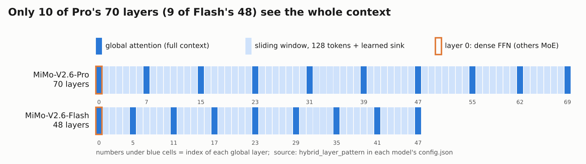
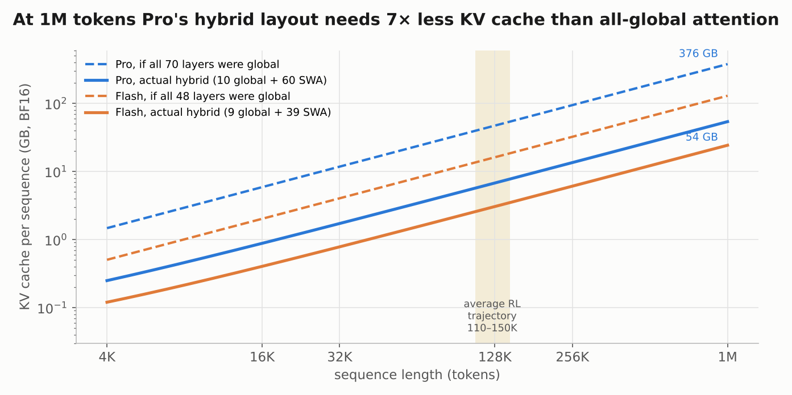

# The base model is the least reproducible stage of MiMo-V2.6

You cannot download the model that MiMo-V2.6's RL started from. Xiaomi released no V2.6 base checkpoint and no pre-RL checkpoint, only the RL outputs and the post-distillation `-MOPD` checkpoints ([collection](https://huggingface.co/collections/XiaomiMiMo/mimo-v26)). The [MiMo-V2.6 report](https://arxiv.org/abs/2610.11959) gives the architecture in full, the token counts per stage and the context schedule. It gives no data mixture, no learning-rate schedule, no batch size and no tokenizer details for V2.6 itself. The architecture you can read straight from the released `config.json` files. For the recipe, the closest public proxy is the earlier [MiMo-V2-Flash report](https://arxiv.org/abs/2601.02780), which V2.6 cites for its text backbone. The nearest public starting weights are [MiMo-V2.5-Pro-Base](https://huggingface.co/XiaomiMiMo/MiMo-V2.5-Pro-Base) (1.02T/42B) and [MiMo-V2-Flash-Base](https://huggingface.co/XiaomiMiMo/MiMo-V2-Flash-Base) (309B/15B). This part covers what a pre-training engineer needs to know before the RL parts: the hybrid attention layout and why it matters for rollouts, the speculative-decoding drafter, the pre-training stages, and the mid-training stage that prepared the model for RL.

Everything here is as of October 2026.

## What you would be rebuilding

Both checkpoints share one design and differ in size. The numbers below come from Table 1 of the report, the model cards and the released configs. They disagree only on Flash's size: 309B on the model card, 310B in Table 1 ([Pro config](https://huggingface.co/XiaomiMiMo/MiMo-V2.6-Pro-RL/blob/main/config.json), [Flash config](https://huggingface.co/XiaomiMiMo/MiMo-V2.6-Flash-RL/blob/main/config.json)).

| | MiMo-V2.6-Pro | MiMo-V2.6-Flash |
| --- | --- | --- |
| Parameters, total / active | 1.02T / 42B | 309B / 15B |
| Layers (global / sliding-window) | 70 (10 / 60) | 48 (9 / 39) |
| Hidden size | 6,144 | 4,096 |
| Query / KV heads, global layers | 128 / 8 | 64 / 4 |
| Query / KV heads, sliding-window layers | 128 / 8 | 64 / 8 |
| Head dim, QK / V | 192 / 128 | 192 / 128 |
| Routed experts / active, expert FFN width | 384 / 8, 2,048 | 256 / 8, 2,048 |
| Shared experts | none | none |
| Layer 0 | global attention, dense FFN (width 16,384) | same |
| Vocabulary, tied embeddings | 152,576, untied | 152,576, untied |
| Context | 1,048,576 tokens | 1,048,576 tokens |
| Pre-training tokens (text + omni) | 30T (27T + 3T) | 48T (26T + 22T) |

The model is natively omni-modal: a 681M-parameter vision encoder and two audio encoders (308M and 127M) feed the same backbone ([Pro model card](https://huggingface.co/XiaomiMiMo/MiMo-V2.6-Pro-RL)). For the RL story the backbone matters most, and two of its features shape everything later: sliding-window attention and the drafter.

## The backbone: hybrid sliding-window attention with sinks

**Most layers see only the last 128 tokens.** Each sliding-window (SWA) layer attends to a window of W = 128 tokens. Only the global-attention (GA) layers see the whole context. The released configs list the layout per layer in `hybrid_layer_pattern`:

Flash follows the 5:1 pattern that MiMo-V2-Flash introduced: one global layer after every five SWA layers, with a global layer first and last. Pro is sparser, with runs of 6–7 SWA layers between global ones. Layer 0 is global with a dense FFN; every other layer is MoE. The V2-Flash report says the dense first layer "stabilizes early representation learning" ([V2-Flash](https://arxiv.org/abs/2601.02780), §2).

**The sink lets a head attend to nothing.** A softmax over 128 positions must put all its probability somewhere, even when no token in the window is relevant. MiMo adds one learned scalar per head to the softmax denominator, so a head can push most of its mass to this "sink" instead. The released configs set `add_swa_attention_sink_bias: true` and `add_full_attention_sink_bias: false`: the sink lives only in the SWA layers. V2-Flash took the design from [gpt-oss](https://arxiv.org/abs/2508.10925). Its ablation on a 32B dense model is the evidence for it: hybrid SWA *without* the sink degraded on general benchmarks; *with* the sink it matched or beat an all-global baseline (V2-Flash §2).

**Why such a small window.** V2-Flash compared W = 128 against W = 512. The 512 window degraded after long-context extension and SFT; 128 held up. The authors' explanation is that a small window regularizes the model and splits the work cleanly: SWA layers do local processing, GA layers do long-range retrieval. They call the finding empirical (V2-Flash §2).

**RoPE differs by layer type.** In the V2.6 configs the SWA layers use `swa_rope_theta = 10,000` and the GA layers use `rope_theta = 10,000,000`. Only a third of each head rotates: `partial_rotary_factor = 0.334` × 192 = 64 dimensions. There is no `rope_scaling` entry, so 1M context is trained in, not extrapolated. V2-Flash used a GA base of 640,000 at 32K context and raised it to 5,000,000 for 256K (V2-Flash §3). V2.6's 10⁷ is one step further; the report does not describe the change. Lesson 02 explains why a raised base plus partial RoPE is the common recipe: [How open LLMs get long context](../02_long_context/README.md).

**Which of these details are V2-Flash's and which are V2.6's.** The V2.6 report describes the backbone in one paragraph and refers to "Core Team et al., 2026" for details. That citation is almost certainly the MiMo-V2-Flash report, whose author line is "Core Team" and which the V2.6 report also cites for the MTP module. The layout, window, sinks, head counts and RoPE bases above are read from V2.6's own configs. The *reasons* (the sink ablation, 128 vs 512, the dense first layer) are V2-Flash experiments; whether they were re-run at V2.6 scale is not stated.

### Worked example: the KV cache of one rollout

The hybrid layout matters for RL because rollouts are long and numerous. Each step keeps about 25,000 trajectories in flight, averaging 110–150K tokens ([report](https://arxiv.org/abs/2610.11959), §4.1). Count the KV cache per sequence for Pro in BF16:

- One token in one layer stores K and V for 8 KV heads: 8 × (192 + 128) × 2 bytes = **5,120 bytes**.
- The 10 GA layers keep every token: 10 × 5,120 × L bytes.
- The 60 SWA layers keep at most 128 tokens: 60 × 5,120 × 128 bytes ≈ 39 MB, whatever L is.

At L = 128K that is **6.8 GB** per sequence; if all 70 layers were global it would be 47 GB. At 1M it is 54 GB against 376 GB:

The hybrid layout cuts KV memory 7× for Pro and about 5× for Flash. The all-global baseline gives every layer the global layers' KV heads: 8 for Pro, 4 for Flash. Flash's figure matches V2-Flash's "nearly 6×" claim for the same 48-layer layout. Even so, a 128K trajectory still holds about 7 GB of KV, so the rollout scheduler must admit trajectories by predicted KV demand. [Part 3](03_rl_systems.md) covers that scheduler. Training also benefits: under context parallelism, the SWA layers exchange only window-sized KV between ranks, which keeps 1M-token training affordable (report §6.4).

### MoE and the checkpoint format

Every layer except layer 0 is a sparse MoE with top-8 routing and no shared expert. The V2-Flash report adds two details that likely carry over: the router runs in FP32, and load balancing uses a tiny sequence-level auxiliary loss (coefficient 10⁻⁵) plus an expert-bias update in the style of DeepSeek-V3 (V2-Flash §3). During RL the V2.6 router is **frozen**, because a trainable router collapsed expert balance within 20 steps ([Part 2](02_rl_algorithm.md) has the numbers).

The released checkpoints are low-precision. The config declares FP8 (`e4m3`, 128 × 128 blocks, dynamic activations) with `store_dtype: mxfp4` and `mxfp4_block_size: 32`, and excludes every attention output projection (`o_proj`) from quantization. Our reading, not stated on the card: the MoE experts ship in MXFP4, the format the model was trained to tolerate (see mid-training below).

## The vision and audio encoders, briefly

RL touches the encoders only through visual tasks, where the agent sees screenshots of its own web pages. Three facts are worth knowing (report §2.2–2.3):

- **MiMo-ViT** (681M parameters, 28 layers: 24 SWA + 4 global, patch 2 × 16 × 16, 2 × 2 spatial merge) uses sink-augmented SWA. Successive SWA layers alternate row-major and column-major token order, so information crosses window boundaries in both directions.
- The ViT was **pre-trained from scratch** on more than 4T image tokens. It was paired with a small pre-trained LLM, trained only with next-token cross-entropy on multimodal understanding data, with no contrastive loss.
- The **audio tokenizer** (308M, 24 layers) turns log-mel features into 25 Hz frames of 20 residual-VQ codes; it was trained on 20 million hours of audio. A 127M **patch encoder** groups four frames per patch, so audio enters the backbone at 6.25 Hz.

## The drafter: from MTP to block diffusion

Speculative decoding matters more in RL than in serving. Rollout generation took 43.8% of Pro's RL compute (report §4.1). Decoding is memory-bound, and the long tail of trajectories leaves GPUs running small batches.

**The MTP lineage.** [DeepSeek-V3](https://arxiv.org/abs/2412.19437) trained a multi-token-prediction (MTP) module next to the main model and noted it can be reused as a draft model for speculative decoding. MiMo-V2-Flash did the same with a 0.33B MTP block: dense FFN, SWA attention, one head during pre-training, replicated K times afterwards. The MTP loss weight was 0.3, then 0.1 in later stages. With three MTP layers it reports an acceptance length of up to 3.6 tokens and a 2.6× decoding speedup ([V2-Flash](https://arxiv.org/abs/2601.02780)).

**V2.6 switches to a DFlash drafter.** **[DFlash: Block Diffusion for Flash Speculative Decoding](https://arxiv.org/abs/2602.06036)** (Chen et al., 2026) drafts a whole block of tokens in one forward pass with a small block-diffusion model conditioned on the target model's features. It claims over 6× lossless speedup. The paper is the place to learn the mechanism; it says nothing about RL. V2.6's drafter has 5 SWA layers with dense FFNs. It is conditioned on backbone hidden features plus one clean anchor token. Each draft token attends bidirectionally within its block and to at most 1,024 positions before the anchor, and one pass proposes 7 tokens (report §2.4).

**What the RL run actually used** (report §6.4):

- **Block-6 DFlash**, not the MTP-3 configuration inherited from SFT. Average accepted length was **31.3% higher** than with MTP.
- Block-6 gave about **6% more global throughput** than block-8 in mixed-task RL. Larger blocks propose more tokens but lose more of them.
- Running the drafter in FP8 added about **10.3% per-node throughput** on a long-context workload.
- The drafter was first trained on the SFT policy, then **fine-tuned on early RL rollout logs**.

That last point is an RL-specific problem: the policy moves every step, so a drafter fit to the starting policy loses acceptance rate as training proceeds. The report does not say whether the drafter was refreshed later in the run.

## Pre-training: what V2.6 states, and the closest proxy

The V2.6 report gives this much (§3.1):

- **Two stages.** Stage 1 trains the text backbone on text. Stage 2 attaches the ViT and audio encoder and trains everything on omni-modal data.
- **Tokens.** Pro: 30T (27T text + 3T omni). Flash: 48T (26T text + 22T omni). The smaller model saw seven times more omni data.
- **Context.** 32K at the start, extended to 256K partway through.
- **Optimizer.** AdamW.
- **Data.** Text from web, books, papers, code and STEM sources. Vision data covers captioning, grounding, OCR, GUI, conversation, video and visual coding. Audio covers speech-text interleaving, ASR and audio captioning.

It gives no mixture weights, learning rates, batch sizes, warmup, decay schedule or tokenizer description.

**The proxy: MiMo-V2-Flash's published recipe.** The V2-Flash report is the most complete public description of a MiMo pre-training run. Treat every number below as V2-Flash's, not V2.6's:

| Setting | MiMo-V2-Flash (309B / 15B) |
| --- | --- |
| Tokens | 27T: general 0–22T at 32K, mid-training 22–26T (more code, ~5% synthetic reasoning), 26–27T at 256K |
| Optimizer | AdamW, β = (0.9, 0.95), weight decay 0.1, gradient clip 1.0 |
| Learning rate | warmup to 3.2 × 10⁻⁴ over 50B tokens, constant for 12T, cosine to 1.0 × 10⁻⁴ over 10T; then to 3 × 10⁻⁵ and 1 × 10⁻⁵ in later stages |
| Batch size | warmup to 2,048 sequences over 500B tokens; 256 in the 256K stage |
| Precision | FP8 mixed precision in the style of DeepSeek-V3; embeddings, output head and attention output projection in BF16, router in FP32 |
| MoE balancing | sequence auxiliary loss 10⁻⁵; expert-bias update 0.001, then 10⁻⁵ in the last stage |
| Init | std 0.006 for all parameters |

One more clue links V2.5 and V2.6. The [MiMo-V2.5-Pro-Base card](https://huggingface.co/XiaomiMiMo/MiMo-V2.5-Pro-Base) says it was "trained on 27T tokens using FP8 mixed precision and native 32k seq length", with the same 1.02T/42B shape as V2.6-Pro. That matches V2.6-Pro's 27T text stage exactly. *Inference:* V2.6-Pro may continue from the V2.5-Pro base, or share its text recipe. The report does not say either way. For a practical recreation, V2.5-Pro-Base is the closest public checkpoint you can start from.

## Mid-training: preparing the model for RL

Mid-training has three stated goals: build agentic ability, extend context to 1M, and "adapt the optimizer for large-batch RL" (report §3.2). It runs at 256K for most of its compute, then extends to 1M in the final stage. The data is "agent-centric": realistic agent trajectories across coding, general, visual and research tasks, mixed with high-quality text, repository-level code, and image, video and audio data.

Three changes made here carry straight into RL.

### 1. The optimizer switches to Muown

**What Muon does.** Muon applies SGD with momentum, then replaces each 2D update matrix with the nearest semi-orthogonal matrix, computed with a few Newton–Schulz iterations. All singular directions of the update then get the same step size, which amplifies small but useful directions that Adam-style updates leave near zero. Three explanations, in order of depth:

- **[Keller Jordan, "Muon: An optimizer for hidden layers in neural networks"](https://kellerjordan.github.io/posts/muon/)** (December 2024) is the original description, with the Newton–Schulz code and the rule for which parameters Muon should touch. It is empirical and short on theory.
- **[Jeremy Bernstein, "Deriving Muon"](https://jeremybernste.in/writing/deriving-muon)** derives the update as steepest descent under the RMS-to-RMS operator norm. Read it to understand *why* orthogonalization is the natural step for a linear layer.
- **[Moonshot, "Muon is Scalable for LLM Training"](https://arxiv.org/abs/2502.16982)** (2025) is the large-scale evidence. It adds weight decay and per-parameter update scaling to make Muon work at LLM scale.

**What Xiaomi changed and why.** The base model was trained with AdamW. In mixed-task RL experiments, AdamW "showed diminishing optimization efficiency as the batch size increased". Muon "retains stronger data efficiency beyond the critical-batch-size regime", so the hidden weight matrices switch to **Muown**, which "augments Muon with explicit row-norm control" to reduce spectral-norm drift and sensitivity to weight decay (report §3.2). The report gives no formula for the row-norm control. Prior work warns that switching from Adam to Muon mid-training can cause instabilities; Xiaomi reports no loss spikes.

The RL settings for Muown are the only hyperparameters published (report §5.1):

| Component | Setting |
| --- | --- |
| Learning rate | 3 × 10⁻⁶, no warmup, no weight decay, gradient clip 1.0 |
| Muon part (hidden matrices) | momentum 0.95, Nesterov on, 10 Newton–Schulz iterations, extra update scale 0.5 |
| Adam part (embeddings, LM head, router) | β₁ = β₂ = 0.95, ε = 10⁻⁸ |

**Why embeddings, the LM head and the router stay on AdamW.** The report states the split and gives no reason. The standard reasons, from Keller Jordan's post and the Moonlight paper, are these:

- An embedding table is a lookup, not a linear map. Each row receives gradient only when its token appears. Orthogonalizing the whole update would spread changes onto rows of tokens that were not in the batch.
- The LM head has the same row-per-token structure, with very uneven token frequencies; Keller Jordan reports that AdamW simply works better there.
- The router is a small matrix whose logits drive expert load. In RL it is frozen anyway.

**What the code release contains.** Muown is not in Xiaomi's [verl fork](https://github.com/XiaomiMiMo/verl). Upstream verl exposes plain Muon through Megatron-Core's "emerging optimizers" (`optimizer: muon` in `verl/trainer/config/optim/megatron.yaml`), and the released recipes all train the 9B model with Adam.

### 2. MXFP4 quantization-aware training

Rollouts run the MoE experts in **MXFP4**: 4-bit floating-point values (E2M1) that share one 8-bit power-of-two scale per block of 32 elements ([Microscaling Data Formats for Deep Learning](https://arxiv.org/abs/2310.10537)). Halving expert memory and bandwidth against FP8 speeds up memory-bound decoding. But a model trained in higher precision loses accuracy when its experts are rounded to 4 bits. So mid-training uses MXFP4 **quantization-aware training**: the forward pass sees quantized expert weights while the optimizer keeps high-precision master weights (report §3.2).

This choice ties the stages together:

- **RL starts from the SFT checkpoint's FP32 master weights and Muown row state**, carried over "to stabilize MXFP4 training" (report §5.1). It does not restart from a rounded BF16 export.
- After every RL update, the experts are quantize-dequantized so that the trainer and the MXFP4 rollout kernels see identical expert weights (report §6.4). [Part 3](03_rl_systems.md) explains why any trainer–sampler mismatch biases the RL gradient.

### 3. Self-correction data from earlier RL runs

Early MiMo RL experiments showed reward hacking. Xiaomi turned those trajectories into examples where the model reflects on its faulty reasoning, rewrites the offending turn and continues from the task specification, and added them to mid-training (report §4.2.6). It is a pre-training-stage fix for an RL failure. [Part 4](04_environments_and_grading.md) covers the hacks themselves.

After mid-training comes a short SFT stage, then RL. Both start in [Part 2](02_rl_algorithm.md).

## Published vs. missing

| Item | Status | Where |
| --- | --- | --- |
| Architecture: layers, heads, window, experts, sinks, RoPE bases | Released | `config.json` of the [-RL checkpoints](https://huggingface.co/collections/XiaomiMiMo/mimo-v26); report §2, Table 1 |
| Modeling code | Released | `custom_code` in the model repos; SGLang and vLLM serving recipes |
| Final weights (RL and post-MOPD) | Released | `MiMo-V2.6-{Pro,Flash}-RL`, `MiMo-V2.6-{Pro,Flash}-MOPD`, MIT |
| V2.6 base or pre-RL weights | Missing | none published; V2.5-Pro-Base and V2-Flash-Base are the nearest |
| Pre-training token counts, stages, context schedule | Described | report §3.1 |
| Pre-training data mixture, tokenizer training, LR, batch size | Missing | V2-Flash report gives a proxy for its own model |
| Mid-training data | Described (categories only) | report §3.2 |
| Muown optimizer | Described (no formula, no code) | report §3.2; RL hyperparameters in §5.1 |
| MXFP4 QAT | Described | report §3.2, §5.1, §6.4 |
| Vision and audio encoders | Weights released inside the checkpoints; training data described | report §2.2–2.3 |
| DFlash drafter | Architecture released and listed on the model card (the SGLang recipe enables speculative decoding); RL-time fine-tuning described only | report §2.4, §6.4 |

## What remains uncertain

- Whether V2.6-Pro's 27T-token text stage *is* the V2.5-Pro base. The token count, size and precision match; the report is silent.
- Which V2-Flash design findings were re-validated at V2.6 scale (sink ablation, 128 vs 512 window, dense first layer). We cite them as V2-Flash results.
- What "explicit row-norm control" means mathematically. Plausible readings include normalizing or capping row norms of the weight matrix after each step, but this is a guess.
- How the released checkpoint splits precision. The config shows FP8 blocks plus MXFP4 storage with `o_proj` excluded. We infer the experts are MXFP4; the card does not say.
- Whether the DFlash drafter was refreshed during RL, or only fine-tuned once on early rollout logs.
- The drafter's block size: the architecture section describes 7-token blocks, while the RL section uses "block-6". These may count differently (with or without the anchor token); the report does not reconcile them.

## Questions to think about

1. Using the worked example, compute Flash's KV cache per sequence at 128K tokens in BF16. How many such sequences fit in 80 GB after 30 GB of weights? What does that imply for how many GPUs the rollout fleet needs?
2. A SWA layer with W = 128 has no sink. Construct a case where every token in the window is irrelevant to the query, and say what the softmax is forced to do. Why is this worse for long agent trajectories than for short chat?
3. Flash saw 22T omni tokens, Pro only 3T. Give two reasons a lab might train the smaller model on far more multimodal data.
4. Mid-training switches optimizer from AdamW to Muown before RL. What could go wrong if the switch happened at the start of RL instead, with the learning rate at 3 × 10⁻⁶ and only 30 updates?
5. Why initialize RL from FP32 master weights rather than from the released MXFP4/FP8 checkpoint? What would you expect to see in the first RL steps if you started from the quantized export?
6. The drafter was fit to the SFT policy and the RL policy moves every step. Sketch a metric you would log to decide when to retrain the drafter.

## Further reading

- **[MiMo-V2.6 report](https://arxiv.org/abs/2610.11959)**, §2 (architecture), §3 (pre- and mid-training), §6.4 (drafter in RL).
- **[MiMo-V2-Flash report](https://arxiv.org/abs/2601.02780)**, §2–3. The full pre-training recipe and the hybrid-SWA ablations; the best proxy for V2.6's undisclosed settings.
- **[DFlash](https://arxiv.org/abs/2602.06036)** for block-diffusion drafting; **[DeepSeek-V3](https://arxiv.org/abs/2412.19437)** for the MTP objective MiMo inherited.
- **[gpt-oss model card](https://arxiv.org/abs/2508.10925)** for the learned attention sink that MiMo borrowed.
- **[Keller Jordan on Muon](https://kellerjordan.github.io/posts/muon/)**, **[Bernstein, "Deriving Muon"](https://jeremybernste.in/writing/deriving-muon)**, **[Muon is Scalable for LLM Training](https://arxiv.org/abs/2502.16982)**.
- **[Microscaling Data Formats for Deep Learning](https://arxiv.org/abs/2310.10537)** for MXFP4.
- Lesson 02 of this course, **[How open LLMs get long context](../02_long_context/README.md)**, for RoPE bases, partial RoPE and hybrid attention.
