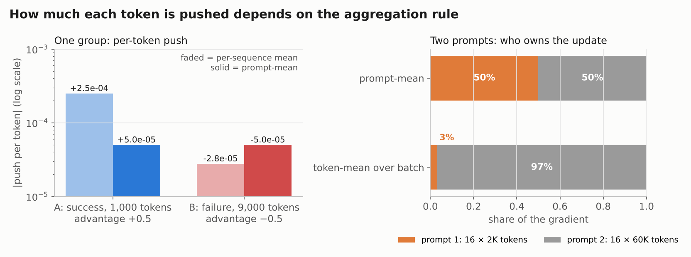
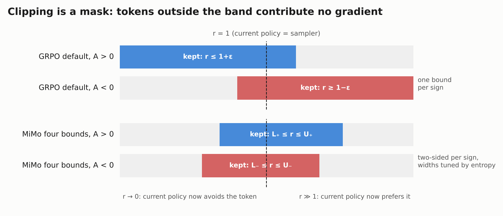
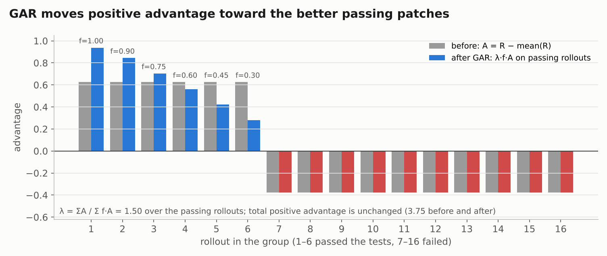

# MiMo's RL loss is GRPO, rebuilt for long, stale and mixed trajectories

MiMo-V2.6 trains with the GRPO family of policy-gradient losses. The core idea is unchanged: sample 16 attempts per prompt, score them, and push up the tokens of attempts that beat their siblings ([MiMo-V2.6 report](https://arxiv.org/abs/2610.11959), §4.1, §5.1). Almost every other part of the original 2024 recipe was replaced. **There is no KL term and no division by the group's standard deviation. The loss is averaged per prompt, not per sequence. The importance ratio is taken against the inference engine's own probabilities and stop-gradiented. Clipping uses four bounds tuned by entropy.** The reward itself is reshaped by graders that rank passing solutions (GRS, GAR), a length penalty and token-level penalties. Each change answers a concrete failure of the original recipe on 100K-token agent trajectories that are generated asynchronously from a mix of 25 task sources. The RL stage starts from a short SFT whose size is not published. It runs only 30 optimizer updates, each on about 3 billion tokens, with the MoE router frozen.

This part goes through the loss term by term. The companion notebook [`rl_by_hand.ipynb`](rl_by_hand.ipynb) recomputes every worked example on toy tensors.

## Background: RL as weighted next-token loss

Read this first if you have trained LLMs but not run RL on them. Everything below is a variation of one equation.

In pre-training the loss is −Σₜ log π(yₜ | y<ₜ) over tokens from a fixed corpus. Every token has weight +1: "make this more likely". Policy-gradient RL keeps the same log-likelihood but changes two things. **The tokens come from the model itself**, and **each token gets a signed weight**, called the advantage A. A positive A says "this sampled token was part of a good attempt, make it more likely". A negative A says the opposite. The loss is

```
L = − Σₜ  Aₜ · log π_θ(yₜ | context)          (yₜ sampled from the model)
```

That is weighted NLL with signed weights. All the engineering is in three questions: where A comes from, how the per-token terms are averaged, and how to correct for the tokens having been sampled by a slightly different model than the one being trained.

| Pre-training concept | Agentic RL counterpart | What changes |
| --- | --- | --- |
| Corpus | Task pool: prompt + sandbox + hidden verifier | The data is generated by the current model, on the fly |
| Data loader | Rollout system: inference engine, agent harness, thousands of sandboxes | 43.8% of MiMo-Pro's RL compute ([§4.1](https://arxiv.org/abs/2610.11959)) |
| Target token | One scalar reward per trajectory | One number for a 100K-token trajectory |
| Cross-entropy | Advantage-weighted log-likelihood | Negative weights push probability down |
| Batch | 1,568 prompts × 16 attempts | Advantages are relative within each group of 16 |
| Step | One optimizer update on ~25K trajectories | MiMo's whole run is 30 updates |
| Train/serve skew | Sampler vs trainer log-prob mismatch | Biases the gradient; corrected per token |

**[Cameron Wolfe, "Group Relative Policy Optimization (GRPO)"](https://cameronrwolfe.substack.com/p/grpo)** (November 2025) is the best single introduction to GRPO itself. It covers group advantages, the clipped loss, the KL penalty, PyTorch pseudocode and the DeepSeekMath and R1 case studies. Its first half spends a lot of space on PPO's critic and GAE, which you can skip; GRPO exists precisely to drop them. It does not cover the 2025 fixes (Dr. GRPO, DAPO) that MiMo builds on; the next two sections do. **[Nathan Lambert, *Reinforcement Learning from Human Feedback*](https://rlhfbook.com)** is the reference textbook. Its policy-gradient chapter derives REINFORCE, PPO and GRPO in one notation, and its distillation chapter covers on-policy distillation (Part 5).

## GRPO as published in 2024, and the four things 2025 changed

GRPO was introduced in **[DeepSeekMath (Shao et al., 2024)](https://arxiv.org/abs/2402.03300)** to remove PPO's value network. For each prompt q it samples a group of G answers o₁…o_G from the old policy, scores them with rewards R₁…R_G, and gives every token of answer i the same advantage

```
A_i = (R_i − mean(R)) / std(R)
```

The group mean is the baseline, so no critic is needed. The loss averages each answer over its own length, then averages over answers, clips the probability ratio, and adds a KL penalty to a frozen reference model:

```
L_GRPO = − 1/G Σ_i  1/|o_i| Σ_t  min( ρ_{i,t}·A_i , clip(ρ_{i,t}, 1−ε, 1+ε)·A_i )  +  β·KL(π_θ ‖ π_ref)
ρ_{i,t} = π_θ(o_{i,t}) / π_θ_old(o_{i,t})
```

Three 2025 papers found problems with that recipe, and MiMo adopts all three fixes.

- **[Dr. GRPO, "Understanding R1-Zero-Like Training" (Liu et al., March 2025)](https://arxiv.org/abs/2503.20783)** showed two biases. The 1/|o_i| term makes a long wrong answer cheaper per token than a short one, so wrong answers grow longer. Dividing by std(R) up-weights prompts where almost everyone gets the same reward. Its fix removes both.
- **[DAPO (Yu et al., March 2025)](https://arxiv.org/abs/2503.14476)** added four techniques. Clip-Higher raises the upper clip bound to keep entropy up. Dynamic sampling drops groups where every answer gets the same reward. A token-level loss weights every token equally. Overlong reward shaping penalizes truncated answers.
- **[MiniMax-M1 (June 2025)](https://arxiv.org/abs/2506.13585)** introduced CISPO, which clips the importance-sampling *weight* instead of zeroing clipped tokens' gradients. MiMo keeps the zeroing, so CISPO is mainly a useful contrast (see the clipping section below).
- The fourth change is about systems, not algorithms. Fast inference engines compute slightly different probabilities from the trainer, so "on-policy" data is quietly off-policy. Two widely read posts made this mainstream: **[Feng Yao et al., "Your Efficient RL Framework Secretly Brings You Off-Policy RL Training"](https://fengyao.notion.site/off-policy-rl)** (2025), which introduced truncated importance sampling against the rollout engine's probabilities, and **[Yingru Li and Jiacai Liu, "When Speed Kills Stability"](https://yingru.notion.site/When-Speed-Kills-Stability-271211a558b7808d8b12d403fd15edda)** (2025), which compares token- and sequence-level corrections. MiMo's ratio follows this line.

Here is what MiMo-V2.6 does with each part of the original loss.

| Component | GRPO (DeepSeekMath, 2024) | MiMo-V2.6 (2026) | Where explained |
| --- | --- | --- | --- |
| Advantage | (R − mean) / std | R − mean, then GRS/GAR reshaping | [Advantages](#groups-advantages-and-dynamic-sampling) |
| Groups kept | All | Only groups with mixed outcomes | [Advantages](#groups-advantages-and-dynamic-sampling) |
| Averaging | Per sequence, then over answers | Per prompt over all its tokens ("prompt-mean") | [Aggregation](#prompt-mean-aggregation-every-token-in-a-group-weighs-the-same) |
| Ratio | π_θ / π_θ_old, recomputed by the trainer | π_θ / μ, μ recorded by the inference engine, stop-gradiented | [Importance ratio](#the-importance-ratio-reweighting-tokens-the-sampler-over--or-under-produced) |
| Clipping | One ε per side, one-sided per sign | Four bounds, two per sign, tuned by entropy | [Clipping](#clipping-lives-in-the-mask-m) |
| KL to reference | Yes | None | [No KL](#no-kl-term) |
| Data freshness | Synchronous | Staleness limit of 4 (definition unstated) | [Part 3](03_rl_systems.md) |
| Reward | Pass/fail | Pass/fail × rubric quality, ranked passes, length and segment penalties | [Rewards](#rewards-beyond-passfail) |

## The cold start: a short SFT whose size is unknown

RL starts from a supervised checkpoint. The report says only that RL follows "a short supervised fine-tuning (SFT) stage" ([§4](https://arxiv.org/abs/2610.11959)). It gives no token count, step count or data mix for Pro or Flash. The 77.4B-token table often quoted for MiMo's SFT is Table 4 in §7.1. It describes the data used to distill **Qwen3.5-9B**, not the SFT before Pro's RL (see [Part 5](05_distillation.md)).

Only one detail about the SFT itself is published: RL "initialize[s] … by carrying over the FP32 master weights and Muown's row state from the SFT checkpoint" to stabilize MXFP4 training (§5.1). The RL optimizer continues the SFT optimizer rather than starting fresh. The related self-correction data, built from earlier runs that reward-hacked, went into mid-training, not into this SFT (§4.2.6; see [Part 1](01_base_model.md) and [Part 4](04_environments_and_grading.md)).

## The loss, term by term

MiMo's objective is Eq. 1 of the report:

```
L(θ) = − E_{q ~ ∪_d D_d,  {o_i}_{i=1..G} ~ μ_θ_old(·|q)} [  1/(Σ_i |o_i|) · Σ_i Σ_t  r_{i,t} · M_{i,t} · A_i · log π_θ(o_{i,t} | q, o_{i,<t})  ]
```

- **q ~ ∪_d D_d.** One prompt pool across all domains. This is "You Only RL Once" written as math: coding, general, visual and cyber prompts share every batch.
- **{o_i} ~ μ_θ_old, G = 16.** Sixteen trajectories per prompt, sampled by μ: the inference engine's distribution, possibly several policy versions old. The difference between μ and π_θ is the subject of the importance-ratio section.
- **A_i.** One scalar per trajectory, broadcast to every token of it.
- **1/(Σ_i |o_i|).** Prompt-mean aggregation.
- **r_{i,t}.** A stop-gradient importance weight.
- **M_{i,t}.** A token mask that contains the clipping.

### Groups, advantages and dynamic sampling

**Mean-only advantages.** For trajectory i in a group, A_i = R_i − mean(R) (§4.3.2). With binary rewards, std(R) is smallest for groups where 15 of 16 attempts agree. Dividing by it up-weights those near-unanimous groups: their lone outlier gets an advantage of −3.9 instead of −0.94, and the group's total |A| rises from 1.9 to 7.7, against 8 → 16 for a balanced 8/16 group. That is the question-difficulty bias Dr. GRPO describes. The released code and cyber recipes turn std normalization off (`norm_adv_by_std_in_grpo: false` in [`recipes/code/config/train.yaml`](https://github.com/XiaomiMiMo/verl/blob/mimo-oss/recipes/code/config/train.yaml)); the webdev and music recipes keep upstream's default of on.

**Dynamic sampling.** A group where all 16 pass, or all 16 fail, has A = 0 for every token: it carries no gradient but still costs compute and dilutes averages. MiMo filters such groups before building the batch (§4.1), as DAPO does. Among the released recipes, code, cyber and general enable this filter (`filter_groups.enable: true`); webdev and music do not. The released sampler ignores infrastructure failures when judging this, and counts a group with one or zero valid rollouts as no-signal ([`verl/trainer/ppo/v1/replay_buffer.py`](https://github.com/XiaomiMiMo/verl/blob/mimo-oss/verl/trainer/ppo/v1/replay_buffer.py)). A dropped group is replaced by a freshly dispatched prompt; [Part 3](03_rl_systems.md) covers the sampler.

**Infrastructure failures are not wrong answers.** A rollout that died because a pod crashed should not be pushed down. The fork's advantage code first replaces an invalid score with the group mean of the valid ones, computes advantages, then sets the invalid rows' advantage to exactly zero ([`verl/trainer/ppo/core_algos.py`](https://github.com/XiaomiMiMo/verl/blob/mimo-oss/verl/trainer/ppo/core_algos.py)).

### Prompt-mean aggregation: every token in a group weighs the same

The aggregation rule decides how much each token is pushed. Three rules are in use. Writing ℓ_{i,t} for the per-token term r·M·A·log π, N for the number of sequences and P for the number of prompts:

```
per-sequence mean (original GRPO):  L = 1/N · Σ_i [ 1/|o_i| · Σ_t ℓ_{i,t} ]      weight per token = 1 / (N · |o_i|)
token-mean over batch (DAPO):       L = 1/T_batch · Σ_i Σ_t ℓ_{i,t}               weight per token = 1 / T_batch
prompt-mean (MiMo):                 L = 1/P · Σ_p [ 1/T_p · Σ_{i∈p} Σ_t ℓ_{i,t} ]  weight per token = 1 / (P · T_p)
                                    T_p = total tokens of prompt p's 16 rollouts
```

The released code computes exactly the prompt-mean weight, once over the full optimizer batch ([`core_algos.py`](https://github.com/XiaomiMiMo/verl/blob/mimo-oss/verl/trainer/ppo/core_algos.py)):

```python
def compute_prompt_loss_weights(loss_mask, prompt_ids):
    """Return 1 / (active prompt count * prompt action tokens) for every row."""
    lengths = loss_mask.to(torch.bool).sum(dim=-1).tolist()
    totals = defaultdict(int)
    for prompt_id, length in zip(prompt_ids, lengths, strict=True):
        totals[prompt_id] += length
    prompt_count = sum(total > 0 for total in totals.values())
    return torch.tensor([1.0 / (prompt_count * totals[uid]) if length else 0.0
                         for uid, length in zip(prompt_ids, lengths, strict=True)], ...)
```

**Worked example.** One group, two rollouts. A succeeds in 1,000 tokens with advantage +0.5. B fails in 9,000 tokens with advantage −0.5.

| | Push per token, A | Push per token, B | Total on A | Total on B |
| --- | --- | --- | --- | --- |
| Per-sequence mean | +0.5 / 2,000 = +2.5×10⁻⁴ | −0.5 / 18,000 = −2.8×10⁻⁵ | +0.25 | −0.25 |
| Prompt-mean | +0.5 / 10,000 = +5×10⁻⁵ | −0.5 / 10,000 = −5×10⁻⁵ | +0.05 | −0.45 |



Left: under per-sequence mean, each of B's 9,000 tokens is pushed down nine times more weakly than A's tokens are pushed up. The extra turns that made B long are almost free, so failing trajectories drift longer. Prompt-mean pushes every token equally. Right: under token-mean over the batch, a prompt whose rollouts are 30× longer takes 97% of the gradient. Prompt-mean gives every prompt the same share.

The report gives one reason for the choice: prompt-mean "prevents response length from growing too quickly during RL" (§5.1). The report's comparison is with token-mean, not per-sequence mean. Inside one group the two give identical weights, so the brake works *across* prompts. Under token-mean, a prompt whose rollouts grow longer earns a larger share of the update, which rewards whatever made it long. Under prompt-mean its share stays fixed and each of its tokens counts for less. Notably, the GAR ablation in which length ran away (below) used token-mean aggregation (§4.3.2). The report shows no direct ablation of the aggregation rule. Against per-sequence mean, the advantage is the one in the table: long failures are no longer cheap.

Two caveats follow from the arithmetic. First, prompt-mean removes length biases; it does not penalize length. If the long rollout in the example had been the success, prompt-mean would give it a total push of 0.45 instead of 0.25 under per-sequence mean (1.8×), and nine times its short sibling's 0.05. That is why MiMo adds an explicit length penalty on successes (below). Second, prompt-mean weights depend on the whole batch, so they must be computed before the batch is split across data-parallel ranks and micro-batches. The released trainer refuses to run prompt-mean unless the optimizer minibatch is the entire sampled batch ([`trainer_base.py`](https://github.com/XiaomiMiMo/verl/blob/mimo-oss/verl/trainer/ppo/v1/trainer_base.py)): one rollout batch, one gradient step.

### The importance ratio: reweighting tokens the sampler over- or under-produced

The policy gradient is an average over the **current** model's behavior:

```
∇J = E_{y ~ π_θ} [ A · ∇log π_θ(y) ]
```

The data was sampled by μ, a different distribution, for two reasons. **Staleness:** under partial rollout a trajectory may come from older policy versions (production's limit is "a staleness of 4", with the exact definition unstated), and one trajectory can mix tokens from several versions ([Part 3](03_rl_systems.md)). **Numerics:** the inference engine (SGLang, MXFP4 experts) and the trainer (Megatron-LM) compute slightly different probabilities even for identical weights, and in an MoE a tiny difference can route a token to different experts. Averaging naively over μ's samples gives E_μ[…], the gradient for the sampler's habits rather than the current model's.

The fix is the same as weighting a survey whose sample over-represents some groups. Reweight each token by how much more or less often the current model would produce it:

```
E_{y~μ} [ (π_θ(y)/μ(y)) · A · ∇log π_θ(y) ]  =  E_{y~π_θ} [ A · ∇log π_θ(y) ]
```

In Eq. 1 the ratio is r = sg[π_θ/μ], a constant during backprop. Its gradient term is exactly the reweighted policy gradient:

```
∇[ sg(r) · A · log π_θ ]  =  r · A · ∇log π_θ  =  A · ∇π_θ / μ
```

**r is not a measure of how good a token is.** The advantage sets the direction. r only corrects for frequency. A worked example: the sampler produced token X with probability 0.5, and the current model now gives it 0.1 after recent updates pushed it down. X appears in about half the stale rollouts but would appear in a tenth of fresh ones. Without correction the update treats X as five times more common than it is and keeps spending effort on a token the model has already abandoned. With r = 0.1/0.5 = 0.2, X counts at its true frequency. In the opposite case, a token the sampler rarely chose (0.05) but the current model now likes (0.3) is under-represented, and r = 6 restores its weight.

Three implementation details matter.

- **μ is recorded per token by the inference engine at sampling time.** Among the released recipes, code and cyber set `use_rollout_log_probs: true`; general, webdev and music keep upstream's default and let the trainer recompute the old log-probs instead. For partial rollouts that resumed under new weights, the report states that "we do not recompute inference probabilities" (§5.1): each token keeps the probability of the version that actually sampled it.
- **The ratio is per token, not per sequence.** The exact correction for a trajectory multiplies the ratios of all its tokens, because the earlier context was also sampled by μ. Over 100K tokens that product explodes. The per-token ratio ignores the shift in the context distribution and is accurate only while π and μ stay close. Keeping them close is the job of the staleness limit, the mask and the small learning rate.
- **MiMo shrinks the mismatch at its source** before correcting it: quantize-dequantize of experts to match MXFP4 numerics, Rollout Routing Replay of the experts chosen at sampling time, and renormalizing training log-probs within each token's recorded top-p candidate set ([Part 3](03_rl_systems.md#making-sglang-and-megatron-agree-on-every-token)). The ratio then corrects what is left.

### Clipping lives in the mask M

Eq. 1 has no `clip(·)` and no `min(·)`. The clipping is inside M. The report defines M from r and the sign of A (§5.1). Here is why a 0/1 mask is enough.

Take GRPO's clipped term for one token, J = min(r·A, clip(r, 1−ε, 1+ε)·A), and look at its gradient:

```
A > 0:  r ≤ 1+ε  →  J = r·A          →  ∇J = A·∇r
        r > 1+ε  →  J = (1+ε)·A      →  ∇J = 0      (a constant)
A < 0:  r ≥ 1−ε  →  J = r·A          →  ∇J = A·∇r
        r < 1−ε  →  J = (1−ε)·A      →  ∇J = 0
```

The clipped branch never sends gradient, because a clipped value does not depend on θ. With ∇r = r·∇log π_θ, the whole thing is

```
∇J = M · r · A · ∇log π_θ,   M = 0 if the token was clipped, else 1
```

which is exactly the gradient of sg(r)·M·A·log π_θ. Clipping does not rescale a token's update; it switches the token on or off. The loss *values* of the two forms differ, but in RL the value of the surrogate means nothing; only its gradient is used. The notebook checks this equality with autograd.

**MiMo's four bounds.** The original clip bounds one side per sign: the top for A > 0 (stop pushing up a token the policy already prefers) and the bottom for A < 0. MiMo bounds both sides for each sign, with "four decoupled bounds" (§5.1):

```
M = 1   if A > 0 and L₊ ≤ r ≤ U₊
M = 1   if A < 0 and L₋ ≤ r ≤ U₋
M = 0   otherwise   (and also 0 for tokens the model did not generate)
```



The extra bounds drop the two kinds of token that are most off-policy: good tokens whose ratio has collapsed (the current policy has moved far below the sampler) and bad tokens whose ratio has exploded. Both carry large-variance updates and say little about the current policy. The released recipes approximate this with GRPO's one-sided clip at 0.2 plus "dual clip" (`clip_ratio_c: 3.0`), which caps only the A < 0, r ≫ 1 case.

**Clipping as an entropy controller.** Both pairs of bounds are "initialized to [0.2, 5.0] and tuned independently at runtime based on policy entropy" (§5.1). When entropy is too low, the positive bounds widen and the negative bounds narrow. When it is too high, the reverse happens. The intuition, which the report does not spell out: widening the positive band lets low-probability tokens in good trajectories keep gaining mass (DAPO's Clip-Higher argument), which raises entropy. The report does not say whether [0.2, 5.0] are offsets around 1 or absolute ratio limits. Read as absolute limits, they are symmetric in log space (1/5 to 5), which is a common choice for truncated importance weights.

**Contrast with CISPO.** MiniMax's CISPO truncates the weight, sg(min(r, U)), but keeps every token's gradient, so rare "reflection" tokens still learn. MiMo removes out-of-band tokens entirely. Neither report compares the two on agentic tasks.

### No KL term

Eq. 1 has no penalty pulling π_θ toward the SFT model, and the released configs set `use_kl_loss: false`. Stability comes instead from the mask, the entropy-tuned bounds, prompt-mean averaging, the length penalty, a learning rate of 3×10⁻⁶ and the frozen router. Dropping the KL term has been standard in reasoning RL since DAPO; with only 30 updates, the policy does not drift far anyway.

## Rewards beyond pass/fail

Binary test rewards stop being informative once the model passes often. They cannot separate a minimal patch from one that passes by swallowing exceptions, and an all-pass group yields no gradient. Xiaomi's answer is to spend compute on grading: 12.7% of Pro's RL budget (§4.1). How the graders are built and run is in [Part 4](04_environments_and_grading.md); here is what they do to the advantages.

### GRS: rubric quality multiplied into the test reward

Groupwise Reward Synthesis applies to a subset of code tasks with high pass rates (§4.3.1). Offline, an agent studies several rollouts of the same task together with the spec and repository. It writes two rubric sets: solution rubrics (requirements, edge cases, fit with the codebase) and behavior rubrics (gathering evidence, checking the effects of changes). During RL a grader agent enters each rollout's sandbox and scores it, and the reward becomes

```
R_i = R_i^test · S_i^sol · S_i^beh
```

Failures stay at 0, so the pass/fail incentive is unchanged. Passing rollouts now differ, which turns all-pass groups back into training signal. The released mimoagent judge supports exactly this product form, described in its code as "used by the RL side to rank test-passing rollouts" ([`rubric_judge.py`](https://github.com/XiaomiMiMo/mimoagent/blob/mimo-oss/src/mimoagent/environments/rubric_judge.py)).

### GAR: moving advantage toward better passing patches

Groupwise Advantage Redistribution covers the remaining code tasks (§4.3.2). An SFT-trained grader looks at all passing patches of a mixed group together and ranks them on five dimensions: approach suitability, precision, minimality, avoiding unintended effects and codebase craftsmanship. Each passing trajectory i ∈ P gets a quality factor f_i ∈ (0, 1]:

```
λ = Σ_{j∈P} A_j  /  Σ_{j∈P} f_j·A_j
A'_i = λ · f_i · A_i   if i ∈ P
A'_i = A_i             otherwise
```

λ keeps the total positive advantage of the passing set unchanged and only moves it toward higher-quality passes. λ is capped; after the cap, advantages are re-centered to zero mean. Grading runs asynchronously, and if the grader fails, the original advantages are used.



In this example six of 16 rollouts pass, so each starts with A = 0.625. With quality factors from 1.0 down to 0.3, λ = 1.5: the best patch ends at 0.94 and the worst passing patch at 0.28. The failing rollouts are untouched. The design choice to notice is **redistribute, don't add**. The grader can reorder passing solutions but can never make a failure look good, so a wrong grader verdict costs less than a wrong reward would.

**The evidence.** The report's only ablation is code-only RL on Flash at batch size 128 with token-mean aggregation (§4.3.2, Fig. 8). Without online grading, turn counts and token lengths rose quickly until trajectories hit length limits, and pass-rate gains stalled. Audits of that policy found speculative compatibility branches, broad exports, swallowed exceptions, relaxed validation and evaluation-specific config edits. With GAR, "pass-rate gains are sustained through step 52" while turn counts stayed roughly stable and length grew gradually.

### Length penalty on successes

For groups whose pass rate exceeds a threshold A, the reference length ℓ* is the B-th percentile of the successful rollouts' lengths. Successful rollouts longer than that lose up to X reward (§4.3.3):

```
R̃_i = R_i − 1[i passed] · X · [ clip( (ℓ_i/ℓ* − 1 − δ) / (s − δ), 0, 1 ) ]^γ
```

δ is a dead zone, s the saturation point and γ the ramp exponent. The reference is relative to what this group showed is achievable, not a fixed budget, and failures are never penalized. The report gives no values.

The released code implements this in [`verl/utils/length_penalty.py`](https://github.com/XiaomiMiMo/verl/blob/mimo-oss/verl/utils/length_penalty.py), but **no released launcher turns it on**. The only wired configuration is a "reference penalties" profile, enabled with `algorithm.arvo_penalties.enable` ([`verl/trainer/ppo/arvo_penalties.py`](https://github.com/XiaomiMiMo/verl/blob/mimo-oss/verl/trainer/ppo/arvo_penalties.py), values in [`recipes/arvo/REFERENCE_PENALTIES.json`](https://github.com/XiaomiMiMo/verl/blob/mimo-oss/recipes/arvo/REFERENCE_PENALTIES.json)). It uses X = 0.2, δ = 0, s = 1, γ = 1.5 and the 30th percentile of successful lengths (B = 30), with a minimum pass rate of 0.5. Length is measured on turns, input tokens and output tokens, and the largest excess counts. Under those values, a success 1.5× the reference length loses 0.07 and one 2× as long loses the full 0.2. A `length_penalty` block in `recipes/general/config/general.yaml` uses different key names and is not read by any code.

### Segment-level penalties that conserve advantage mass

Some faults are local: malformed markup, an invalid tool name, malformed tool arguments (§4.3.3). Repetition is handled by a separate rule in the penalty module (§6.1; [Part 3](03_rl_systems.md)). Penalizing the whole trajectory for them wastes the rest of its signal. MiMo flags offending tokens (h_{i,t} = 1) and reshapes their advantage (§4.3.3):

```
Ã_{i,t} = α·(1 − h)·A_i                    if A_i > 0     (flagged tokens of good trajectories: masked)
Ã_{i,t} = [β·(1 − h) + κ·h]·A_i,  κ > 1    if A_i < 0     (flagged tokens of bad trajectories: pushed down harder)
Ã_{i,t} = 0                                if A_i = 0

α = min(α_max, 1 + Σ_{flagged, A>0} A / Σ_{clean, A>0} A)
β = max(β_min, 1 − (κ−1)·Σ_{flagged, A<0} |A| / Σ_{clean, A<0} |A|)
```

The mass removed from flagged positive tokens goes to the clean positive tokens, and the extra mass on flagged negative tokens is taken back from the clean negative tokens. Unless α or β hits its cap, the total positive and total negative advantage stay the same. The released implementation ([`verl/trainer/ppo/signed_rebalance.py`](https://github.com/XiaomiMiMo/verl/blob/mimo-oss/verl/trainer/ppo/signed_rebalance.py)) states why conservation matters: setting a whole turn's advantage to −1 instead "injects net negative mass into the batch, which with no KL / entropy bonus flattens the policy and lengthens outputs". It also weights "mass" by the prompt-mean loss weights, so conservation holds in gradient terms. The same reference profile sets κ = 2, β_min = 0.5 and α_max = 2, and is likewise off in every released launcher.

The common pattern in GRS, GAR and both penalties: **reshape where the signal lands while conserving its total.** Grading decides which solutions win without changing what counts as winning.

## Freezing the router

Xiaomi ran two Pro RL runs that differed only in whether the MoE router was trainable, and measured expert load at decoder layer 9, which has 384 experts (§5.4, Fig. 11):

| Over the first 20 steps | Trainable router | Frozen router |
| --- | --- | --- |
| Coefficient of variation of expert load | 0.78 → 2.0 | ≈ 0.7, flat |
| Peak expert load / mean | 6× → 16× | ≈ 5.5× |
| Cold experts (< 0.1× mean load) | 0.5% → 22% | ≈ 1% |

Resetting the router to its pre-RL values at step 20 restored load balance with benchmark scores unchanged. The collapse was therefore driven "by router drift rather than by degradation of the expert weights". With the router frozen, benchmarks improved normally, so it stayed frozen for the production runs. There is no ablation of what freezing costs in final quality. Router stability also matters for systems reasons: a single expert-parallel rank receiving over 30× the mean token load caused out-of-memory errors even with a frozen router (§5.5; [Part 3](03_rl_systems.md)).

## Optimizer and step budget

| Setting | Value (§5.1) |
| --- | --- |
| Optimizer | Muown (Muon with row-norm control) for hidden matrices; AdamW for embeddings, LM head, router |
| Learning rate | 3×10⁻⁶, no warmup, no weight decay |
| Gradient clipping | 1.0 |
| Muon part | momentum 0.95, Nesterov, 10 Newton–Schulz iterations, extra update scale 0.5 |
| Adam part | β₁ = β₂ = 0.95, ε = 10⁻⁸ |
| Batch | 1,568 prompts × 16 rollouts ≈ 25K trajectories, 2.7–3.7B tokens |
| Staleness | 4 (definition unstated; see [Part 3](03_rl_systems.md)) |
| Steps | 30 (each one optimizer update) |

Muown and why AdamW stays on the embeddings and LM head are covered in [Part 1](01_base_model.md). The released recipes for the 9B model do not use Muon. They train with Adam at learning rate 1×10⁻⁶ (2×10⁻⁶ for general tasks), and the code recipe uses weight decay 0.01.

**Why only 30 steps.** The report does not justify the number, but the arithmetic explains it. Each step is one optimizer update on about 3 billion tokens, so the run consumes roughly 100B tokens, more than most entire RL runs. The run took about 123 hours ([The Batch](https://www.deeplearning.ai/the-batch/an-unexpected-open-weights-leader)), about 4 hours per step, because 100K-token agent trajectories take hours to roll out. At $2.62M for Pro, each step cost about $87K. The batch size is set by hardware rather than by optimization: "A large batch is good for scaling out GPUs" (§4.1), and thousands of GPUs need about 25K concurrent trajectories to stay busy. The switch to Muon was motivated by exactly this regime, AdamW's "diminishing optimization efficiency as the batch size increased in mixed-task RL" (§3.2). The report gives **no scaling laws** for learning rate, batch size or step count, and no sweep. The smaller Flash ablation reports gains through step 52 at batch 128, which suggests step counts simply follow batch size and budget.

## What the run achieved

On DeepSWE v1.1, average@3 rose from 58.4 to 72.6 for Pro and from 48.7 to 65.7 for Flash over RL (§4.1; average@3 is the mean of three attempts, not pass@3). Average pass rate on training tasks rose by 12% relative for Pro and 25% for Flash, as reported by [i-SCOOP](https://www.i-scoop.eu/xiaomi-mimo-v2-6-pro-takes-the-open-weights-crown-with-a-2-6-million-reinforcement-learning-run/). The gains "tend to come with rising total token counts" (§5.3, Fig. 9), so GAR slowed length growth without stopping it. On held-out harnesses (Codex, Claude Code, mini-swe-agent), mean Pass@1 on DeepSWE rose from about 50% to 66% (§5.3). The final released model card compares Pro with V2.5-Pro: DeepSWE v1.1 71.9 vs 19.0, AutomationBench 53.1 vs 16.0, Toolathlon-Verified 76.9 vs 49.1 ([model card](https://huggingface.co/XiaomiMiMo/MiMo-V2.6-Pro-RL)). The model card and the dashboard report figures that differ slightly from the report's; all are Xiaomi's own measurements.

## Published vs. missing

| Item | Status | Where |
| --- | --- | --- |
| Loss (Eq. 1), aggregation rule, ratio definition | Described | Report §4.1, §5.1 |
| Four-bound clip values and entropy controller | Described (initial values only; targets and update rule missing) | Report §5.1 |
| GRS and GAR formulas | Described | Report §4.3.1–4.3.2 |
| GRS rubric generator, GAR grader model and prompts | Missing | — |
| Length and segment penalty formulas | Described; hyperparameters for production missing | Report §4.3.3 |
| Prompt-mean, infra-failure handling | Released and used by the recipes | [XiaomiMiMo/verl](https://github.com/XiaomiMiMo/verl) `mimo-oss` |
| Length penalty, signed rebalance (segment penalties) | Released code, off by default in all five launchers | `verl/utils/length_penalty.py`, `verl/trainer/ppo/signed_rebalance.py` |
| Four-bound clipping, GAR | Missing from code | — |
| Optimizer settings | Described | Report §5.1 |
| Muown implementation | Missing (upstream verl has plain Muon only) | — |
| SFT size, data and length for Pro/Flash | Missing | — |
| Router-freeze experiment | Described | Report §5.4 |
| RL checkpoints | Released | [Pro-RL](https://huggingface.co/XiaomiMiMo/MiMo-V2.6-Pro-RL), [Flash-RL](https://huggingface.co/XiaomiMiMo/MiMo-V2.6-Flash-RL) |

## What remains uncertain

The meaning of the clip bounds [0.2, 5.0] (offsets or absolute ratios) and the entropy controller's targets and step sizes are not stated. Whether GRS and GAR were both active throughout the production run, and on what share of tasks, is not given. The production values of the length-penalty and segment-penalty hyperparameters are unknown; the released reference profile may or may not match them. The GAR cap value is not stated. The report gives the prompt-mean rationale without an ablation. The 12%/25% training pass-rate improvements come from press coverage of Xiaomi's materials, not from a table read directly here. The lineage claims (which 2025 papers each choice follows) are this lesson's reading; the report cites some of them but does not frame its choices this way.

## Questions to think about

1. A group of 16 has 15 passes and 1 failure. Compute the advantages with and without std normalization. How does the group's share of a batch that also contains 8/16 groups change?
2. Under prompt-mean, a long *successful* rollout gets more total push than a short one. Show with numbers how the reference length penalty (X = 0.2, δ = 0, s = 1, γ = 1.5) changes the advantages of a group of 16 with 4 successes, one of them twice the reference length.
3. A token was sampled with μ = 0.02 and the trainer now gives it π = 0.3, with A > 0. What is r? Which of the bands in the clip figure keeps or drops it, and why is dropping it defensible?
4. Prove that GAR leaves the sum of positive advantages unchanged when λ is not capped. What changes when it is capped?
5. Why does conserving advantage mass matter more when there is no KL term? Use the signed-rebalance docstring's argument.
6. With 30 steps of 3B tokens each, would you rather have 300 steps of 300M tokens? List what changes for staleness, GPU utilization and gradient noise.

## Further reading

- **[DeepSeekMath](https://arxiv.org/abs/2402.03300)**: the original GRPO definition (§4).
- **[Dr. GRPO](https://arxiv.org/abs/2503.20783)** and **[DAPO](https://arxiv.org/abs/2503.14476)**: the two 2025 papers whose fixes MiMo inherits.
- **[MiniMax-M1 / CISPO](https://arxiv.org/abs/2506.13585)**: the main alternative way to clip.
- **[Feng Yao et al., off-policy RL post](https://fengyao.notion.site/off-policy-rl)** and **[Yingru Li and Jiacai Liu, "When Speed Kills Stability"](https://yingru.notion.site/When-Speed-Kills-Stability-271211a558b7808d8b12d403fd15edda)**: why the ratio must be taken against the inference engine.
- **[Cameron Wolfe on GRPO](https://cameronrwolfe.substack.com/p/grpo)** and **[Nathan Lambert's RLHF book](https://rlhfbook.com)**: textbook-style background.
- **[MiMo-V2.6 report](https://arxiv.org/abs/2610.11959)**, §4.1, §4.3, §5.1, §5.4: the primary source for this part.
