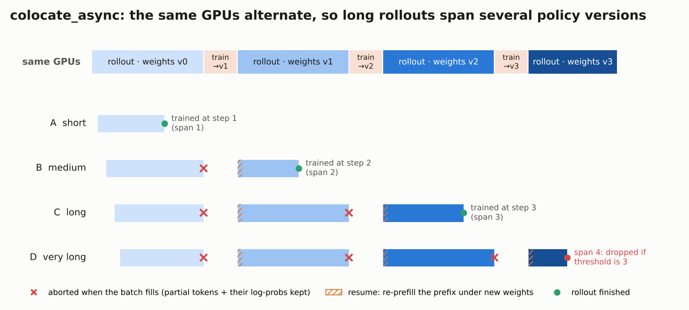
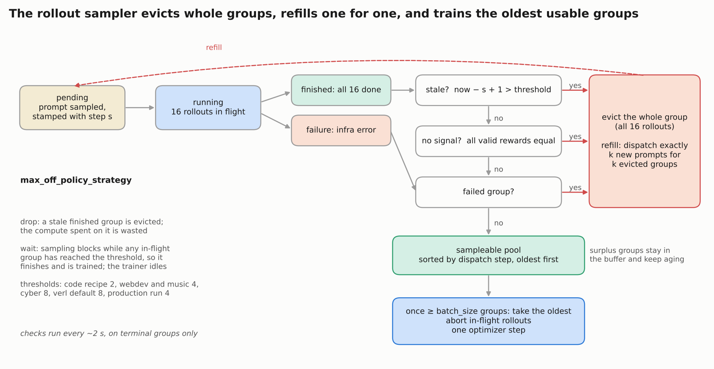
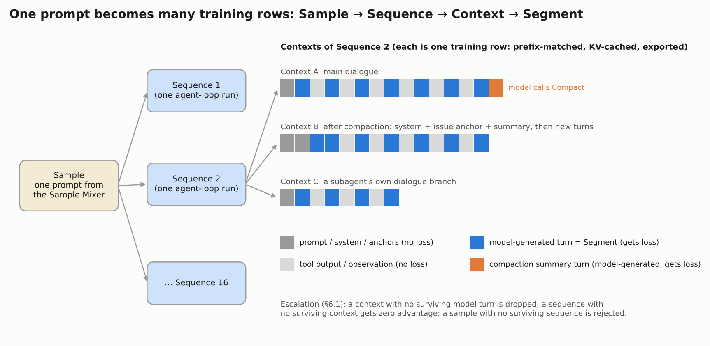

# RL at this scale is a distributed-systems problem

*[← Part 2: the RL algorithm](02_rl_algorithm.md) · [Lesson hub](README.md) · [Part 4: environments and grading →](04_environments_and_grading.md)*

One MiMo-V2.6-Pro RL step is a 25,000-trajectory, ~3-billion-token data pipeline that feeds **a single optimizer update**. The learning rule fits on one line (see [Part 2](02_rl_algorithm.md)). Almost everything that made the run work, or break, is systems engineering: when to cut off rollouts that are still running, which finished groups to train on, how to stop fast tasks from flooding the batch, and how to make SGLang and Megatron agree on every token's probability. The [MiMo-V2.6 report](https://arxiv.org/abs/2610.11959) describes all of this in §4.1, §5.5 and §6. The [verl fork](https://github.com/XiaomiMiMo/verl/tree/mimo-oss) releases a smaller, single-domain version of the same machinery. This part walks through both and keeps them apart: **"production"** means what the report says about the Pro/Flash run, **"the recipe"** means what the released code does.

## The anatomy of one step

| Quantity | Value | Source |
|---|---|---|
| Prompts per step | 1,568 | report §5.1 |
| Rollouts per prompt (group size G) | 16 | report §5.1 |
| Trajectories per step | ≈ 25K | report §4.1 |
| Training tokens per step | 2.7–3.7 B | report §4.1 |
| Tokens per trajectory | ≈ 110K–150K on average | derived: 2.7–3.7 B / 25K |
| Context length during RL | up to 1M | report §4.1, §6.4 |
| Optimizer updates per step | 1 | released launchers, see below |
| Steps in the final run | 30 | report Fig. 12 |
| Wall clock | ≈ 123 h | [The Batch](https://www.deeplearning.ai/the-batch/an-unexpected-open-weights-leader) |
| RL cost | $2.62M Pro, $0.85M Flash | Xiaomi via press; report rounds to $2.6M / $0.9M |
| Cost split (Pro) | rollout 43.8%, training 43.5%, grading 12.7% | report §4.1 |
| Engines | SGLang (inference), Megatron-LM (training) | report §6.4 |

Two consequences follow from these numbers. First, each step takes about four hours (123 h / 30), because a step cannot end before enough 100K-token agent runs have finished. Second, rollout and grading together cost more than training. The pipeline that *produces* experience is the main cost, not the backward pass.

**One step really is one update.** The [model card](https://huggingface.co/XiaomiMiMo/MiMo-V2.6-Pro-RL) says "billions of tokens per update". The released code makes it a hard rule. The trainer refuses a prompt-mean batch that is not exactly one optimizer minibatch ([`verl/trainer/ppo/v1/trainer_base.py`](https://github.com/XiaomiMiMo/verl/blob/mimo-oss/verl/trainer/ppo/v1/trainer_base.py)):

```python
ppo_mini_batch_size = self.config.actor_rollout_ref.actor.ppo_mini_batch_size
ppo_mini_batch_size = ppo_mini_batch_size * self.config.actor_rollout_ref.rollout.n
if self.config.actor_rollout_ref.actor.loss_agg_mode == "prompt-mean" and len(batch) != ppo_mini_batch_size:
    raise ValueError("prompt-mean requires one optimizer minibatch containing the complete sampled batch")
```

The launchers check the same thing before starting ([`recipes/general/run_general.sh`](https://github.com/XiaomiMiMo/verl/blob/mimo-oss/recipes/general/run_general.sh)): `loss_agg_mode=prompt-mean needs TRAIN_BATCH_SIZE == PPO_MINI_BATCH_SIZE`. Together with `ppo_epochs: 1`, every trajectory in the released recipes contributes to exactly one gradient step. Two caveats: most recipes run several epochs over their prompt set (`total_epochs` of 4–6; webdev 1), so a *prompt* returns with fresh rollouts; and production's Sample Replay reuses completed groups after a restart, without saying whether they had already been trained on ([below](#the-sample-mixer-keeps-a-mixed-batch-stable-described-not-released)). [Part 2](02_rl_algorithm.md#optimizer-and-step-budget) discusses why so few, so large steps.

## "Async" means the batch boundary is not tied to rollouts finishing

### Background

**[AReaL (Fu et al., 2025)](https://arxiv.org/abs/2505.24298)** is the clearest paper on why agentic and long-reasoning RL goes asynchronous. Rollout workers keep generating while trainers update whenever a batch is ready, and a staleness bound controls how old the data may be. It describes a fully decoupled design on separate GPUs, which is one of the two options below. **[PipelineRL](https://arxiv.org/abs/2509.19128)** goes further and swaps weights into the inference engine in the middle of a sequence. **[Kimi k1.5](https://arxiv.org/abs/2501.12599)** popularized "partial rollouts": cap the tokens generated per iteration, save unfinished trajectories, and continue them in the next iteration. MiMo's design is closest to Kimi's.

### verl's three trainer modes

The fork inherits three trainer modes from upstream verl ([`verl/trainer/config/ppo_trainer.yaml`](https://github.com/XiaomiMiMo/verl/blob/mimo-oss/verl/trainer/config/ppo_trainer.yaml)):

| Mode | Where rollout and training run | When weights reach rollout | Staleness |
|---|---|---|---|
| `sync` | same GPUs, strictly alternating | every step | none: each step waits for its own slowest rollout |
| `colocate_async` | same GPUs, alternating | every step | yes: unfinished rollouts carry over |
| `separate_async` | separate GPU pools, running at the same time | every `parameter_sync_step` steps (default 4) | yes |

The code, cyber, webdev and music recipes use `colocate_async` (for example `trainer.v1.trainer_mode="${TRAINER_MODE:-colocate_async}"` in [`recipes/code/run_train.sh`](https://github.com/XiaomiMiMo/verl/blob/mimo-oss/recipes/code/run_train.sh)); the general-agent recipe uses `sync` ([`recipes/general/config/general.yaml`](https://github.com/XiaomiMiMo/verl/blob/mimo-oss/recipes/general/config/general.yaml)). The `colocate_async` trainer class is four hooks ([`verl/trainer/ppo/v1/trainer_colocate_async.py`](https://github.com/XiaomiMiMo/verl/blob/mimo-oss/verl/trainer/ppo/v1/trainer_colocate_async.py)):

```python
def on_sample_end(self):
    # abort all unfinished requests and pause generation
    self.checkpoint_manager.abort_replicas()
    # sleep all replicas to discard weights and kv cache
    self.checkpoint_manager.sleep_replicas()

def on_step_end(self):
    # wake up all replicas to update weights
    self.checkpoint_manager.update_weights(self.global_steps)
    # resume generation
    self.checkpoint_manager.resume_generation_replicas()
```

The cycle is: the sampler (next section) decides that enough finished groups exist; every still-running request is aborted; SGLang frees its weights and KV cache; Megatron takes one optimizer step on the same GPUs; the new weights are loaded into SGLang; generation resumes. Nothing runs concurrently. "Async" means only that **a step's batch is whatever finished first, not what was launched in that step**.

### Partial rollout: an aborted request resumes under new weights

An aborted rollout is not discarded. The client retries it with the tokens generated so far appended to the prompt ([`verl/workers/rollout/llm_server.py`](https://github.com/XiaomiMiMo/verl/blob/mimo-oss/verl/workers/rollout/llm_server.py), `FullyAsyncLLMServerClient.generate`):

```python
while True:
    output = await super().generate(request_id=request_id,
                                    prompt_ids=prompt_ids + final_output.token_ids, ...)
    final_output.token_ids.extend(output.token_ids)
    final_output.log_probs.extend(output.log_probs)
    ...
    if output.stop_reason not in ("aborted", "abort") or not should_retry:
        break
```

Three facts follow from this loop.

1. **The prefix is re-prefilled.** The KV cache was freed during training, so the continuation recomputes it under the new weights. The report names this as the price of partial rollout, amortized by the huge batch (§4.1).
2. **Old log-probs are kept, not recomputed.** Each token keeps the log-probability that the sampling engine assigned when it generated it. The report states this for production: "for partial rollouts we do not recompute inference probabilities" (§5.1). This is why the importance ratio in [Part 2](02_rl_algorithm.md#the-importance-ratio-reweighting-tokens-the-sampler-over--or-under-produced) must be per token: different tokens of one trajectory were sampled by different policies.
3. **One trajectory can span several policy versions.** The loop records `min_global_steps` and `max_global_steps` for exactly this reason. Long rollouts span more versions than short ones, so staleness concentrates in the long tail.



Four rollouts start in the same phase. A finishes before the first cut and is trained on fresh data. B, C and D are aborted at each cut (red ×), resumed with a re-prefill (hatched) under the next weights, and so carry tokens from 2, 3 and 4 versions. With a threshold of 3, D would be dropped when it finishes.

### What production did

The report calls the system "fully asynchronous" (§1), uses "asynchronous partial rollouts at a staleness of 4" (§5.1), and says interrupted sequences resume "in the next rollout phase" (§4.1). It never says whether rollout and training share GPUs. "Rollout phase" fits a colocated, phase-alternating design. "Fully asynchronous" fits separate pools. Treat the production placement as unknown.

## The rollout sampler decides what gets trained

The sampler is the replay buffer in [`verl/trainer/ppo/v1/replay_buffer.py`](https://github.com/XiaomiMiMo/verl/blob/mimo-oss/verl/trainer/ppo/v1/replay_buffer.py), mostly upstream code that Xiaomi extended. Its unit is a **group**: one prompt and its 16 rollouts. Groups live and die together because the advantage of each rollout is defined relative to its 15 siblings.

**Lifecycle.** A prompt is stamped with the global step at which it was dispatched and moves through `pending → running → finished` (or `failure` if a rollout hit an infrastructure error). Only terminal groups are examined.

**Staleness is measured from dispatch, and checked only after a group finishes** (`ReplayBufferAsync._stale_terminal_keys`):

```python
return {
    uid for uid in terminal_keys
    if global_steps - prompt_global_steps.get(uid, global_steps) + 1 > self.max_off_policy_threshold
}
```

A group dispatched at step *s* and considered at step *t* has span *t − s + 1*. Span 1 is fully on-policy. With the code recipe's threshold of 2, a group can be trained one step after dispatch, never two.

**Every ~2 seconds the sampler evicts three kinds of terminal group:**

- **stale**: span above the threshold (strategy `drop` only);
- **no signal** (only when `filter_groups.enable` is on, as in the code, cyber and general recipes; webdev and music leave it off): all valid rewards identical, so every advantage is zero (DAPO-style filtering). Xiaomi changed the check to ignore infrastructure failures first, and to count a group with ≤ 1 valid rollout as no signal (`_classify_group`);
- **failed**: an infrastructure failure.

Each evicted group is deleted and replaced by **exactly one** newly dispatched prompt (`refill_fn(len(evicted_uids))`). In async mode the buffer's docstring sums it up as "Evict k; refill k".

**Selection is oldest first.** Once at least `batch_size` usable groups exist, `_select_prompt_uids` sorts them by dispatch step and takes the oldest. The rest stay in the buffer and keep aging, so a finished group can still go stale while it waits.

**`drop` or `wait`.** With `drop`, an in-flight group that has already passed the threshold keeps generating until it finishes, and is then thrown away: wasted rollout compute. With `wait`, the sampler refuses to hand out a batch while any in-flight group has reached the threshold, so stragglers always finish and get trained; the trainer idles instead (`_has_enough_samples`). All released async recipes use `drop`.

| Setting | Threshold |
|---|---|
| Production run (report §5.1) | 4 |
| Code recipe (`run_train.sh` default) | 2 |
| Webdev and music recipes (`recipes/design/config/*.yaml`) | 4 |
| Cyber recipe (`recipes/arvo/config/arvo.yaml`) | 8 |
| Upstream verl default | 8 |



The sampler never trains on a partial group. Eviction always works on whole groups and is refilled one for one. Training always takes the oldest usable groups first.

## What a production batch contains

**By domain** (report §5.1): agentic and competitive coding 68%, aesthetic design 13%, general tool use 12%, cybersecurity 4%, context following 3%. **By outcome**: only groups with mixed results, since all-pass and all-fail groups are filtered out. **By harness**: several mini-harnesses in the same batch ([Part 4](04_environments_and_grading.md#harnesses-are-part-of-the-environment)).

**Per trajectory**, the trainer needs more than tokens:

| Field | Why it is needed |
|---|---|
| token ids, with a loss mask over model-generated turns | tool outputs are context only; only model turns get loss (§6.1) |
| per-token log-probs from the sampling engine | the denominator μ of the importance ratio ([Part 2](02_rl_algorithm.md#the-importance-ratio-reweighting-tokens-the-sampler-over--or-under-produced)) |
| per-token expert indices | Rollout Routing Replay (below) |
| per-token top-p candidate sets | top-p candidate replay (below) |
| reward, then advantage | after hack-zeroing and grader adjustments ([Part 2](02_rl_algorithm.md#rewards-beyond-passfail)) |
| prompt-mean loss weight | 1 / (number of prompts × tokens in the group) ([Part 2](02_rl_algorithm.md#prompt-mean-aggregation-every-token-in-a-group-weighs-the-same)) |

**The trajectory hierarchy** (§6.1) is Sample → Sequence → Context → Segment. A Sample is one prompt. A Sequence is one agent-loop run, so a Sample has 16. A Context is one dialogue branch: the unit of prefix matching, KV-cache reuse and training-data export. A Segment is one turn. Compaction, subagents and multiple agent roles all create extra Contexts inside one Sequence.



One prompt becomes many training rows. When the model compacts its history, the dialogue after compaction becomes a new Context that starts from system prompt, issue anchor and summary. The summary itself was generated by the model, so it is trained.

**The penalty module** (§6.1) separates detection from effect. A *rule* (hand-written logic or a model judge) flags a segment, context or sequence: infrastructure failures, garbled tokens, calls to tools that do not exist, repetition. A *strategy* decides what happens: `mask` removes the flagged content from the loss; `advantage shaping` sets, scales or subtracts advantage on flagged tokens; `monitor` only logs; `early stop` ends the rollout, zeroes its outcome reward and treats the triggering turn and the earlier turns separately. Failures escalate: a context with no surviving model turn is dropped, a sequence with no surviving context gets zero advantage, and a sample with no surviving sequence is rejected. The specific penalties used in training are in [Part 2](02_rl_algorithm.md#rewards-beyond-passfail).

**Infrastructure failures never become a training signal.** In the released code, a rollout whose reward equals a sentinel "invalid" value is excluded from the group mean, and its own advantage is set to zero ([`verl/trainer/ppo/core_algos.py`](https://github.com/XiaomiMiMo/verl/blob/mimo-oss/verl/trainer/ppo/core_algos.py), `compute_grpo_outcome_advantage`). A crashed sandbox therefore neither punishes the model nor shifts its siblings' advantages.

## The Sample Mixer keeps a mixed batch stable (described, not released)

The released sampler has no notion of task source. That is fine for the released recipes, because each launcher trains one domain. It fails for a run like production, where 25 sources differ by **90× in mean generated tokens** and **66× in active rollout duration** (§6.3). If you dispatch prompts uniformly and take whatever finishes first, short, easy sources fill every batch. The Sample Mixer is Xiaomi's answer. It is described in the report and absent from the code.

**Symbols** (§6.3). For source *i*: *B_i* is the target number of retained groups per step; *r_i* the estimated fraction of groups accepted, i.e. not filtered out; *t_i* the estimated active rollout time (generation plus tool time, excluding pauses between steps); *A_i* the number of groups already accepted for the current batch. *A_i* is a count here, not an advantage.

**How much to run in parallel.** The expected generation demand is *m_i = B_i / r_i*: you must start more groups than you keep. Each source gets an oversampling ratio

  p_i = clip(c · t_i − 1, p_min, p_max),

where the shared factor *c* is chosen so the demand-weighted mean Σ m_i p_i / Σ m_i equals a global ratio p̄. A source may have up to (1 + p_i) · m_i groups in flight. Slow sources get more headroom. Allocations are recomputed from recent timing and acceptance statistics.

**What to dispatch next.** Each source gets a scheduling weight

  w_i = α · B_i / r_i + (1 − α) · (B_i − A_i)⁺ / r_i,

used by a smooth weighted round robin. The first term keeps steady demand. The second favors sources still short of their quota for this batch. Startup uses α = 0.5. In a trace-driven simulation, α = 0.5 kept occupancy more stable than α = 0 and collection more balanced than α = 1.

**Where to dispatch it.** Per-source length priors, updated from finished rollouts, predict each rollout's final sequence length and so its KV-cache need. A rollout is admitted to a rank only if a safety multiple of that need fits in the rank's free KV capacity. Among feasible ranks, a greedy rule picks the one with the most remaining capacity.

**Replay after a restart.** After startup, short rollouts finish first, and collection from slow sources took about 1.8× as long as in steady state. To avoid a skewed first batch, the mixer reuses finished groups from selected slow sources, but only in the first collection after startup or checkpoint recovery, and only within each source's staleness limit.

If you build a mixed run on the released code, this is the component you would have to write.

## Making SGLang and Megatron agree on every token

### Background

**[Feng Yao et al., "Your Efficient RL Framework Secretly Brings You Off-Policy RL Training"](https://fengyao.notion.site/off-policy-rl)** (2025) showed that the gap between the sampling engine's and the trainer's probabilities is large enough to destabilize RL, and proposed truncated importance sampling as a fix. **[Yingru Li and Jiacai Liu, "When Speed Kills Stability"](https://yingru.notion.site/When-Speed-Kills-Stability-271211a558b7808d8b12d403fd15edda)** analyses which corrections work and when. The cleanest engineering endpoint so far is vLLM's **["Finish RL Training Faster: Bitwise-Consistent, High-Performance, Agent-Driven"](https://vllm.ai/blog/2026-10-14-train-inference-consistency)** (October 2026), which makes rollout and training log-probs identical for DeepSeek-V4-Flash at 91.3% of baseline rollout throughput. MiMo takes the middle road: remove the biggest sources of mismatch, then correct the rest with the importance ratio ([Part 2](02_rl_algorithm.md#the-importance-ratio-reweighting-tokens-the-sampler-over--or-under-produced)).

### Three fixes for an MoE (§6.4)

1. **QDQ.** Rollout runs the experts in MXFP4. After each update, the trainer's expert weights are quantized to MXFP4 and dequantized again, so both engines compute with the same expert values.
2. **Rollout Routing Replay (R3).** Tiny numerical differences can change which experts a token is routed to, even with identical weights, and a different expert means a very different probability. The rollout records each token's expert indices, and the trainer reuses them. R3 comes from the MiMo team's own paper, **[Ma et al., "Stabilizing MoE Reinforcement Learning by Aligning Training and Inference Routers"](https://arxiv.org/abs/2510.11370)**. Upstream verl already supports routing replay, and its partial-rollout client (inherited unchanged by the fork) tracks routing per segment on resume: "keep existing routing and only append routing for newly generated tokens" (`llm_server.py`).
3. **Top-p candidate replay.** The sampler draws from the top-p set, but a trainer computing a full-vocabulary softmax would assign probability to tokens that could never have been sampled. The rollout records each token's candidate set, and the trainer renormalizes its log-probabilities within that set. The set is shipped as a fixed-shape, full-vocabulary bitmap, so no synchronization or truncation is needed. At top-p 0.97 the set averages under five tokens.

The **frozen router** ([Part 2](02_rl_algorithm.md#freezing-the-router)) removes a fourth source of drift: expert load cannot move during RL.

### Caching between turns

Each dialogue Context has a persistent key within a policy version. Later turns reuse the cached KV, including the model's own generated tokens, and prefill only the new suffix: the tool output plus whatever comes next. Expert indices and candidate sets are returned only when a rollout is collected. Images are sent once and re-sent only after a policy update or a cache miss. KV state lives in HBM while the model is generating and moves to a pinned host pool while a tool runs, with offload and restore on side CUDA streams (§6.4).

## The plumbing

- **Harness Pool** (§6.2). Each agent harness instance is a "tenant" hosted on fixed pools of persistent Ray actors, instead of one Ray actor per instance; that approach exhausted the Ray GCS's file descriptors. Each harness gets a configurable share of a fixed actor budget, set at startup. Blocking work such as environment calls and tokenization runs on background threads.
- **Payload Porter** (§6.2). The driver schedules using light metadata only: rewards, lengths, keys. Heavy payloads (routing records, top-p bitmaps, images) go to a distributed object store, either the Ray object store or [TransferQueue](https://github.com/Ascend/TransferQueue), which the released fork uses. Each tensor-parallel group pulls only the context-parallel window it needs. The vision encoder runs data-parallel.
- **Speculative decoding in rollout** (§6.4). Rollouts use a block-6 DFlash drafter instead of the 3-token MTP head inherited from SFT. The drafter was trained on the SFT policy and then fine-tuned on early RL rollout logs. Average accepted length rose 31.3%. Block-6 gave about 6% more global throughput than block-8, and an FP8 drafter about 10.3% more per-node throughput on long contexts. See [Part 1](01_base_model.md) for the architecture.
- **Training at 1M context** (§6.4). Training uses context parallelism. Sliding-window layers (window 128) exchange only window-sized KV between ranks, so their communication does not grow with sequence length. Optimizer states stay in CPU memory until the update. The policy-gradient and on-policy-distillation losses are fused into one kernel.

## What broke during the final run

Figure 12 of the report plots every interruption of both 30-step runs (§5.5). The failures are a good checklist for anyone planning a similar run.

| Layer | What happened |
|---|---|
| Infrastructure | Mostly GPU memory double-bit errors. Flash restarted after a Kubernetes failure crashed pods in the cyber-task cluster between steps 15 and 16. Pro restarted after the grader became unreachable over the network after step 14. |
| Rollout | After each restart, short rollouts finished first. That biased the length priors used for KV-aware dispatch, which then exhausted both the GPU and pinned-host KV pools. One harness produced rollouts less than half as long as the others on the same code data, skewing estimates for steps 2–3 after a restart. |
| Training | GPU out-of-memory from MoE imbalance inside a micro-batch: at one layer, one expert-parallel rank received over 30× the mean token load even though the full batch was balanced. Parallelism was changed to reduce activation memory. |
| Driver | Late in the Flash run, longer sequences grew the per-node packing data past host memory, causing CPU out-of-memory errors despite distributed packing. |

Note how many of these come from the long tail of trajectory length. Long rollouts are what makes partial rollout necessary, what biases the dispatcher, and what blows up packing memory.

## Hardware and GPU-hours were not reported

The report says only "thousands of GPUs in a single run" (§4.1). It names no accelerator, node count or GPU-hour total. A back-of-envelope estimate (mine, not Xiaomi's): at an assumed $1.5–3 per GPU-hour, $2.62M buys about 0.9–1.7M GPU-hours. Over about 123 hours that is roughly 7,000–14,000 GPUs. The dollar figure may also include CPU sandboxes and grader serving, which would push the GPU count down. MXFP4 expert kernels in rollout suggest recent hardware with native micro-scaled FP4 support, but that is a hint, not evidence. A claim by an outside commentator that the run used Chinese accelerators is not supported by the report.

## Published vs. missing

| Item | Status | Where |
|---|---|---|
| Batch size, group size, staleness, step count, cost split | Described | report §4.1, §5.1 |
| `colocate_async` / `separate_async` trainers, partial rollout | Released | [XiaomiMiMo/verl](https://github.com/XiaomiMiMo/verl/tree/mimo-oss) (upstream verl) |
| Replay buffer with staleness, DAPO and failure eviction | Released | `verl/trainer/ppo/v1/replay_buffer.py` |
| Infra-failure handling in advantages, penalty channels | Released | `core_algos.py`, `arvo_penalties.py`, `trainer_base.py` |
| GPU placement of rollout vs training in production | Missing | — |
| Sample Mixer (quotas, oversampling, KV-aware dispatch, replay) | Described only | report §6.3 |
| Harness Pool, Payload Porter | Described only | report §6.2 |
| Penalty module (rules, strategies, escalation) | Described, partly released | report §6.1; fork penalty channels |
| QDQ, top-p candidate replay | Described only | report §6.4 |
| Rollout Routing Replay | Released (paper + upstream verl) | [arXiv 2510.11370](https://arxiv.org/abs/2510.11370) |
| DFlash rollout drafter | Described | report §6.4 |
| Failure log | Described | report §5.5, Fig. 12 |
| Accelerator type, GPU count, GPU-hours | Missing | — |

## What remains uncertain

- Whether production colocated rollout and training or ran them on separate pools. The report's wording supports either.
- Whether the production threshold of 4 is measured the same way as verl's span (*t − s + 1*). The report says only "a staleness of 4".
- Whether production uses `drop` or something like `wait` for stragglers. The Sample Mixer's replay rule mentions "each source's staleness limit", which suggests per-source limits that the released code lacks.
- The values of p̄, p_min, p_max and the KV safety margin in the Sample Mixer.
- How the 123-hour figure maps onto Fig. 12's restarts. It comes from press coverage, not the report.
- The GPU-hour range above is an estimate with an assumed price.

## Questions to think about

1. With a threshold of 4 and about 4 hours per step, what is the longest trajectory that can be trained? What happens to that bound if rollout throughput doubles?
2. Under `drop`, which tasks are most likely to be evicted for staleness? What bias does that put into what the model learns?
3. Why does the sampler pick the *oldest* usable groups first? What would go wrong with newest-first?
4. The Sample Mixer oversamples by *c · t_i − 1*. Why should a slow source get more headroom than a fast one with the same acceptance rate?
5. A trajectory spans versions v2, v3 and v4 and is trained at v5. Which probability goes into the ratio's denominator for each token, and why not recompute them all under v4?
6. Top-p replay renormalizes the trainer's probabilities over the sampled candidate set. What would the importance ratio look like for a sampled token if you skipped this?

## Further reading

- [AReaL](https://arxiv.org/abs/2505.24298): fully decoupled asynchronous RL with staleness control.
- [Kimi k1.5](https://arxiv.org/abs/2501.12599): the partial-rollout idea for long generations.
- [PipelineRL](https://arxiv.org/abs/2509.19128): in-flight weight updates during generation.
- [verl: Fully Async Policy Trainer](https://verl.readthedocs.io/en/latest/advance/fully_async.html): verl's separate-pool design, staleness threshold and partial rollout.
- [Stabilizing MoE RL by Aligning Training and Inference Routers (R3)](https://arxiv.org/abs/2510.11370).
- [Feng Yao et al., "Your Efficient RL Framework Secretly Brings You Off-Policy RL Training"](https://fengyao.notion.site/off-policy-rl).
- [Yingru Li and Jiacai Liu, "When Speed Kills Stability"](https://yingru.notion.site/When-Speed-Kills-Stability-271211a558b7808d8b12d403fd15edda).
- [vLLM: bitwise-consistent training and inference](https://vllm.ai/blog/2026-10-14-train-inference-consistency).
- [TransferQueue](https://github.com/Ascend/TransferQueue): the key-value store the released trainer uses for trajectories.
