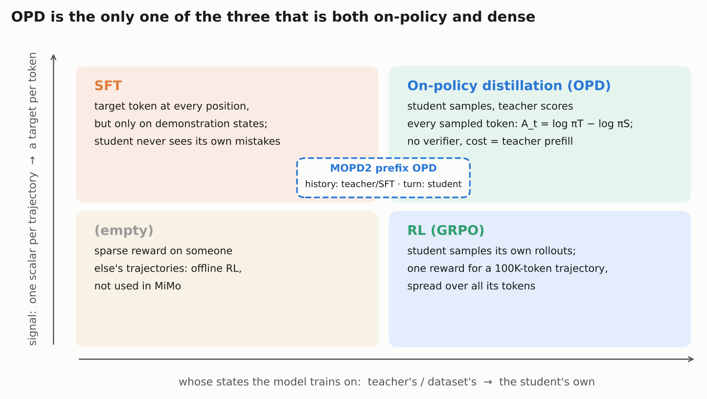
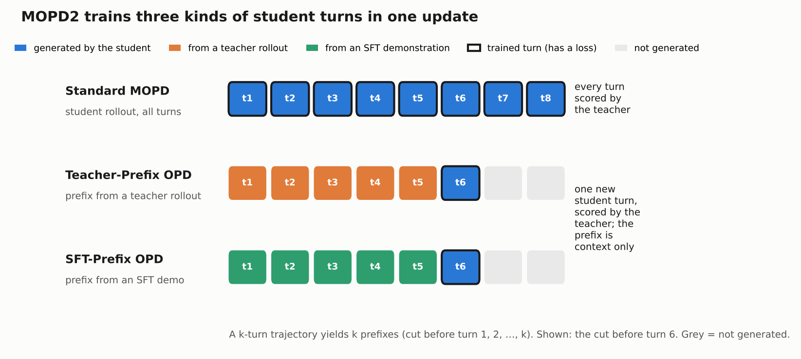

# On-policy distillation is GRPO with the teacher as the advantage

MiMo's post-training ends with distillation, not with RL. After the single mixed RL run, Xiaomi distills several teachers into one student with **MOPD2**, a "multi-prefix" extension of the **MOPD** (Multi-Teacher On-Policy Distillation) stage introduced in [MiMo-V2-Flash](https://arxiv.org/abs/2601.02780). The mechanism is the GRPO loss from [Part 2](02_rl_algorithm.md) with one change. The sequence-level advantage Aᵢ = Rᵢ − mean(R) is replaced by a per-token advantage, the teacher's log-probability minus the student's on the token the student sampled. Everything else is reused: student rollouts, the importance weight, the mask, the rollout engine. The outputs of this stage are public as [MiMo-V2.6-Pro-MOPD](https://huggingface.co/XiaomiMiMo/MiMo-V2.6-Pro-MOPD) and [MiMo-V2.6-Flash-MOPD](https://huggingface.co/XiaomiMiMo/MiMo-V2.6-Flash-MOPD), which also carry a fix for repeated tool calls. The teachers, the distillation data, MOPD2's prefix streams and a MOPD2 loss equation are not public. A plain MOPD-style stage, with several teachers plus a task reward, can be run with the on-policy distillation trainer that the released verl fork inherits from upstream.

This part builds the idea in three steps: plain on-policy distillation (OPD), MOPD as published for V2-Flash, and MOPD2 as described for V2.6. It ends with why Xiaomi uses a separate distillation stage at all.

## Background: three ways to get a training signal

Read [Part 2](02_rl_algorithm.md) first. This part reuses its Eq. 1 and its notation without re-deriving them:

```
L(θ) = −E[ 1/Σᵢ|oᵢ| · Σᵢ Σₜ r_{i,t} · M_{i,t} · A_{i,t} · log π_θ(o_{i,t} | q, o_{i,<t}) ]

r_{i,t} = sg[ π_θ(o_{i,t}) / μ(o_{i,t}) ]     importance weight, μ = the rollout engine's policy
M_{i,t} = loss mask × clip mask
```

In GRPO, A_{i,t} is the same number for every token of rollout i: Aᵢ = Rᵢ − mean(R) over the group of 16. On-policy distillation keeps every other symbol and changes only A.

Post-training methods differ along two axes. One is *whose states* the model trains on: a dataset's or teacher's trajectories, or the student's own. The other is *how dense* the signal is: one reward per trajectory, or a target at every token.



SFT is dense but trains only on demonstration states, so the student never practices recovering from its own mistakes. GRPO trains on the student's own states, but a 100K-token trajectory gets one scalar. OPD is the only one of the three with both properties. MOPD2's prefix streams, discussed below, sit on the boundary: the history comes from a teacher or a demonstration, and only the newest turn is the student's.

## On-policy distillation from first principles

**[Kevin Lu and Thinking Machines Lab, "On-Policy Distillation"](https://thinkingmachines.ai/blog/on-policy-distillation/)** (27 October 2025) is the clearest explanation of the method. It frames OPD as a small change to RL code, with the per-token reverse KL as the advantage, and shows it on Qwen3 math reasoning and on restoring instruction following after domain mid-training. It does not cover multiple teachers, combining distillation with environment rewards (it lists this as future work), or multi-turn agent tasks. MOPD and MOPD2 fill exactly those three gaps.

### The per-token advantage

The student samples a token yₜ in context cₜ. A teacher model prefills the same sequence and returns its log-probability for that token. The OPD advantage is the gap:

```
A_t^OPD = sg[ log π_teacher(y_t | c_t) − log π_student(y_t | c_t) ]
```

Plug this into Eq. 1 in place of Aᵢ:

- If the teacher likes the sampled token more than the student does, A > 0 and the token is pushed up.
- If the student overrates the token, A < 0 and it is pushed down.
- If the two agree, A = 0 and nothing happens.

Averaged over tokens the student itself samples, −A_t is an unbiased estimate of the per-position reverse KL, KL(π_student ‖ π_teacher). So minimizing Eq. 1 with this advantage drives the student toward the teacher, measured on the student's own trajectories.

### Why reverse KL, and what it costs

Reverse KL is *mode-seeking*. The student is penalized for putting probability where the teacher has little, but not for missing some of the teacher's modes. A smaller student therefore commits to one of the teacher's behaviors instead of averaging several. Forward KL, which ordinary SFT on teacher samples approximates, is *mode-covering* and can spread the student thin.

Three practical properties follow:

1. **No credit-assignment problem.** Every token gets its own signal. A GRPO trajectory of 100K tokens shares one number among all of them.
2. **No verifier.** The teacher is the reward. This is what lets MOPD2 reach domains where Xiaomi has no reliable grader.
3. **Cheap supervision.** The teacher never generates. It only prefills the student's tokens to return log-probabilities, which costs about as much as one forward pass.

The ceiling is the teacher. OPD cannot make the student better than its teacher on that teacher's domain, except by combining it with a reward, which is what MOPD does.

### How much cheaper than RL

The [Qwen3 report](https://arxiv.org/abs/2505.09388) (Table 21) gives the cleanest controlled comparison. Starting from the same off-policy-distilled Qwen3-8B checkpoint:

| Method from the same checkpoint | AIME'24 | AIME'25 | GPU hours |
|---|---|---|---|
| Starting point (off-policy distillation) | 55.0 | 42.8 | — |
| + GRPO-style RL | 67.6 | 55.5 | 17,920 |
| + on-policy distillation | 74.4 | 65.5 | 1,800 |

OPD reached better scores with about one tenth of the compute. It had a stronger teacher to learn from, while RL had to discover the behavior itself.

### Where the idea comes from

OPD predates the 2025 name. [GKD (Agarwal et al., 2023)](https://arxiv.org/abs/2306.13649) trained students on their own samples with a teacher's token-level distribution to remove the train/test mismatch of teacher-generated data. [MiniLLM (Gu et al., 2023)](https://arxiv.org/abs/2306.08543) argued specifically for reverse KL. Both are worth skimming for the motivation. The modern recipe is simpler than either: the per-token log-ratio goes straight into the RL loss you already have.

## MOPD in MiMo-V2-Flash: many teachers, plus the outcome reward

The [MiMo-V2-Flash report](https://arxiv.org/abs/2601.02780) (§4) introduced MOPD to fix a specific problem. Training one skill degraded others: "capability imbalance, where improving one skill causes regressions in others (the 'see-saw' effect)". Merging specialist checkpoints or training them in sequence did not solve it.

### Three stages

1. **SFT** on general, reasoning, coding and agent data.
2. **Domain-specialized teachers**, trained separately. For agentic search, coding and tool use, and for math, general reasoning and safety. A teacher can be an RL model, a different SFT model, or the student itself.
3. **MOPD.** The student samples on prompts from every domain. Each prompt is scored by *the teacher for that prompt's domain*.

### The objective, in Part 2's terms

The report's Eqs. 5–9 map onto Eq. 1 directly:

```
w_t       = sg[ π_θ(y_t) / μ(y_t) ],  set to 0 outside [ε_low, ε_high]   ← Part 2's r × clip mask
A_t^MOPD  = sg[ log π_teacher(domain(x))(y_t) − log π_θ(y_t) ]              ← the OPD advantage
A_t       = A_t^MOPD + α · A^ORM                                           ← A^ORM: GRPO's group-relative outcome advantage
```

Two details matter.

- **The outcome reward stays.** A^ORM is the ordinary GRPO advantage from a verifiable or model-based reward, weighted by α. MOPD is therefore "GRPO + a dense teacher term", not distillation instead of RL. The report does not give α, ε_low or ε_high.
- **The same consistency machinery.** The student samples in SGLang and trains in Megatron-LM, in FP8. The report applies training–inference importance sampling, discards tokens with large discrepancies, and uses Rollout Routing Replay (R3) for the MoE. These are the same tools [Part 3](03_rl_systems.md) describes for the RL run.

### Results

The report's Table 7 compares the student before MOPD, its best teacher, and the student after MOPD:

| Benchmark | Student before | Best teacher (type) | Student after | After − teacher |
|---|---|---|---|---|
| AIME 2025 | 89.3 | 93.9 (RL) | 94.1 | +0.2 |
| HMMT Feb. 2025 | 76.9 | 82.6 (RL) | 84.4 | +1.8 |
| LiveCodeBench | 77.5 | 82.6 (RL) | 83.2 | +0.6 |
| Tau2-Bench | 75.9 | 79.6 (RL) | 80.3 | +0.7 |
| SWE-Bench Verified | 67.8 | 74.2 (RL) | 73.4 | −0.8 |
| Arena-Hard (Creative Writing) | 90.1 | 90.1 (self) | 86.2 | −3.9 |
| BrowseComp | 42.5 | 51.7 (SFT) | 45.4 | −6.3 |

On most domains the student reaches or slightly exceeds its best teacher; the outcome-reward term is the likely reason it can exceed one. The losses are real too. BrowseComp kept less than half of its SFT teacher's gain, and creative writing fell below the starting point.

## MOPD2 in MiMo-V2.6: new teachers and multi-prefix rollouts

[MiMo-V2.6 report](https://arxiv.org/abs/2610.11959) §5.6 and the [-MOPD model cards](https://huggingface.co/XiaomiMiMo/MiMo-V2.6-Pro-MOPD) describe two changes from MOPD.

### Change 1: where the teachers come from

V2.6's main RL stage is one mixed run across code, general, visual and cyber tasks ("You Only RL Once", [Part 2](02_rl_algorithm.md)), not a set of per-domain RL runs as in V2-Flash. Yet the report's Fig. 13 calls MOPD2's teachers "domain-specialized", and the card says MOPD2 "distills several domain-specialized teachers". How those teachers relate to the final mixed checkpoint is not stated. In the card's words, there are two teacher families:

- **"mixRL teachers, trained on verifiable tasks."** These come out of the mixed RL setup. The report does not say whether any of them were specialized further after the main run.
- **"SFT teachers, trained on synthetic demonstrations for open-domain tasks."** These cover domains where "reliable training-time verification is hard". The card names "long-horizon game development, scientific research and embodied intelligence".

The second family is what MOPD2 adds. RL cannot train these domains without a grader. A teacher SFT'd on good demonstrations can still score every token the student writes.

### Change 2: three data streams in one update



Each update mixes three kinds of training data:

| Stream | History (context) comes from | Student generates | Teacher supervises |
|---|---|---|---|
| Standard MOPD | the student's own earlier turns | the whole trajectory | every student token |
| Teacher-Prefix OPD | a teacher rollout, cut before turn j | one new turn j | that turn |
| SFT-Prefix OPD | an SFT demonstration, cut before turn j | one new turn j | that turn |

A trajectory with k assistant turns gives k prefixes. From each one, the student samples just the next turn, "without regenerating earlier interactions" (§5.6).

### Why prefixes

The report gives one reason directly. SFT teachers "may provide limited coverage of histories reached after repeated student deviations in long-horizon tasks". A teacher trained on clean demonstrations has never seen the states a drifting student reaches after many mistakes, so its log-probabilities there are unreliable. A fixed demonstration prefix keeps the student in states the teacher knows.

Two more reasons follow from the setting (my reading, not stated by Xiaomi):

- **Cost.** Agent trajectories in this run average 110K–150K tokens. Generating a full student rollout to supervise turn 40 means generating turns 1–39 first. A prefix lets every decision point train for the price of one turn.
- **Coverage of late turns.** A weak student rarely reaches the late stages of a long game-development task on its own. Teacher prefixes put it there.

For a pre-training engineer, the closest picture is: the history is teacher-forced, and only the current turn is on-policy. It resembles DAgger in imitation learning, where a learner acts in states drawn from a mix of its own and an expert's trajectories (an analogy, not Xiaomi's framing). The price is part of OPD's main benefit. The prefix streams no longer train on states the student itself would reach. The standard stream keeps that benefit, which is presumably why all three are mixed.

### The tool-call repetition fix

The [Pro-MOPD card](https://huggingface.co/XiaomiMiMo/MiMo-V2.6-Pro-MOPD) reports a failure the RL checkpoint had in agentic use: "the model would sometimes issue the same or highly similar tool calls repeatedly." "Nothing fails outright, so it tends to go unnoticed." The fix is a short specialized-teacher run folded into the MOPD pass, which the card says "converges quickly", and "this checkpoint mitigates it". The card shows response-level repetition rates before and after in a figure, without numbers in the text.

This shows why a teacher-based stage is convenient. A behavioral defect that no outcome reward penalizes can be fixed by adding a teacher that doesn't have it.

### What MOPD2 does not tell you

- **No loss equation.** The objective is presumably MOPD's per-token form. That is an inference.
- **No ablation.** No comparison against MOPD without prefixes, and no breakdown by stream.
- **Unknown outcome term.** The report does not say whether MOPD2 keeps MOPD's α·A^ORM. One hint points to no: the infrastructure section says that "under OPD, reward evaluation is replaced by teacher scoring" (§6.2).
- **Unknown teachers and data.** Which checkpoints served as mixRL teachers, how the SFT teachers were trained, and the mix of the three streams are not given.

The only evidence of its effect is the final benchmark table and the repetition figure.

## Why a separate stage instead of SFT inside the RL run

A natural question: why not add the demonstration data to the RL batches as an SFT loss, and skip the second stage? Xiaomi does not discuss this. The reasons below are my reading of their setup.

1. **A demonstration is a weak signal; a teacher model is a strong one.** A demonstration is one fixed trajectory and pushes up one token per position, only in states the demonstrator visited. A teacher model gives a full next-token distribution in any state, including the student's mistakes. Training a teacher on the demonstrations, then distilling, turns fixed data into a scorer for new states. MOPD2 still uses the demonstrations, as prefixes rather than targets.
2. **The RL run is the expensive, fragile part.** Each of its 30 steps is one optimizer update on about 25K trajectories and costs roughly $87K for Pro ([Part 2](02_rl_algorithm.md)). An SFT term pulls toward the demonstrator's distribution while RL sharpens toward reward. Balancing the two across 25 task sources, mid-run, is a risky place to tune.
3. **The see-saw.** MOPD exists because joint training of many skills interferes. Distillation copies each teacher's peak per domain instead of searching for a joint optimum while objectives compete. (V2.6 already trains most skills jointly in one RL run, so for V2.6 this argument applies mainly to the domain-specialized teachers added afterwards.)
4. **Modularity.** A new domain needs a new teacher and another MOPD2 pass, not another multi-million-dollar RL run. The repetition fix above is an example.
5. **The signals are still mixed, just later.** In MOPD the outcome reward and the teacher term share one update: A = A^MOPD + α·A^ORM. The mixing happens where the teacher signal is dense and the cost is mostly prefill.

The trade-off is a second training stage, and the post-distillation regressions visible in V2-Flash's table. Mixing SFT into RL is simpler and works for small runs. At this scale, a clean RL objective plus a modular distillation stage is the more conservative engineering choice.

## The 9B model is distilled by SFT, not OPD

[MiMo-V2.6-Distill-Qwen-9B](https://huggingface.co/XiaomiMiMo/MiMo-V2.6-Distill-Qwen-9B) is a different kind of distillation. Qwen3.5-9B was fine-tuned with plain SFT on MiMo-generated trajectories ([report](https://arxiv.org/abs/2610.11959) §7.1, Table 4):

| Domain | Total tokens | Loss tokens |
|---|---|---|
| Code | 23.2B | 7.3B |
| Cyber | 11.0B | 4.8B |
| General | 22.0B | 5.7B |
| Visual | 21.2B | 9.4B |
| **Total** | **77.4B** | **27.2B** |

Only about 35% of the tokens carry loss. The rest are prompts and tool outputs, which are context. Table 4 describes this 9B model's data, not the SFT stage before Pro's RL, whose size the report never gives ([Part 2](02_rl_algorithm.md)).

The 9B checkpoint exists as a starting point for RL with the released environments ([Part 4](04_environments_and_grading.md)). It is off-policy distillation: the student imitates MiMo's trajectories and never trains on its own. Running OPD on top of it, with a MiMo model as the teacher, is the obvious next experiment for anyone with the compute to serve a large teacher. The software exists: the released fork inherits upstream verl's distillation trainer (`verl/trainer/distillation/`, configured by [`verl/trainer/config/distillation/distillation.yaml`](https://github.com/XiaomiMiMo/verl/blob/mimo-oss/verl/trainer/config/distillation/distillation.yaml)). It supports several teachers keyed by data source (`teacher_models`), adding the task reward (`use_task_rewards: true`) and per-token losses such as `k3`. Upstream documents it in [`docs/algo/opd.md`](https://github.com/XiaomiMiMo/verl/blob/mimo-oss/docs/algo/opd.md). What it lacks is MOPD2's prefix streams.

The notebook [rl_by_hand.ipynb](rl_by_hand.ipynb) ends with a toy OPD loop. A categorical student is pulled toward a teacher using only the sampled-token advantage, and the reverse KL falls step by step.

## Published vs. missing

| Item | Status |
|---|---|
| OPD method and loss | Public: Thinking Machines post, GKD, MiniLLM |
| MOPD objective (Eqs. 5–9) | Published in the MiMo-V2-Flash report, without α, ε_low, ε_high |
| MOPD results | Published (V2-Flash Table 7) |
| MOPD2 description (teacher families, three streams, target domains) | Described in V2.6 §5.6 and the -MOPD model cards |
| MOPD2 loss equation, stream mix, hyperparameters | Missing |
| mixRL and SFT teachers (weights) | Missing |
| SFT teacher demonstration data | Missing |
| MOPD-style multi-teacher OPD code | Released via upstream verl's distillation trainer, inherited by the [fork](https://github.com/XiaomiMiMo/verl) |
| MOPD2 prefix streams (Teacher-Prefix, SFT-Prefix) | Missing |
| Post-MOPD2 checkpoints | **Released**: MiMo-V2.6-Pro-MOPD, MiMo-V2.6-Flash-MOPD |
| Pre-MOPD2 (RL) checkpoints | Released: MiMo-V2.6-Pro-RL, MiMo-V2.6-Flash-RL |
| Tool-call repetition fix | Described on the -MOPD cards; method details missing |
| 9B SFT distillation data mix | Published (§7.1 Table 4); data itself missing |
| 9B checkpoint | Released |

You can study MOPD2 by comparing the -RL and -MOPD checkpoints on your own evaluations, and you can run a plain multi-teacher OPD stage on the released stack. You cannot rerun MOPD2 itself: its teachers, data and prefix streams are not public.

## What remains uncertain

- Whether MOPD2 keeps MOPD's outcome-reward term (α·A^ORM) is not stated.
- "mixRL teachers" could be the final mixed-RL checkpoint or further-specialized variants. The report's wording ("MixRL-trained on verifiable tasks") does not settle it.
- The MOPD2 loss is assumed to be MOPD's per-token reverse-KL form. No equation confirms this.
- No benchmark isolates MOPD2's contribution. The RL and MOPD checkpoints have not been compared side by side in the report text read for this lesson.
- The cost and prefix-coverage arguments for prefix streams, and all of "Why a separate stage", are this lesson's reasoning, not Xiaomi's.
- The DAgger comparison is an analogy. Xiaomi does not cite it.

## Questions to think about

1. A student assigns probability 0.05 to a token the teacher assigns 0.40. What is A_t^OPD, and which way does the update push? What if the probabilities are swapped?
2. Why does sampling from the student, rather than the teacher, make −A_t an estimate of *reverse* KL rather than forward KL?
3. In MOPD, A = A^MOPD + α·A^ORM. What happens to a token the teacher likes in a rollout that failed the verifier, for small and for large α?
4. A Teacher-Prefix sample trains turn 30 of a 40-turn task. Which states does the student see during this update, and which does it never see?
5. You want to remove a bad habit (say, apologizing after every tool error) without hurting coding scores. Would you add an RL penalty, an SFT dataset, or a teacher in MOPD2? Why?
6. Given the released -RL and -MOPD checkpoints, design an evaluation that estimates what MOPD2 added and what it cost.

## Further reading

- **[Kevin Lu and Thinking Machines Lab, "On-Policy Distillation"](https://thinkingmachines.ai/blog/on-policy-distillation/)** (October 2025). Start here for the mechanism.
- [MiMo-V2-Flash Technical Report](https://arxiv.org/abs/2601.02780), §4 (MOPD, Eqs. 5–9, Table 7).
- [MiMo-V2.6 Technical Report](https://arxiv.org/abs/2610.11959), §5.6 (MOPD2) and §7.1 (the 9B distillation).
- [MiMo-V2.6-Pro-MOPD](https://huggingface.co/XiaomiMiMo/MiMo-V2.6-Pro-MOPD) and [MiMo-V2.6-Flash-MOPD](https://huggingface.co/XiaomiMiMo/MiMo-V2.6-Flash-MOPD) model cards.
- [Qwen3 Technical Report](https://arxiv.org/abs/2505.09388), Table 21 (RL vs. on-policy distillation from the same checkpoint).
- [GKD: On-Policy Distillation of Language Models (Agarwal et al., 2023)](https://arxiv.org/abs/2306.13649).
- [MiniLLM: Knowledge Distillation of Large Language Models (Gu et al., 2023)](https://arxiv.org/abs/2306.08543).
