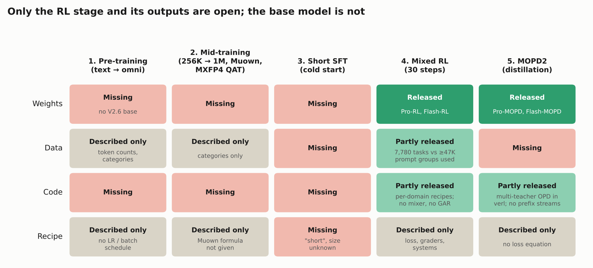

# Rebuilding MiMo-V2.6-Pro: the RL run is open, the model underneath is not

In September 2026 Xiaomi trained MiMo-V2.6-Pro (1.02T parameters, 42B active) and its smaller sibling Flash (309B, 15B active) with one large reinforcement-learning run. They streamed its training metrics on a public dashboard ([NYU Shanghai RITS](https://rits.shanghai.nyu.edu/ai/xiaomi-mimo-v2-6-live-rl-dashboard)) and then published the weights, a technical report, a fork of the verl RL framework, an agent harness and 7,780 training environments ([MiMo-V2.6 report](https://arxiv.org/abs/2610.11959); [model card](https://huggingface.co/XiaomiMiMo/MiMo-V2.6-Pro-RL)). It is the most complete public record of a frontier-scale agentic RL run so far. It is still not a recipe you can rerun end to end. **The RL stage is described in detail and partly released. Everything before it is described in a few paragraphs and not released.** There are no V2.6 base weights, no pre-training data or schedule, and no size for the SFT that precedes RL. The mixed RL run itself, which cost $2.62M for Pro and $0.85M for Flash, depends on components that exist only as descriptions: a sampler that balances 25 task sources, graders that rank passing solutions, and four-bound clipping tuned by entropy. What you *can* rerun is per-domain RL on a distilled 9B model, with the released environments and some of the same loss modifications (prompt-mean aggregation, mean-only advantages, infrastructure-failure handling).

This lesson reads the release as a senior engineer who wanted to rebuild Pro would. For each stage it explains what was done and why, and says exactly what is public. Most of the space goes to the RL algorithm and the systems around it.

Each column is a training stage, in order. Dark green cells can be downloaded; light green ones are partly available; grey ones exist only as text in the report; red ones are not published at all.

## How to read this lesson

| Part | What it answers | Read if |
| --- | --- | --- |
| [1. The base model](01_base_model.md) | Architecture (hybrid sliding-window attention with sinks, MoE, the speculative drafter), pre-training, mid-training (Muown, MXFP4 training, self-correction data), and how little of it is reproducible | You want the full pipeline, or wonder why rollouts run in MXFP4 |
| [2. The RL algorithm](02_rl_algorithm.md) | GRPO from the weighted-NLL view, and every MiMo change: mean-only advantages, dynamic sampling, prompt-mean aggregation, the importance ratio against the inference engine, clipping as a mask, GRS and GAR grading, length and segment penalties, the frozen router, why only 30 steps | **Start here** if you came for RL |
| [3. RL systems](03_rl_systems.md) | What "async" means in verl, how stale trajectories arise and get dropped, what a 25K-trajectory batch contains, the Sample Mixer, making SGLang and Megatron agree on every token, what broke | You run training infrastructure |
| [4. Environments and grading](04_environments_and_grading.md) | What an environment is in each domain, how tasks and graders were built and validated, harness mixing, reward hacking and the 67% git-history leak in the released tasks, what you can rebuild with the release | You want to build environments |
| [5. Distillation](05_distillation.md) | On-policy distillation as GRPO with the teacher as the advantage, MOPD in MiMo-V2-Flash, MOPD2's multi-prefix rollouts, why distillation is a separate stage | You want the post-RL stage |
| [Notebook: the loss by hand](rl_by_hand.ipynb)  | Every worked example from Parts 2 and 5 on toy numbers: advantages, aggregation weights, the importance ratio recovering the true gradient, a finite-difference proof that clipping is a mask, GAR, the length penalty, mass-conserving penalties, a toy OPD loop | You want to check the math. NumPy only, runs on CPU in seconds |

Read Part 2 first if you came for RL. Parts 3 and 4 can then be read in either order, and Part 5 builds on Part 2's loss.

## The run in numbers

| | Pro | Flash | Source |
| --- | --- | --- | --- |
| Parameters (total / active) | 1.02T / 42B | 309B / 15B | model cards |
| Pre-training tokens (text + omni) | 30T (27T + 3T) | 48T (26T + 22T) | report §3.1 |
| Context | 1M | 1M | report §3.2 |
| RL batch per step | 1,568 prompts × 16 rollouts ≈ 25K trajectories, 2.7–3.7B tokens | same | report §4.1, §5.1 |
| Tokens per trajectory | ~110–150K on average, up to 1M | same | report §4.1 |
| RL steps (= optimizer updates) | 30 | 30 | report §5.5, Fig. 12 |
| Staleness limit | 4 (definition unstated) | 4 | report §5.1 |
| RL cost | $2.62M | $0.85M | [VentureBeat](https://venturebeat.com/technology/better-than-deepseek-xiaomis-mimo-v2-6-pro-debuts-as-the-top-open-weights-model-in-the-world-alongside-cheaper-v2-6-flash); report §4.1 rounds to $2.6M / $0.9M |
| Compute split | rollout 43.8%, training 43.5%, grading 12.7% | not given | report §4.1 |
| Task mix | coding 68%, aesthetic design 13%, general tool use 12%, cyber 4%, context following 3% | same | report §5.1 |
| DeepSWE v1.1 (average@3) over RL | 58.4 → 72.6 | 48.7 → 65.7 | report §4.1 |
| GPU type and GPU-hours | not reported | not reported | see [Part 3](03_rl_systems.md#hardware-and-gpu-hours-were-not-reported) |

## What is released

| Artifact | What it is | Part |
| --- | --- | --- |
| [MiMo-V2.6-Pro-RL](https://huggingface.co/XiaomiMiMo/MiMo-V2.6-Pro-RL), [Flash-RL](https://huggingface.co/XiaomiMiMo/MiMo-V2.6-Flash-RL) | Checkpoints at the end of the mixed RL run, MIT license | 2 |
| [MiMo-V2.6-Pro-MOPD](https://huggingface.co/XiaomiMiMo/MiMo-V2.6-Pro-MOPD), [Flash-MOPD](https://huggingface.co/XiaomiMiMo/MiMo-V2.6-Flash-MOPD) | The same checkpoints after MOPD2 distillation, including a fix for repeated tool calls | 5 |
| [MiMo-V2.6-Distill-Qwen-9B](https://huggingface.co/XiaomiMiMo/MiMo-V2.6-Distill-Qwen-9B) | Qwen3.5-9B fine-tuned on 77.4B tokens of MiMo data; the starting point for the released recipes | 4, 5 |
| [Technical report](https://arxiv.org/abs/2610.11959) | Architecture, pre-training in outline, RL in detail | all |
| [MiMo-V2.6-RL-oss](https://huggingface.co/datasets/XiaomiMiMo/MiMo-V2.6-RL-oss) + [Docker images](https://hub.docker.com/r/xiaomimimo/mimo-v2.6-rl-oss) | 7,780 tasks in five domains with graders at release (7,684 on the page as of 19 October 2026), Apache-2.0 | 4 |
| [XiaomiMiMo/verl](https://github.com/XiaomiMiMo/verl) (branch `mimo-oss`) | verl fork: five per-domain RL recipes plus loss and advantage changes | 2, 3, 4 |
| [XiaomiMiMo/mimoagent](https://github.com/XiaomiMiMo/mimoagent) | Rollout framework: agents, harnesses, sandboxes, graders | 4 |
| [Live RL dashboard](https://mimo.xiaomi.com/rl) | Training metrics streamed during the run | 3 |

## Prerequisites

You should know how LLM pre-training works: transformers, MoE, mixed precision, data and tensor parallelism. No RL background is assumed; Part 2 starts from "RL is weighted next-token loss". For the long-context side of the architecture, read [lesson 2](../02_long_context/README.md) first. Two outside readings pair well with this lesson: **[Cameron Wolfe on GRPO](https://cameronrwolfe.substack.com/p/grpo)** for the algorithm Part 2 modifies, and **[Thinking Machines, "On-Policy Distillation"](https://thinkingmachines.ai/blog/on-policy-distillation/)** for the idea Part 5 builds on.

## What remains uncertain

Each part lists its own open questions. Four matter for the lesson as a whole. First, every benchmark number except the Artificial Analysis Intelligence Index score is Xiaomi's own measurement, and the run happened once. Second, the report describes the production system, but the released code is a simplified per-domain version that runs a 9B model. Where they differ, each part says which one it is describing. Third, some descriptions in the report are too brief to implement: Muown's row-norm control, the entropy controller for clipping, GAR's grader, the Sample Mixer's constants and MOPD2's loss. Fourth, an independent audit found that 67% of the released coding tasks still contain their solutions in git history. Xiaomi says the training environments had an extra cleanup step that the release lacked, but this cannot be checked from outside ([Part 4](04_environments_and_grading.md)).

## Questions to think about

Each part ends with exercises on its own material. Three questions span the whole lesson:

1. You have the released environments, the 9B model and 64 GPUs. Which of MiMo's changes from Part 2 would you adopt first, and which need infrastructure from Part 3 that you do not have?
2. The run spent 12.7% of its compute on grading and 43.8% on rollouts. If grading were free, would you spend the savings on more rollouts per prompt, more prompts or more steps? Use the numbers in Parts 2 and 3.
3. V2-Flash trained per-domain RL teachers and distilled them into one student (MOPD). V2.6 runs one mixed RL run first and then distills further teachers into it (MOPD2). What does each ordering give up? Parts 2 and 5 have the evidence.

## Further reading

- **Primary sources:** [MiMo-V2.6 report](https://arxiv.org/abs/2610.11959); [MiMo-V2-Flash report](https://arxiv.org/abs/2601.02780), which introduced the hybrid attention backbone and MOPD; [R3: Stabilizing MoE RL by Aligning Training and Inference Routers](https://arxiv.org/abs/2510.11370), Xiaomi's paper on routing replay; [CodeMidas](https://arxiv.org/abs/2609.22068), Xiaomi's pipeline for turning codebases into coding tasks.
- **Algorithms:** [DeepSeekMath (GRPO)](https://arxiv.org/abs/2402.03300), [Dr. GRPO](https://arxiv.org/abs/2503.20783), [DAPO](https://arxiv.org/abs/2503.14476), [Thinking Machines on on-policy distillation](https://thinkingmachines.ai/blog/on-policy-distillation/).
- **Systems:** [AReaL](https://arxiv.org/abs/2505.24298), [PipelineRL](https://arxiv.org/abs/2509.19128), [verl](https://github.com/verl-project/verl).
- **Independent analysis:** [Vals AI's audit of the released environments](https://www.vals.ai/blogs/mimo-reward-hacking).
